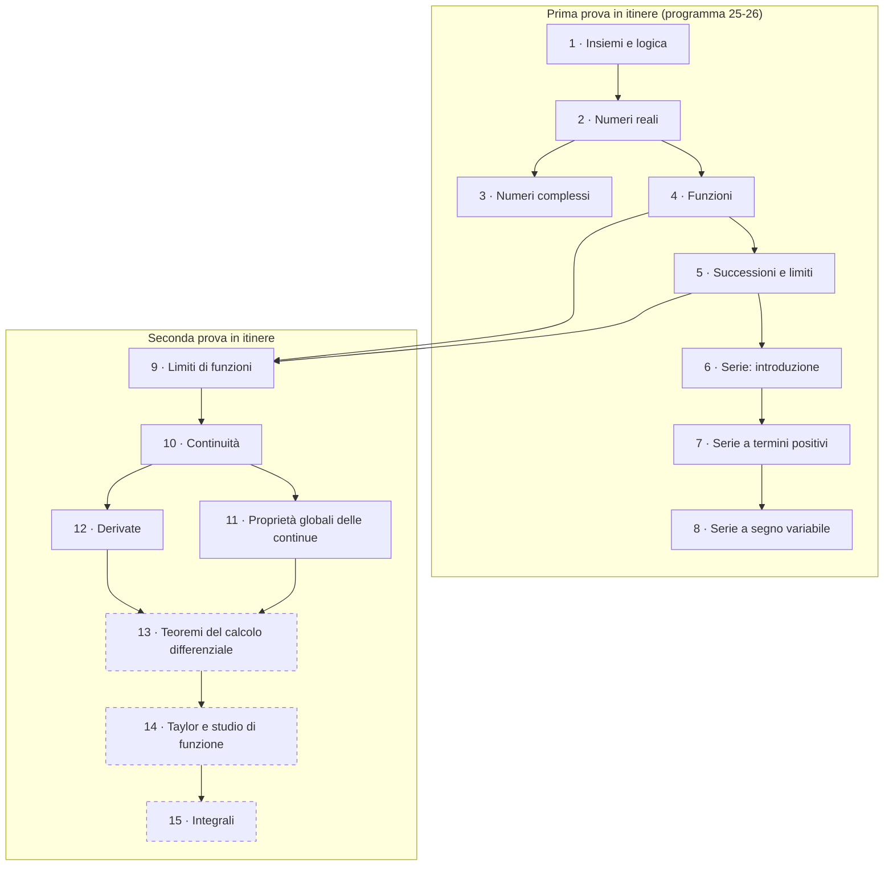

---
tags:
  - AM1
  - guida-studio
  - claude-workspace
data: 2026-11-13
materia: Analisi Matematica 1
tipo: guida
fonte: "MOC AM1; programma svolto AM1 A.A. 25-26 (Biagi-Punzo); regolamento AM1 26-27"
---

# Guida allo studio — Analisi Matematica 1

Percorso ordinato per **macroargomenti**. Per ognuno trovi: cosa stai per affrontare, i contenuti fondamentali da imparare, un checkpoint di autoverifica e le note da studiare (spunta le checkbox man mano).

> [!tip] Come usarla
> - Spunta `- [x]` una nota quando l'hai **studiata e capita** (non solo letta).
> - Nel flowchart, per segnare un blocco come finito togli i `%%` dalla riga `class ... fatto` in fondo al grafico e aggiungi gli id dei blocchi.
> - Le dimostrazioni segnate con **(D#)** sono nell'elenco delle dimostrazioni richieste allo scritto (vedi sezione finale).
> - Il blocco 13 è basato sul programma 25-26: da confermare con le lezioni reali.

```dataviewjs
const t = dv.current().file.tasks;
const done = t.where(x => x.completed).length;
const tot = t.length;
dv.paragraph(`**Progresso complessivo:** ${done} / ${tot} voci (${tot ? Math.round(100*done/tot) : 0}%) <progress value="${done}" max="${tot}" style="width:240px"></progress>`);
```

## Flowchart della progressione



---

## 1 · Fondamenti: insiemi e logica

> [!abstract] Stai per affrontare
> Il linguaggio con cui è scritto tutto il corso: insiemi numerici, connettivi, quantificatori e le tre tecniche dimostrative di base. Serve a leggere e scrivere correttamente definizioni come quella di limite.

> [!important] Da imparare
> - Quantificatori $\forall,\exists$ e **negazione** di enunciati con più quantificatori.
> - Implicazione, contronominale, doppia implicazione.
> - Dimostrazione per **assurdo** (modello: $\sqrt2\notin\mathbb{Q}$, **D1**).
> - Dimostrazione per **induzione** (modello: disuguaglianza di Bernoulli, **D2**).

> [!question] Checkpoint
> Sai negare "$\forall \varepsilon>0\ \exists N:\dots$"? Sai impostare una dimostrazione per induzione completa (base + passo)?

- [x] [[01_Insiemi_Numerici]] — $\mathbb{N},\mathbb{Z},\mathbb{Q},\mathbb{R}$ ✅ 2026-11-13
- [x] [[02_Logica]] — connettivi, quantificatori, negazioni ✅ 2026-11-13
- [x] [[03_Dimostrazioni]] — panoramica delle tecniche ✅ 2026-11-13
- [x] [[04_Dimostrazione_per_Assurdo]] — irrazionalità di $\sqrt2$ (D1) ✅ 2026-11-13
- [x] [[05_Dimostrazione_per_Induzione]] — principio di induzione, Bernoulli (D2) ✅ 2026-11-13

---

## 2 · I numeri reali

> [!abstract] Stai per affrontare
> La struttura di $\mathbb{R}$ come campo ordinato **completo**: è la proprietà di completezza (estremo superiore) che sta dietro limiti, continuità e teoremi globali.

> [!important] Da imparare
> - Definizione di campo ordinato; maggioranti, minoranti, insiemi limitati.
> - **Massimo/minimo** vs **estremo superiore/inferiore**: quando coincidono e quando no.
> - Caratterizzazione dell'estremo superiore con $\varepsilon$ e assioma di completezza.
> - Valore assoluto e disuguaglianza triangolare; intervalli.
> - Potenze, radici e logaritmi: proprietà e domini.

> [!question] Checkpoint
> Dato $A=\{1-\tfrac1n\}$, sai calcolare $\sup A$ e dire se è massimo? Sai risolvere disequazioni con modulo?

- [x] [[06_Campi_Ordinati]] — assiomi di campo ordinato ✅ 2026-11-13
- [ ] [[07_Insiemi_Limitati_Max_Min]] — maggioranti, minoranti, max, min
- [ ] [[08_Estremo_Superiore_Inferiore]] — sup, inf, completezza
- [ ] [[09_Valore_Assoluto]] — modulo, disuguaglianza triangolare
- [ ] [[10_Retta_Reale_Intervalli]] — retta reale e intervalli
- [x] [[11_Radici_e_Potenze]] — potenze e radici ✅ 2026-11-13
- [x] [[12_Logaritmi]] — logaritmi e proprietà ✅ 2026-11-13

---

## 3 · I numeri complessi

> [!abstract] Stai per affrontare
> L'estensione $\mathbb{C}$ in cui ogni polinomio ha radici: tre rappresentazioni (algebrica, trigonometrica, esponenziale) e il loro significato geometrico nel piano di Gauss.

> [!important] Da imparare
> - Parte reale/immaginaria, coniugato, modulo, argomento.
> - Passare da forma algebrica a trigonometrica/esponenziale e viceversa.
> - **Formule di De Moivre** per prodotti e potenze (**D3**).
> - **Radici $n$-esime** di un numero complesso (**D4**): $n$ radici sui vertici di un poligono regolare.
> - Equazioni di secondo grado in $\mathbb{C}$ e teorema fondamentale dell'algebra.

> [!question] Checkpoint
> Sai calcolare $(1+i)^{10}$ e le radici cubiche di $-8$ senza formulario?

- [x] [[13_Numeri_Complessi]] — forma algebrica, operazioni ✅ 2026-11-13
- [x] [[14_Piano_di_Argand_Gauss]] — interpretazione geometrica ✅ 2026-11-13
- [x] [[15_Forma_Trigonometrica_Esponenziale]] — modulo, argomento, Eulero ✅ 2026-11-13
- [ ] [[16_Formule_di_De_Moivre]] — prodotti e potenze (D3)
- [ ] [[17_Radici_Complesse]] — radici $n$-esime (D4)
- [ ] [[18_Equazioni_in_C]] — equazioni in $\mathbb{C}$

---

## 4 · Funzioni

> [!abstract] Stai per affrontare
> Il vocabolario delle funzioni reali: tutto ciò che servirà per studiare limiti, continuità e derivate di una funzione e per tracciarne il grafico.

> [!important] Da imparare
> - Dominio, codominio, immagine, controimmagine, grafico; **campo di esistenza**.
> - Funzioni limitate, pari/dispari, periodiche, monotone.
> - **Composizione** di funzioni e suo dominio.
> - Iniettività, suriettività, **invertibilità**; strettamente monotona ⇒ iniettiva ⇒ invertibile.
> - Grafici delle funzioni elementari e delle loro inverse.

> [!question] Checkpoint
> Sai trovare il campo di esistenza di $\log(\sqrt{x}-1)$ e dire se $f(x)=x^2$ è invertibile su $\mathbb{R}$ e su $[0,+\infty)$?

- [x] [[19_Funzioni_Generalità]] — concetto di funzione, immagine, controimmagine ✅ 2026-11-13
- [x] [[20_Funzioni_Limitate_Estremi]] — limitatezza, estremi di una funzione ✅ 2026-11-13
- [x] [[21_Campo_di_Esistenza]] — dominio naturale ✅ 2026-11-13
- [x] [[22_Funzioni_Pari_Dispari]] — simmetrie del grafico ✅ 2026-11-13
- [x] [[23_Monotonia]] — crescente/decrescente ✅ 2026-11-13
- [x] [[24_Funzioni_Periodiche]] — periodicità ✅ 2026-11-13
- [x] [[25_Composizione_di_Funzioni]] — $g\circ f$ ✅ 2026-11-13
- [x] [[26_Iniettivita_Suriettivita_Inversa]] — funzione inversa ✅ 2026-11-13
- [x] [[27_Teorema_Monotone_Invertibili]] — monotone ⇒ invertibili ✅ 2026-11-13
- [x] [[28_Esempi_Funzioni_Inverse]] — esempi e grafici ✅ 2026-11-13

---

## 5 · Successioni e limiti

> [!abstract] Stai per affrontare
> Il primo incontro con il **limite**, nel caso più semplice (variabile $n\to+\infty$). Tutte le idee (definizione, teoremi, asintotici) verranno riprese per le funzioni.

### 5.1 · Definizione di limite e teoremi fondamentali

> [!important] Da imparare
> - Definizione di successione, successioni monotone e limitate.
> - Definizione $\varepsilon$–$N$ di limite; convergente, divergente, irregolare; proprietà "definitivamente".
> - **Unicità del limite** (D5), **convergente ⇒ limitata** (D6), **permanenza del segno** (D7), **due carabinieri** (D8), **regolarità delle monotone** (D9).
> - Algebra dei limiti.

> [!question] Checkpoint
> Sai verificare un limite con la definizione e dimostrare che una successione convergente è limitata?

- [ ] [[29_Successioni_Definizioni_Base]] — successioni, grafico
- [ ] [[30_Limiti_di_Successioni]] — definizione di limite, unicità (D5)
- [ ] [[31_Successioni_Monotone]] — regolarità (D9)
- [ ] [[32_Successione_Convergente_e_Limitata]] — (D6)
- [ ] [[33_Teorema_Permanenza_del_Segno]] — (D7)
- [ ] [[34_Algebra_dei_Limiti]] — somma, prodotto, quoziente
- [ ] [[35_Teoremi_del_Confronto]] — carabinieri (D8)

### 5.2 · Infiniti, forme indeterminate, numero di Nepero

> [!important] Da imparare
> - Aritmetica parziale di $\pm\infty$ e **forme indeterminate**.
> - **Gerarchia degli infiniti**: $\log n\ll n^a\ll b^n\ll n!\ll n^n$.
> - Il numero $e=\lim(1+\tfrac1n)^n$ e perché esiste (monotonia + Bernoulli).
> - Criterio del rapporto per successioni.

- [x] [[36_Gerarchia_degli_Infiniti]] — confronto tra infiniti ✅ 2026-11-13
- [x] [[37_Algebra_Limiti_Infiniti]] — forme indeterminate ✅ 2026-11-13
- [x] [[38_Numero_di_Nepero]] — $e$ ✅ 2026-11-13
- [x] [[39_Criterio_del_Rapporto]] — rapporto per successioni ✅ 2026-11-13

### 5.3 · Confronti asintotici

> [!important] Da imparare
> - Relazioni $\sim$ (asintotico) e $o$-piccolo: definizione e proprietà.
> - **Limiti notevoli** (per successioni) e loro uso per risolvere forme indeterminate.
> - Sostituzione di asintotici in prodotti, quozienti, potenze (non in somme!).
> - Formula di Stirling.

> [!question] Checkpoint
> Sai calcolare $\lim n\sin(1/n)$ e $\lim n^2\bigl(\sqrt{1+1/n^2}-1\bigr)$ con gli asintotici?

- [ ] [[40_Confronti_Asintotici]] — definizione di $\sim$
- [ ] [[41_o_piccolo_e_Asintotico]] — $o$-piccolo
- [ ] [[42_Confronti_Asintotici_Proprieta_e_Notevoli]] — proprietà e notevoli
- [ ] [[43_Asintotici_con_Funzioni_Composte]] — composizione con funzioni
- [ ] [[44_Esempio_Asintotici_con_Logaritmo_e_Arctan]] — esempio guidato
- [ ] [[45_Esercizio_Asintotici_Limite_21]] — esercizio
- [ ] [[46_Asintotici_Notevoli_e_Limiti_Notevoli]] — raccolta
- [ ] [[68_Formula_di_Stirling]] — $n!\sim\sqrt{2\pi n}(n/e)^n$

---

## 6 · Serie numeriche: introduzione

> [!abstract] Stai per affrontare
> Somme di infiniti termini, definite come limite delle somme parziali. Il problema centrale è decidere il **carattere** (convergente/divergente/irregolare) e, quando possibile, la somma.

> [!important] Da imparare
> - Serie come limite della successione delle somme parziali; resto $N$-esimo.
> - **Serie geometrica**: converge se e solo se $|q|<1$, con somma $\frac1{1-q}$ (se parte da $n=0$).
> - **Serie telescopiche** (Mengoli) e linearità.
> - **Condizione necessaria** $a_n\to0$ (D10): è necessaria, **non** sufficiente.
> - **Serie armonica**: diverge, pur con $a_n\to0$.

> [!question] Checkpoint
> Perché $\sum 1/n$ diverge anche se $1/n\to0$? Sai calcolare $\sum\frac1{n(n+1)}$?

- [ ] [[47_Serie_Introduzione_e_Somme_Parziali]] — definizione
- [ ] [[48_Studio_del_Carattere_di_una_Serie]] — carattere
- [ ] [[49_Esempi_Elementari_di_Serie]] — esempi
- [ ] [[50_Serie_Geometrica]] — geometrica
- [ ] [[51_Rappresentazione_Decimale_e_Serie]] — $0{,}\overline9=1$
- [ ] [[52_Linearita_delle_Serie]] — linearità
- [ ] [[53_Serie_Telescopiche_e_Mengoli]] — telescopiche, Mengoli
- [ ] [[54_Condizione_Necessaria_di_Convergenza]] — $a_n\to0$ (D10)
- [ ] [[55_Serie_Armonica]] — armonica
- [ ] [[56_Resto_N-esimo_della_Serie]] — resto

---

## 7 · Serie a termini positivi

> [!abstract] Stai per affrontare
> Il caso in cui la serie non può essere irregolare: o converge o diverge a $+\infty$. Qui nasce il "kit" di **criteri** da applicare in sequenza.

> [!important] Da imparare
> - Regolarità delle serie a termini $\ge0$.
> - **Confronto** (D11) e **confronto asintotico** (D12).
> - Serie di riferimento: **armonica generalizzata** $\sum n^{-\alpha}$ (converge $\iff\alpha>1$) e serie di **Bertrand**.
> - **Criterio del rapporto** (D13) e **criterio della radice**; quando non decidono ($L=1$).
> - Studio di serie con **parametro**.

> [!question] Checkpoint
> Dato $\sum\frac{n^a}{b^n}$ o $\sum\frac{\log^b n}{n^a}$, sai dire per quali parametri converge e con quale criterio?

- [ ] [[57_Serie_a_Termini_Positivi]] — regolarità
- [ ] [[58_Criterio_del_Confronto_per_Serie]] — confronto (D11)
- [ ] [[59_Esempio_Confronto_Serie_18_cos_n]] — esempio
- [ ] [[60_Serie_Armonica_Generalizzata]] — $\sum n^{-\alpha}$
- [ ] [[61_Serie_di_Bertrand_Generalizzata]] — Bertrand
- [ ] [[62_Criterio_del_Confronto_Asintotico_per_Serie]] — (D12)
- [ ] [[63_Esempio_Confronto_Asintotico_con_Parametro]] — esempio con parametro
- [ ] [[81_Esempio_Confronto_Asintotico_con_Bertrand]] — esempio con Bertrand
- [ ] [[64_Criterio_del_Rapporto_per_Serie]] — rapporto
- [ ] [[69_Dimostrazione_del_Criterio_del_Rapporto_per_Serie]] — dimostrazione (D13)
- [ ] [[65_Criterio_della_Radice_per_Serie]] — radice
- [ ] [[66_Esempio_Rapporto_e_Radice_su_Armonica_Generalizzata]] — esempio
- [ ] [[67_Esempio_Serie_n_Fattoriale_su_n_alla_n]] — esempio
- [ ] [[70_Esempio_Serie_a_alla_n_su_n_alla_n]] — esempio
- [ ] [[71_Esempio_Serie_n_alla_a_per_b_alla_n]] — esempio
- [ ] [[72_Esempio_Serie_a_alla_n_per_log_n_alla_b]] — esempio

---

## 8 · Serie a termini di segno variabile

> [!abstract] Stai per affrontare
> Cosa succede quando i termini cambiano segno: si introduce la convergenza **assoluta** e si studia il caso alternato con il criterio di Leibniz.

> [!important] Da imparare
> - Convergenza assoluta vs semplice; **assoluta ⇒ semplice** (D14).
> - Strategia: studiare $\sum|a_n|$ con i criteri del blocco 7; se non basta, passare ad altro.
> - **Criterio di Leibniz** per serie a segno alterno (ipotesi: $b_n\ge0$, decrescente, $\to0$).

> [!question] Checkpoint
> Sai distinguere "converge assolutamente", "converge solo semplicemente" e "non converge" per $\sum\frac{(-1)^n}{n^\alpha}$ al variare di $\alpha$?

- [ ] [[73_Convergenza_Assoluta_e_Semplice]] — assoluta e semplice
- [ ] [[74_Criterio_di_Convergenza_Assoluta]] — assoluta ⇒ semplice (D14)
- [ ] [[75_Esempio_Convergenza_Assoluta_sin_n_su_n_alla_3_su_2]] — esempio
- [ ] [[76_Serie_a_Segno_Alterno_e_Criterio_di_Leibniz]] — Leibniz
- [ ] [[77_Esempio_Serie_Alternata_con_Parametro_alpha]] — esempio con $\alpha$
- [ ] [[78_Osservazioni_sul_Criterio_di_Leibniz]] — osservazioni
- [ ] [[79_Esempio_Serie_Alternata_log_n_su_n]] — esempio
- [ ] [[80_Esempio_Serie_alpha_meno_1_alla_n_su_n_2_alla_n]] — esempio

---

## 9 · Limiti di funzioni

> [!abstract] Stai per affrontare
> Il limite per funzioni $f(x)$ con $x\to x_0$ (finito o infinito). Le idee sono quelle delle successioni, ma servono intorni e punti di accumulazione. In fondo trovi i limiti notevoli e gli asintotici, strumenti principali per calcolare limiti.

### 9.1 · Definizioni e primi risultati

> [!important] Da imparare
> - Intorni di un punto e di $\pm\infty$; **punti di accumulazione**.
> - Tre definizioni equivalenti: **successionale**, **topologica**, **metrica** ($\varepsilon$–$\delta$ / $\varepsilon$–$M$).
> - Limite finito/infinito in un punto finito, limiti **destro e sinistro**, per eccesso/difetto.
> - **Asintoti**: orizzontale, verticale, obliquo.
> - Unicità del limite; uso della def. successionale per mostrare la **non esistenza**.

- [ ] [[82_Intorni_di_un_Punto_e_di_Infinito]] — intorni
- [ ] [[83_Punti_di_Accumulazione]] — punti di accumulazione
- [ ] [[84_Definizione_Successionale_di_Limite]] — def. successionale
- [ ] [[85_Teorema_di_Unicita_del_Limite]] — unicità
- [ ] [[86_Definizione_Topologica_di_Limite]] — def. topologica
- [ ] [[87_Definizioni_Metriche_di_Limite_all_Infinito]] — def. metriche
- [ ] [[88_Asintoto_Orizzontale_e_Limiti_per_Eccesso_e_per_Difetto]] — asintoto orizzontale
- [ ] [[89_Asintoto_Obliquo]] — asintoto obliquo
- [ ] [[90_Limite_Infinito_in_un_Punto_Finito]] — limite infinito in un punto
- [ ] [[91_Limiti_Destro_e_Sinistro_e_Asintoto_Verticale]] — destro/sinistro, asintoto verticale
- [ ] [[92_Limite_Finito_in_un_Punto_Finito]] — limite finito in un punto
- [ ] [[99_Proprieta_Valida_Definitivamente]] — "definitivamente" per funzioni

### 9.2 · Teoremi sui limiti

> [!important] Da imparare
> - **Permanenza del segno**, **confronto** (carabinieri), **algebra** dei limiti e forme indeterminate.
> - **Cambio di variabile** nel limite.

- [ ] [[100_Teorema_del_Confronto_per_Limiti_di_Funzioni]] — confronto
- [ ] [[101_Teorema_di_Permanenza_del_Segno_per_Funzioni]] — permanenza del segno
- [ ] [[102_Algebra_dei_Limiti_di_Funzioni]] — algebra dei limiti
- [ ] [[104_Cambio_di_Variabile_nei_Limiti]] — cambio di variabile

### 9.3 · Asintotici, limiti notevoli e grafici

> [!important] Da imparare
> - $\sim$ e $o$ per funzioni; regole di calcolo (prodotti, quozienti, potenze sì, somme con attenzione).
> - **Limiti notevoli**: $\frac{\sin x}{x}$, $\frac{1-\cos x}{x^2}$, $\frac{\log(1+x)}{x}$, $\frac{e^x-1}{x}$, $\frac{(1+x)^a-1}{x}$ e le loro conseguenze asintotiche.
> - Gerarchia degli infiniti per funzioni.
> - **Grafici locali / probabili**: ricostruire il grafico a partire da limiti e asintotici.

> [!question] Checkpoint
> Sai calcolare $\lim_{x\to0}\frac{\sin x-x\cos x}{x^3}$ ragionando con asintotici e $o$-piccolo?

- [ ] [[106_Asintotico_e_o_piccolo_per_Funzioni]] — $\sim$ e $o$ per funzioni
- [ ] [[107_Proprieta_degli_Asintotici_per_Funzioni]] — proprietà
- [ ] [[108_Limiti_Notevoli_di_Funzioni]] — limiti notevoli
- [ ] [[109_Gerarchia_degli_Infiniti_per_Funzioni]] — gerarchia
- [ ] [[110_Grafici_Locali_e_Grafici_Probabili]] — grafici locali
- [ ] [[118_Dimostrazione_dei_Limiti_Notevoli]] — log, esp, potenza
- [ ] [[119_Dimostrazione_del_Limite_Notevole_sin_x_su_x]] — $\sin x/x$
- [ ] [[120_Dimostrazione_del_Limite_Notevole_1_meno_cos_x_su_x_quadro]] — $(1-\cos x)/x^2$

---

## 10 · Continuità

> [!abstract] Stai per affrontare
> Una funzione è continua in $x_0$ se il limite coincide con il valore: "il grafico non si spezza". Si classificano i modi in cui la continuità può fallire e si dimostra che le funzioni elementari sono continue.

> [!important] Da imparare
> - Definizione: $\lim_{x\to x_0}f(x)=f(x_0)$.
> - **Classificazione delle discontinuità**: eliminabile (prolungamento per continuità), di prima specie (salto), di seconda specie.
> - Algebra delle continue e **continuità della composta**.
> - Continuità delle **funzioni elementari**.
> - Continuità e **invertibilità**.

> [!question] Checkpoint
> Data $f$ definita a tratti con un parametro, sai trovare i valori che la rendono continua e classificare le discontinuità restanti?

- [ ] [[93_Continuita_in_un_Punto]] — definizione
- [ ] [[94_Esempio_Continuita_di_e_alla_x]] — esempio
- [ ] [[95_Funzione_di_Dirichlet]] — Dirichlet (mai continua)
- [ ] [[96_Discontinuita_Eliminabile_e_Prolungamento_per_Continuita]] — eliminabile
- [ ] [[97_Discontinuita_di_Prima_Specie_a_Salto]] — salto
- [ ] [[98_Discontinuita_di_Seconda_Specie]] — seconda specie
- [ ] [[103_Algebra_delle_Funzioni_Continue]] — algebra
- [ ] [[105_Continuita_della_Funzione_Composta]] — composta
- [ ] [[117_Continuita_delle_Funzioni_Elementari]] — elementari
- [ ] [[116_Continuita_e_Invertibilita]] — continuità e inversa

---

## 11 · Proprietà globali delle funzioni continue

> [!abstract] Stai per affrontare
> I tre grandi teoremi che valgono per le funzioni continue su un **intervallo**: zeri, valori intermedi e Weierstrass. Sono i primi risultati "globali" e le ipotesi (intervallo, chiuso, limitato) sono decisive.

> [!important] Da imparare
> - **Teorema degli zeri** (D15): enunciato, ipotesi, uso per provare l'esistenza di soluzioni.
> - **Teorema dei valori intermedi** (D16).
> - **Teorema di Weierstrass** (D17): massimo e minimo su $[a,b]$; contro-esempi quando manca una ipotesi.
> - Immagine di una continua su $[a,b]$ è $[\min,\max]$.
> - Limiti di funzioni monotone.

> [!question] Checkpoint
> Sai dimostrare con lo teorema degli zeri che $x^3+x-1=0$ ha una soluzione in $[0,1]$ e spiegare perché Weierstrass fallisce su $(0,1]$ per $1/x$?

- [ ] [[111_Teorema_degli_Zeri]] — zeri (D15)
- [ ] [[113_Teorema_dei_Valori_Intermedi]] — valori intermedi (D16)
- [ ] [[112_Teorema_di_Weierstrass]] — Weierstrass (D17)
- [ ] [[114_Immagine_di_una_Funzione_Continua_su_un_Intervallo_Chiuso]] — immagine $[\min,\max]$
- [ ] [[115_Teorema_sui_Limiti_di_Funzioni_Monotone]] — limiti di monotone

---

## 12 · Derivate

> [!abstract] Stai per affrontare
> L'inizio del calcolo differenziale: la derivata come limite del rapporto incrementale, pendenza della retta tangente e tasso di variazione. È il blocco in cui ti trovi ora.

> [!important] Da imparare
> - **Rapporto incrementale** e definizione di derivata; derivata destra/sinistra; retta tangente $y=f(x_0)+f'(x_0)(x-x_0)$.
> - **Funzione derivata** e derivate di ordine superiore.
> - **Derivabile ⇒ continua** (D18) e non viceversa ($|x|$).
> - **Differenziabilità** $\iff$ derivabilità (D19) e approssimazione lineare.
> - Punti di non derivabilità: **angoloso**, **cuspide**, **flesso a tangente verticale**; derivata infinita.
> - Derivate delle funzioni elementari, **algebra** (somma, prodotto, quoziente) e **regola della catena**.

> [!question] Checkpoint
> Sai derivare $e^{\sin(x^2)}$ e dire in quali punti $\sqrt[3]{x}$ o $|x^2-1|$ non sono derivabili, classificandoli?

- [ ] [[121_Problemi_Motivanti_delle_Derivate]] — tangente e velocità
- [ ] [[122_Rapporto_Incrementale_e_Derivata_in_un_Punto]] — definizione
- [ ] [[123_Esempi_di_Derivata_e_Retta_Tangente]] — esempi
- [ ] [[124_Funzione_Derivata_e_Derivate_di_Ordine_Superiore]] — $f'$, $f''$, …
- [ ] [[125_Derivata_Infinita_e_Tangente_Verticale]] — tangente verticale
- [ ] [[126_Interpretazione_della_Derivata_nelle_Applicazioni]] — interpretazioni
- [ ] [[127_Differenziabilita_e_Approssimazione_Lineare]] — differenziabilità (D19)
- [ ] [[129_Derivabilita_e_Continuita]] — derivabile ⇒ continua (D18)
- [ ] [[130_Classificazione_dei_Punti_di_Non_Derivabilita]] — angoli, cuspidi, flessi
- [ ] [[128_Derivate_delle_Funzioni_Elementari]] — derivate elementari
- [ ] [[131_Algebra_delle_Derivate]] — algebra
- [ ] [[132_Regola_della_Catena]] — catena

---

## 13 · Teoremi del calcolo differenziale *(prossimamente)*

> [!abstract] Stai per affrontare
> Dalla derivata alle sue conseguenze globali: derivata della funzione inversa, punti stazionari e i teoremi di Fermat, Rolle e Lagrange. Da qui si ricava il legame tra **segno della derivata e monotonia**.

> [!important] Da imparare
> - Derivata della **funzione inversa**.
> - Punti stazionari, massimi/minimi locali; **teorema di Fermat** (D20).
> - **Rolle** (D21) → **Lagrange** (D22): la catena logica e le ipotesi.
> - Funzioni a derivata nulla ⇒ costanti; **test di monotonia** (D23): $f'>0\Rightarrow$ strettamente crescente (il viceversa è falso).
> - Massimi e minimi assoluti di continue su $[a,b]$; derivabilità di funzioni definite a tratti.

> [!info] Nota
> Argomenti dal programma 25-26: non ancora presenti nel vault.

- [ ] Derivata della funzione inversa *(nota da creare)*
- [ ] Punti stazionari ed estremi locali, Fermat (D20) *(nota da creare)*
- [ ] Teorema di Rolle (D21) *(nota da creare)*
- [ ] Teorema di Lagrange (D22) *(nota da creare)*
- [ ] Test di monotonia e funzioni costanti (D23) *(nota da creare)*
- [ ] Massimi e minimi assoluti su $[a,b]$ *(nota da creare)*

---

## 14 · Taylor e studio di funzione *(prossimamente)*

> [!abstract] Stai per affrontare
> Derivate successive: convessità, flessi, De L'Hospital e soprattutto la **formula di Taylor**, che unifica asintotici, $o$-piccolo e derivate e permette di calcolare limiti difficili.

> [!important] Da imparare
> - Convessità/concavità e derivata seconda; **punti di flesso**.
> - **De L'Hospital**: quando si può applicare.
> - **Polinomio di Taylor**; resto di **Peano** (D24) e di Lagrange.
> - Taylor delle funzioni elementari ($e^x,\sin x,\cos x,\log(1+x),\dots$) e calcolo di limiti.
> - **Studio completo del grafico** di una funzione.

- [ ] Convessità e flessi *(nota da creare)*
- [ ] De L'Hospital *(nota da creare)*
- [ ] Polinomio di Taylor, resto di Peano (D24) *(nota da creare)*
- [ ] Taylor delle funzioni elementari e limiti *(nota da creare)*
- [ ] Studio del grafico di una funzione *(nota da creare)*

---

## 15 · Integrali *(prossimamente)*

> [!abstract] Stai per affrontare
> L'operazione inversa della derivata (primitive) e l'integrale di Riemann come limite di somme, collegati dal teorema fondamentale del calcolo.

> [!important] Da imparare
> - **Primitive** e integrale indefinito (D25); metodi: immediati, scomposizione, **sostituzione**, **per parti**, funzioni razionali.
> - **Integrale di Riemann**, classi di funzioni integrabili, proprietà; **media integrale** (D26).
> - **Teoremi fondamentali del calcolo integrale** (D27); funzione integrale.
> - **Integrali impropri**, criteri del confronto (D28) e confronto asintotico, assoluta integrabilità.

- [ ] Primitive e integrale indefinito (D25) *(nota da creare)*
- [ ] Metodi di integrazione *(nota da creare)*
- [ ] Integrale di Riemann e proprietà *(nota da creare)*
- [ ] Teorema della media integrale (D26) *(nota da creare)*
- [ ] Teoremi fondamentali del calcolo integrale (D27) *(nota da creare)*
- [ ] Integrali impropri e confronto (D28) *(nota da creare)*

---

## Dimostrazioni richieste allo scritto

> [!warning] Priorità alta
> Elenco ufficiale dal regolamento AM1 26-27. Le altre dimostrazioni del corso possono comparire solo all'orale. La seconda parte dell'esame (10 punti, soglia 5) è di **teoria**: queste dimostrazioni sono lì.

- [ ] **D1** Irrazionalità di $\sqrt2$ → [[04_Dimostrazione_per_Assurdo]]
- [ ] **D2** Disuguaglianza di Bernoulli → [[05_Dimostrazione_per_Induzione]]
- [ ] **D3** Formule di De Moivre → [[16_Formule_di_De_Moivre]]
- [ ] **D4** Radici $n$-esime di un numero complesso → [[17_Radici_Complesse]]
- [ ] **D5** Unicità del limite → [[30_Limiti_di_Successioni]]
- [ ] **D6** Limitatezza delle successioni convergenti → [[32_Successione_Convergente_e_Limitata]]
- [ ] **D7** Permanenza del segno → [[33_Teorema_Permanenza_del_Segno]]
- [ ] **D8** Due carabinieri → [[35_Teoremi_del_Confronto]]
- [ ] **D9** Regolarità delle successioni monotone → [[31_Successioni_Monotone]]
- [ ] **D10** Condizione necessaria di convergenza di una serie → [[54_Condizione_Necessaria_di_Convergenza]]
- [ ] **D11** Criterio del confronto → [[58_Criterio_del_Confronto_per_Serie]]
- [ ] **D12** Criterio del confronto asintotico → [[62_Criterio_del_Confronto_Asintotico_per_Serie]]
- [ ] **D13** Criterio del rapporto per le serie → [[69_Dimostrazione_del_Criterio_del_Rapporto_per_Serie]]
- [ ] **D14** Convergenza assoluta ⇒ semplice → [[74_Criterio_di_Convergenza_Assoluta]]
- [ ] **D15** Teorema di esistenza degli zeri → [[111_Teorema_degli_Zeri]]
- [ ] **D16** Teorema dei valori intermedi → [[113_Teorema_dei_Valori_Intermedi]]
- [ ] **D17** Teorema di Weierstrass → [[112_Teorema_di_Weierstrass]]
- [ ] **D18** Derivabilità ⇒ continuità → [[129_Derivabilita_e_Continuita]]
- [ ] **D19** Derivabilità ⇔ differenziabilità → [[127_Differenziabilita_e_Approssimazione_Lineare]]
- [ ] **D20** Teorema di Fermat *(nota da creare)*
- [ ] **D21** Teorema di Rolle *(nota da creare)*
- [ ] **D22** Teorema di Lagrange *(nota da creare)*
- [ ] **D23** Test di monotonia e caratterizzazione delle costanti *(nota da creare)*
- [ ] **D24** Formula di Taylor con resto di Peano *(nota da creare)*
- [ ] **D25** Struttura dell'integrale indefinito *(nota da creare)*
- [ ] **D26** Teorema della media integrale *(nota da creare)*
- [ ] **D27** Primo e secondo teorema fondamentale del calcolo integrale *(nota da creare)*
- [ ] **D28** Teorema del confronto per integrali impropri *(nota da creare)*

> [!note] Struttura dell'esame (regolamento 26-27)
> Appello completo: 32 punti in 2 ore = **14** (test, soglia 7) + **10** (teoria, soglia 5) + **8** (esercizi). Prove in itinere: 1 ora ciascuna, stessa struttura, voto finale = media, almeno 15 in ciascuna.

## Note collegate
- [[00_MOC_Analisi_1]]

#AM1/guida
