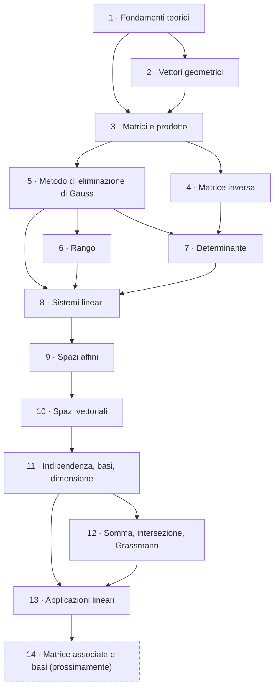

---
tags:
  - GAL
  - guida-studio
  - claude-workspace
data: 2026-11-13
materia: Geometria e Algebra Lineare
tipo: guida
fonte: "MOC GAL; indici lezioni 0-20"
---

# Guida allo studio — Geometria e Algebra Lineare

Percorso ordinato per **macroargomenti**, seguendo la dipendenza logica tra i temi (non solo l'ordine cronologico delle lezioni). Per ognuno trovi: cosa stai per affrontare, i contenuti fondamentali da imparare, un checkpoint di autoverifica e le note da studiare (spunta le checkbox man mano).

> [!tip] Come usarla
> - Spunta `- [x]` una nota quando l'hai **studiata e capita**, non solo letta.
> - Nel flowchart, per segnare un blocco come finito togli i `%%` dalla riga `class ... fatto` in fondo al grafico e aggiungi gli id dei blocchi.
> - Le note segnate *(esercizio)* sono esercizi svolti: falli prima da solo, poi confronta.
> - Il file di riferimento per la cronologia rimane [[00_MOC_GAL]].

```dataviewjs
const t = dv.current().file.tasks;
const done = t.where(x => x.completed).length;
const tot = t.length;
dv.paragraph(`**Progresso complessivo:** ${done} / ${tot} voci (${tot ? Math.round(100*done/tot) : 0}%) <progress value="${done}" max="${tot}" style="width:240px"></progress>`);
```

## Flowchart della progressione



---

## 1 · Fondamenti teorici

> [!abstract] Stai per affrontare
> Il linguaggio di base: prodotto cartesiano, relazioni (in particolare di equivalenza e d'ordine) e funzioni. Servono per capire cosa sono i vettori geometrici (classi di equivalenza) e cosa significa "invertibile".

> [!important] Da imparare
> - Prodotto cartesiano e relazione binaria; proprietà riflessiva, simmetrica, transitiva.
> - **Relazione di equivalenza**, classi di equivalenza, partizione.
> - Relazione d'ordine.
> - Funzioni: **iniettiva, suriettiva, biettiva**; come si nega un'implicazione.
> - Il campo $\mathbb{F}_2=\{0,1\}$ con le sue operazioni.

> [!question] Checkpoint
> Sai dire se una relazione data è di equivalenza e descriverne le classi? Sai scrivere la negazione di "$f$ è iniettiva"?

- [ ] [[11_Prodotto_Cartesiano]] — prodotto cartesiano
- [ ] [[19_Prodotto_Cartesiano_di_Piu_Insiemi]] — più insiemi
- [ ] [[12_Relazione_Binaria]] — relazione binaria
- [ ] [[13_Proprieta_Riflessiva_Simmetrica_Transitiva]] — proprietà
- [ ] [[14_Relazione_di_Equivalenza]] — equivalenza e classi
- [ ] [[15_Relazione_di_Ordine]] — ordine
- [ ] [[16_Funzioni]] — funzioni
- [ ] [[17_Excursus_Logico_Negazione_Implicazione]] — negazione di un'implicazione
- [ ] [[18_Iniettivita_Suriettivita_Biettivita]] — iniettiva, suriettiva, biettiva
- [ ] [[31_Il_Campo_F2]] — $\mathbb{F}_2$

---

## 2 · Vettori geometrici

> [!abstract] Stai per affrontare
> Il modello geometrico intuitivo da cui nasce l'idea di spazio vettoriale: frecce nel piano/spazio, somma e moltiplicazione per scalare, prodotto interno ed esterno.

> [!important] Da imparare
> - Segmenti orientati, **equipollenza**, vettori come classi di equivalenza.
> - Somma di vettori e prodotto per scalare: proprietà.
> - Sistema di riferimento e **coordinate**.
> - **Prodotto interno** (ortogonalità) e **prodotto esterno** in coordinate.
> - Determinanti $2\times2$ e $3\times3$ (area/volume).

> [!question] Checkpoint
> Sai calcolare angolo tra due vettori, verificare ortogonalità e area di un parallelogramma?

- [ ] [[20_Segmenti_Orientati_ed_Equipollenza]] — equipollenza
- [ ] [[21_Vettori_come_Classi_di_Equivalenza]] — vettori come classi
- [ ] [[22_Operazioni_tra_Vettori]] — operazioni
- [ ] [[23_Sistemi_di_Riferimento_e_Coordinate]] — coordinate
- [ ] [[24_Proprieta_delle_Operazioni_tra_Vettori]] — proprietà
- [ ] [[25_Prodotto_Interno_e_Ortogonalita]] — prodotto interno
- [ ] [[26_Prodotto_Interno_in_Coordinate]] — in coordinate
- [ ] [[27_Prodotto_Esterno]] — prodotto esterno
- [ ] [[28_Determinanti_2x2_e_3x3]] — determinanti $2\times2$, $3\times3$

---

## 3 · Matrici e prodotto matriciale

> [!abstract] Stai per affrontare
> Le matrici come oggetti algebrici e come modo di **codificare funzioni**. Il punto chiave: il prodotto righe per colonne è costruito perché corrisponda alla **composizione**.

> [!important] Da imparare
> - Definizione di matrice, casi speciali, uguaglianza.
> - Somma, opposta, prodotto per scalare.
> - **Prodotto righe per colonne** e compatibilità delle dimensioni.
> - Prodotto = composizione di funzioni.
> - Proprietà (associativa, distributiva) e **non commutatività**.
> - Matrice identità e matrici diagonali.

> [!question] Checkpoint
> Sai moltiplicare due matrici a mano e spiegare perché $AB\ne BA$ in generale?

- [ ] [[30_Matrici_come_Rappresentazione_di_Funzioni]] — matrici e funzioni
- [ ] [[32_Definizione_di_Matrice]] — definizione
- [ ] [[33_Matrici_Casi_Speciali]] — casi speciali
- [ ] [[34_Confronto_e_Uguaglianza_tra_Matrici]] — uguaglianza
- [ ] [[35_Somma_tra_Matrici]] — somma
- [ ] [[40_Opposto_di_una_Matrice]] — opposta
- [ ] [[36_Prodotto_di_una_Matrice_per_uno_Scalare]] — per uno scalare
- [ ] [[37_Efficienza_Computazionale]] — efficienza
- [ ] [[41_Prodotto_Matriciale_Righe_per_Colonne]] — prodotto righe per colonne
- [ ] [[42_Prodotto_e_Composizione_di_Funzioni]] — prodotto e composizione
- [ ] [[44_Proprieta_del_Prodotto_Matriciale]] — proprietà
- [ ] [[45_Matrice_Identita_e_Matrici_Diagonali]] — identità e diagonali
- [ ] [[43_PageRank_e_Matrice_di_Google]] — applicazione: PageRank

---

## 4 · Matrice inversa

> [!abstract] Stai per affrontare
> L'analogo matriciale del reciproco: quando una matrice ha un'inversa e quali proprietà ha.

> [!important] Da imparare
> - Definizione di matrice **invertibile**; l'inversa è **unica** e bilatera.
> - Non commutatività del prodotto e conseguenze sull'inversa.
> - Condizioni di esistenza (si completeranno con rango e determinante).

> [!question] Checkpoint
> Se $AB=I$, perché anche $BA=I$? E perché $(AB)^{-1}=B^{-1}A^{-1}$?

- [ ] [[60_Matrice_Invertibile]] — definizione
- [ ] [[61_Unicita_e_Bilateralita_dell_Inversa]] — unicità
- [ ] [[62_Non_Commutativita_del_Prodotto_Matriciale]] — non commutatività
- [ ] [[72_Esistenza_della_Matrice_Inversa]] — esistenza

---

## 5 · Metodo di eliminazione di Gauss (MEG)

> [!abstract] Stai per affrontare
> L'algoritmo centrale del corso: trasformare una matrice in forma a scala con operazioni elementari. Serve per rango, determinante, sistemi, inversa e basi.

> [!important] Da imparare
> - Le tre **operazioni elementari** sulle righe.
> - **Pivot** e matrice a scala.
> - **Reversibilità** delle operazioni.
> - Ogni operazione elementare è un prodotto per una matrice elementare.

> [!question] Checkpoint
> Sai ridurre a scala una matrice $4\times5$ senza errori di segno e individuare i pivot?

- [ ] [[67_Operazioni_Elementari_sulle_Righe]] — operazioni elementari
- [ ] [[68_Metodo_di_Eliminazione_di_Gauss]] — MEG
- [ ] [[69_Pivot_e_Matrice_a_Scala]] — pivot e scala
- [ ] [[70_Reversibilita_del_MEG]] — reversibilità
- [ ] [[71_Codifica_del_MEG_con_il_Prodotto_Matriciale]] — MEG come prodotto

---

## 6 · Rango

> [!abstract] Stai per affrontare
> Una misura di "quanta informazione indipendente" c'è in una matrice. Le definizioni di rango (righe, colonne, pivot) coincidono: è un risultato chiave.

> [!important] Da imparare
> - Definizione di rango e calcolo con il MEG.
> - **Rango per righe = rango per colonne**.
> - Spazio delle righe e delle colonne.
> - Rango e matrici di rango 1 (somma di $r$ matrici di rango 1).

> [!question] Checkpoint
> Sai calcolare il rango di una matrice con parametro e dire per quali valori cambia?

- [ ] [[63_Rango_di_una_Matrice]] — rango
- [ ] [[64_Rango_e_Matrice_di_Probabilita_Congiunta]] — applicazione probabilistica
- [ ] [[73_MEG_e_Rango]] — MEG e rango
- [ ] [[130_Riepilogo_sulle_Definizioni_di_Rango]] — riepilogo
- [ ] [[131_Spazio_delle_Righe_e_delle_Colonne]] — spazio righe/colonne
- [ ] [[108_Esercizio_EE1_Somma_di_Matrici_di_Rango_1]] — *(esercizio)* EE1
- [ ] [[109_EE1_Riduzione_a_Scala_di_A]] — *(esercizio)*
- [ ] [[110_EE1_Fattorizzazione_con_Matrici_Elementari]] — *(esercizio)* $A=PLU$
- [ ] [[111_EE1_Somma_di_Tre_Matrici_di_Rango_1]] — *(esercizio)*

---

## 7 · Determinante

> [!abstract] Stai per affrontare
> Un numero associato a una matrice quadrata che dice se è invertibile, e come cambia il volume. Si studia sia con lo sviluppo di Laplace sia con il MEG.

> [!important] Da imparare
> - **Sviluppo di Laplace** e matrici triangolari.
> - Proprietà: normalizzato, **alternante**, **multilineare**; righe uguali ⇒ $\det=0$.
> - Effetto delle operazioni elementari sul determinante.
> - **Teorema di Binet**: $\det(AB)=\det A\det B$.
> - Calcolo con il MEG vs Laplace vs metodo misto.

> [!question] Checkpoint
> Sai calcolare un determinante $4\times4$ con il metodo misto e dire perché scambiare due righe cambia il segno?

- [ ] [[65_Determinante_Sviluppo_di_Laplace]] — Laplace
- [ ] [[66_Matrici_Triangolari]] — triangolari
- [ ] [[76_Determinante_Normalizzato_e_Alternante]] — normalizzato, alternante
- [ ] [[77_Determinante_Multilineare]] — multilineare
- [ ] [[78_Determinante_e_Sostituzione]] — sostituzione
- [ ] [[79_Determinante_con_Righe_Uguali]] — righe uguali
- [ ] [[74_Teorema_di_Binet]] — Binet
- [ ] [[75_Calcolo_del_Determinante_con_il_MEG]] — calcolo con il MEG
- [ ] [[103_Esercizio_5_1_Calcolo_del_Determinante]] — *(esercizio)* Es. 5.1
- [ ] [[104_Determinante_con_il_MEG_Esempio_con_Scambio_di_Righe]] — *(esercizio)*
- [ ] [[105_Determinante_Laplace_Esempio_3x3_Riga_3]] — *(esercizio)*
- [ ] [[106_Determinante_Metodo_Misto_MEG_e_Laplace]] — *(esercizio)*
- [ ] [[107_Confronto_Metodi_Calcolo_Determinante]] — confronto

---

## 8 · Sistemi lineari

> [!abstract] Stai per affrontare
> Il problema pratico che motiva tutta la teoria: risolvere $A\underline{x}=\underline{b}$. Qui convergono MEG, rango, determinante e matrice inversa.

> [!important] Da imparare
> - Rappresentazioni matriciali di un sistema.
> - Risoluzione con il MEG.
> - **Teorema di Rouché–Capelli**: esistenza e numero di soluzioni.
> - **Nucleo** e sistema omogeneo associato; **teorema di struttura** delle soluzioni.
> - **Teorema di Cramer**.
> - Ricerca dell'inversa con il MEG e teorema sull'invertibilità.
> - Sistemi con **parametro**.

> [!question] Checkpoint
> Dato un sistema con parametro $k$, sai dire per quali $k$ ha 0, 1 o $\infty^m$ soluzioni e descriverle?

- [ ] [[80_Rappresentazioni_Matriciali_di_un_Sistema_Lineare]] — forma matriciale
- [ ] [[81_Risoluzione_di_un_Sistema_con_MEG_Esempio_Parametrico]] — risoluzione con il MEG
- [ ] [[82_Teorema_di_Rouche_Capelli]] — Rouché–Capelli
- [ ] [[83_Esempio_Sistema_con_Parametro_k_e_Rouche_Capelli]] — esempio con $k$
- [ ] [[84_Nucleo_e_Sistema_Omogeneo_Associato]] — nucleo, omogeneo
- [ ] [[85_Teorema_di_Struttura_delle_Soluzioni]] — struttura
- [ ] [[86_Teorema_di_Cramer]] — Cramer
- [ ] [[87_Ricerca_della_Matrice_Inversa]] — ricerca dell'inversa
- [ ] [[88_Teorema_sull_Invertibilita_della_Matrice]] — invertibilità
- [ ] [[112_Esercizio_5_4_Sistemi_con_Parametro]] — *(esercizio)* Es. 5.4
- [ ] [[113_Esercizio_5_4_i_Determinante_Sempre_Nullo]] — *(esercizio)* (i)
- [ ] [[114_Esercizio_5_4_ii_Cramer_e_Caso_Singolare]] — *(esercizio)* (ii)
- [ ] [[115_Esercizio_5_4_iii_Quattro_Equazioni_Tre_Incognite]] — *(esercizio)* (iii)
- [ ] [[116_Strategia_Determinante_per_Sistemi_con_Parametro]] — strategia

---

## 9 · Spazi affini

> [!abstract] Stai per affrontare
> L'interpretazione geometrica delle soluzioni: l'insieme delle soluzioni di un sistema è un "sottospazio traslato". È il ponte verso gli spazi vettoriali astratti.

> [!important] Da imparare
> - Equazioni cartesiane e parametriche.
> - Perché le soluzioni di un sistema **omogeneo** sono chiuse per somma e scalari.

- [ ] [[89_Interpretazione_Geometrica_dei_Sistemi_Lineari_Spazi_Affini]] — interpretazione geometrica
- [ ] [[90_Sistemi_Omogenei_e_Chiusura_della_Somma]] — chiusura

---

## 10 · Spazi vettoriali

> [!abstract] Stai per affrontare
> La struttura astratta: un insieme con somma e prodotto per scalare che rispetta gli assiomi. Da qui il corso diventa teorico: dimostrare da definizioni.

> [!important] Da imparare
> - **Assiomi** di spazio vettoriale e proprietà che ne seguono.
> - Esempi: $\mathbb{K}^n$, matrici, polinomi, funzioni.
> - **Sottospazi**: criterio per riconoscerli.
> - **Combinazioni lineari**, **span**, insiemi di **generatori**.

> [!question] Checkpoint
> Sai mostrare in tre righe che un insieme dato è (o non è) un sottospazio?

- [ ] [[91_Spazio_Vettoriale_Definizione]] — definizione
- [ ] [[92_Esempi_di_Spazi_Vettoriali]] — esempi
- [ ] [[93_Proprieta_Fondamentali_degli_Spazi_Vettoriali]] — proprietà
- [ ] [[94_Sottospazi_Vettoriali]] — sottospazi
- [ ] [[95_Combinazioni_Lineari_e_Span]] — combinazioni e span
- [ ] [[96_Insieme_di_Generatori]] — generatori
- [ ] [[97_Esempio_Generatori_di_R3_e_Rappresentazioni_Multiple]] — esempio

---

## 11 · Indipendenza lineare, basi e dimensione

> [!abstract] Stai per affrontare
> Il cuore della teoria: quanti vettori servono davvero per descrivere uno spazio? Risposta: la **dimensione**, ben definita grazie al lemma fondamentale.

> [!important] Da imparare
> - **Indipendenza/dipendenza lineare**, vettori ridondanti.
> - **Base**; unicità della rappresentazione rispetto a una base.
> - **Lemma fondamentale** e **teorema della dimensione**.
> - Dimensione: massimo numero di indipendenti, minimo numero di generatori.
> - Basi canoniche; **estrazione** di una base da un insieme di generatori e **completamento**.
> - Calcolo pratico con il MEG (righe / pivot delle colonne).

> [!question] Checkpoint
> Dati dei vettori di $\mathbb{R}^4$, sai estrarne una base e completarla a base di $\mathbb{R}^4$?

- [ ] [[98_Vettori_Linearmente_Indipendenti]] — indipendenza
- [ ] [[99_Dipendenza_Lineare_e_Vettori_Ridondanti]] — dipendenza
- [ ] [[100_Base_di_uno_Spazio_Vettoriale]] — base
- [ ] [[101_Teorema_di_Unicita_della_Rappresentazione_rispetto_a_una_Base]] — unicità della rappresentazione
- [ ] [[102_Dimensione_di_uno_Spazio_Vettoriale]] — dimensione
- [ ] [[117_Lemma_Fondamentale_Teorema_15_1]] — lemma fondamentale
- [ ] [[118_Teorema_della_Dimensione_Teorema_15_2]] — teorema della dimensione
- [ ] [[119_Significato_della_Dimensione_Massimo_Indipendenti_e_Minimo_Generatori]] — significato
- [ ] [[132_Significato_della_Dimensione_Seconda_Parte]] — la dimensione come misura
- [ ] [[120_Spazi_Vettoriali_Finitamente_Generati_e_Non]] — finitamente generati
- [ ] [[121_Basi_Canoniche]] — basi canoniche
- [ ] [[122_Estrazione_e_Completamento_Due_Problemi_Classici]] — estrazione e completamento
- [ ] [[123_Base_per_Costruzione_Libera_con_il_MEG_sulle_Righe]] — MEG sulle righe
- [ ] [[124_Estrazione_di_una_Base_con_i_Pivot_delle_Colonne]] — pivot delle colonne
- [ ] [[125_Completamento_ad_una_Base]] — completamento
- [ ] [[126_Fac_simile_28_10_Esercizio_su_Sottospazi_Dimensione_e_Basi]] — *(esercizio)* fac-simile
- [ ] [[127_Fac_simile_i_V_e_un_Sottospazio_Due_Strategie]] — *(esercizio)* (i)
- [ ] [[128_Fac_simile_ii_Dimensione_e_Basi_di_V_e_W]] — *(esercizio)* (ii)
- [ ] [[129_Fac_simile_iii_Identita_come_Somma_di_un_Elemento_di_V_e_di_W]] — *(esercizio)* (iii)

---

## 12 · Somma, intersezione e formula di Grassmann

> [!abstract] Stai per affrontare
> Come si combinano due sottospazi: l'intersezione resta un sottospazio, l'unione no, e si introduce il sottospazio somma. La formula di Grassmann lega le dimensioni.

> [!important] Da imparare
> - Intersezione di sottospazi (è un sottospazio).
> - Perché l'**unione** in generale non lo è; sottospazio **somma** $U+W$.
> - **Formula di Grassmann**: $\dim(U+W)=\dim U+\dim W-\dim(U\cap W)$.

> [!question] Checkpoint
> Sai calcolare base e dimensione di $U\cap W$ e di $U+W$ per due sottospazi di $\mathbb{R}^4$?

- [ ] [[133_Intersezione_di_Sottospazi_Vettoriali]] — intersezione
- [ ] [[134_Unione_di_Sottospazi_e_Sottospazio_Somma]] — unione e somma
- [ ] [[135_Formula_di_Grassmann_Teorema_16_3]] — Grassmann

---

## 13 · Applicazioni lineari

> [!abstract] Stai per affrontare
> Le funzioni "compatibili" con la struttura vettoriale. È il blocco in cui ti trovi ora: sono il vero oggetto del corso e le matrici ne saranno la rappresentazione.

### 13.1 · Definizione, esempi e proprietà

> [!important] Da imparare
> - Definizione: additività e omogeneità; **$L(\underline0)=\underline0$**.
> - Esempi e **controesempi**: $L_A$, trasposizione, traccia, derivata.
> - Composizione e inversione.
> - Una applicazione lineare è determinata dai valori sulla base (**Prop. 17.2**).
> - Applicazioni $\mathbb{K}^n\to\mathbb{K}^m$ e matrice associata.

- [ ] [[136_Applicazioni_Lineari_Definizione_17_1]] — definizione
- [ ] [[137_Esempi_di_Applicazioni_Lineari_Matrici_Trasposizione_Traccia]] — esempi
- [ ] [[138_Derivata_come_Applicazione_Lineare]] — derivata
- [ ] [[139_Proprieta_delle_Applicazioni_Lineari]] — proprietà
- [ ] [[140_Esempi_e_Controesempi_di_Applicazioni_Lineari]] — controesempi
- [ ] [[141_Composizione_e_Inversione_di_Applicazioni_Lineari]] — composizione e inversione
- [ ] [[142_Come_Definire_una_Applicazione_Lineare_Proposizione_17_2]] — Prop. 17.2
- [ ] [[143_Esempio_Applicazione_Lineare_da_Polinomi_a_Matrici]] — esempio
- [ ] [[144_Applicazioni_Lineari_da_Kn_a_Km_e_Matrice_Associata]] — $\mathbb{K}^n\to\mathbb{K}^m$

### 13.2 · Immagine e suriettività

> [!important] Da imparare
> - Immagine e controimmagine di sottospazi (sono sottospazi).
> - $\operatorname{Im}L$ e **suriettività**.
> - **Prop. 19.1**: l'immagine dei generatori genera l'immagine.
> - Per $L_A$: $\operatorname{Im}L_A=\operatorname{col}(A)$, suriettiva $\iff r(A)=m$.

- [ ] [[146_Immagine_e_Controimmagine_di_Sottospazi_Vettoriali]] — immagine e controimmagine
- [ ] [[147_Immagine_di_una_Applicazione_Lineare_e_Suriettivita]] — immagine e suriettività
- [ ] [[148_Proposizione_19_1_Immagine_dei_Generatori]] — Prop. 19.1
- [ ] [[149_Conseguenze_della_Suriettivita_Generatori_e_Dimensione]] — conseguenze
- [ ] [[150_Suriettivita_di_L_A_e_Spazio_delle_Colonne]] — $L_A$ e $\operatorname{col}(A)$

### 13.3 · Nucleo e iniettività

> [!important] Da imparare
> - **Nucleo** $\ker L$.
> - **Teorema 20.1**: $L$ iniettiva $\iff\ker L=\{\underline0\}$.
> - Per $L_A$: iniettiva $\iff r(A)=n$.
> - **Cor. 20.2**: iniettività e indipendenza lineare.
> - **Teorema della fibra** (20.3): le controimmagini sono "nucleo traslato".

> [!question] Checkpoint
> Sai calcolare nucleo e immagine di $L_A$ e dedurne iniettività/suriettività dal rango?

- [ ] [[151_Nucleo_di_una_Applicazione_Lineare]] — nucleo
- [ ] [[152_Teorema_20_1_Criterio_di_Iniettivita]] — Teorema 20.1
- [ ] [[153_Conseguenze_del_Criterio_di_Iniettivita_L_A_e_Rango]] — $L_A$ e rango
- [ ] [[154_Corollario_20_2_Iniettivita_e_Indipendenza_Lineare]] — Cor. 20.2
- [ ] [[155_Teorema_20_3_Teorema_della_Fibra]] — fibra

### 13.4 · Isomorfismi e coordinate

> [!important] Da imparare
> - **Isomorfismo** (Def. 20.4): lineare e biettiva; conserva le basi.
> - **Teorema 20.5**: spazi finitamente generati sono isomorfi $\iff$ hanno la stessa dimensione.
> - **Mappa delle coordinate** e **mappa di parametrizzazione** (Def. 20.6).
> - Il **paradigma**: rappresentare $L$ con una matrice rispetto a due basi.

- [ ] [[156_Isomorfismi_Definizione_20_4_e_Conservazione_delle_Basi]] — isomorfismi
- [ ] [[157_Teorema_20_5_Teorema_di_Isomorfismo_tra_Spazi_Finitamente_Generati]] — Teorema 20.5
- [ ] [[158_Mappa_delle_Coordinate_e_Mappa_di_Parametrizzazione_Definizione_20_6]] — coordinate e parametrizzazione
- [ ] [[159_Esempio_Mappa_di_Parametrizzazione_Polinomi_di_Grado_al_piu_2]] — esempio
- [ ] [[160_Paradigma_Rappresentare_una_Applicazione_Lineare_con_una_Matrice]] — paradigma

---

## 14 · Matrice associata e cambio di base *(prossimamente)*

> [!abstract] Stai per affrontare
> Il completamento del paradigma: costruire concretamente la matrice $A$ di $L$ rispetto a basi $\mathcal{B}$ e $\mathcal{C}$, e capire come cambia al variare delle basi.

> [!important] Da imparare
> - Come si costruisce $A$: le colonne sono le coordinate di $L(\underline v_j)$ rispetto a $\mathcal{C}$.
> - Legame tra $L$ e $L_A$ tramite le mappe delle coordinate.
> - Rango di $A$ e dimensioni di nucleo e immagine.

> [!info] Nota
> È la lacuna segnalata nella nota del paradigma (slide 174): atteso nelle prossime lezioni. Non ho il programma completo di GAL 26-27, quindi non indico altri argomenti successivi.

- [ ] Costruzione della matrice associata *(nota da creare)*

---

## Indici delle lezioni
Per tornare alla cronologia: [[01_Indice_Lezione_0]] · [[02_Indice_Lezione_1]] · [[03_Indice_Lezione_2]] · [[04_Indice_Lezione_3]] · [[05_Indice_Lezione_4]] · [[07_Indice_Lezione_6]] · [[08_Indice_Lezione_7]] · [[10_Indice_Lezione_9]] · [[11_Indice_Lezione_10]] · [[12_Indice_Lezione_11]] · [[14_Indice_Lezione_13]] · [[16_Indice_Lezione_15]] · [[17_Indice_Lezione_16]] · [[18_Indice_Lezione_17]] · [[20_Indice_Lezione_19]] · [[21_Indice_Lezione_20]]

## Note collegate
- [[00_MOC_GAL]]

#GAL/guida
