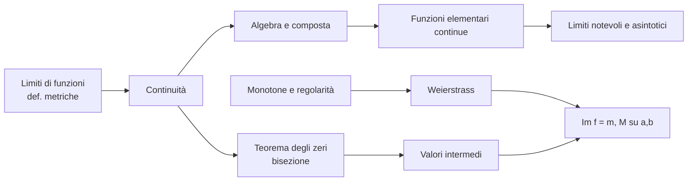

# Recap del 2026-11-07 — AM1 L14-L16 e GAL L16-L17

Integrati direttamente nel vault (come nelle ultime sessioni) 5 nuovi PDF: **AM1 L14** (28-10), **L15** (04-11), **L16** (06-11) e **GAL L16** (04-11), **L17** (05-11). Questa nota sta in `00_Claude_Workspace` perché è un riepilogo di lavoro: puoi spostarla o eliminarla quando vuoi.

Totale: **29 note AM1** (90-118), **15 note GAL** (130-144) + 2 indici lezione (`17_Indice_Lezione_16`, `18_Indice_Lezione_17`), MOC aggiornati, 32 note vecchie con nuovi link.

## Analisi Matematica 1

### L14 (28-10): limiti in un punto finito e continuità
Chiusura della lista delle definizioni metriche di limite (infinito in un punto finito, finito in un punto finito), limiti destro e sinistro e asintoto verticale. Poi la **continuità** (definizione, esempio $e^x$, funzione di Dirichlet), la **classificazione delle discontinuità** (eliminabile, I specie a salto, II specie) e i teoremi sui limiti di funzioni (definitivamente, confronto, permanenza del segno, algebra dei limiti).
Note: [[90_Limite_Infinito_in_un_Punto_Finito]], [[91_Limiti_Destro_e_Sinistro_e_Asintoto_Verticale]], [[92_Limite_Finito_in_un_Punto_Finito]], [[93_Continuita_in_un_Punto]], [[94_Esempio_Continuita_di_e_alla_x]], [[95_Funzione_di_Dirichlet]], [[96_Discontinuita_Eliminabile_e_Prolungamento_per_Continuita]], [[97_Discontinuita_di_Prima_Specie_a_Salto]], [[98_Discontinuita_di_Seconda_Specie]], [[99_Proprieta_Valida_Definitivamente]], [[100_Teorema_del_Confronto_per_Limiti_di_Funzioni]], [[101_Teorema_di_Permanenza_del_Segno_per_Funzioni]], [[102_Algebra_dei_Limiti_di_Funzioni]].

### L15 (04-11): limiti e continuità, asintotici, teorema degli zeri
Algebra delle funzioni continue, cambio di variabile nei limiti e continuità della composta; $\sim$ e $o$ per funzioni con le loro proprietà; limiti notevoli (con la versione $\varepsilon(x)$) e gerarchia degli infiniti per funzioni; grafici locali/probabili; **teorema degli zeri** con dimostrazione per bisezione; enunciato del teorema di Weierstrass.
Note: [[103_Algebra_delle_Funzioni_Continue]], [[104_Cambio_di_Variabile_nei_Limiti]], [[105_Continuita_della_Funzione_Composta]], [[106_Asintotico_e_o_piccolo_per_Funzioni]], [[107_Proprieta_degli_Asintotici_per_Funzioni]], [[108_Limiti_Notevoli_di_Funzioni]], [[109_Gerarchia_degli_Infiniti_per_Funzioni]], [[110_Grafici_Locali_e_Grafici_Probabili]], [[111_Teorema_degli_Zeri]], [[112_Teorema_di_Weierstrass]].

### L16 (06-11): proprietà globali delle funzioni continue
Dimostrazione di Weierstrass (stessa nota, dove ho unito enunciato di L15 e dimostrazione di L16), teorema dei valori intermedi, immagine di una funzione continua su $[a,b]$, limiti di funzioni monotone (le monotone hanno solo salti), continuità e invertibilità, continuità delle funzioni elementari, dimostrazione dei limiti notevoli con logaritmo, esponenziale e potenza.
Note: [[113_Teorema_dei_Valori_Intermedi]], [[114_Immagine_di_una_Funzione_Continua_su_un_Intervallo_Chiuso]], [[115_Teorema_sui_Limiti_di_Funzioni_Monotone]], [[116_Continuita_e_Invertibilita]], [[117_Continuita_delle_Funzioni_Elementari]], [[118_Dimostrazione_dei_Limiti_Notevoli]].



## Geometria e Algebra Lineare

### L16 (04-11): rango, somma e intersezione, Grassmann
Riepilogo delle definizioni di rango e prova che $r(A)=\dim\operatorname{col}(A)$ con esempio svolto; la dimensione come "misura" (analogia con area e additività); intersezione di sottospazi (sottospazio), unione che non è sottospazio, **sottospazio somma** e **formula di Grassmann** con dimostrazione completa.
Note: [[130_Riepilogo_sulle_Definizioni_di_Rango]], [[131_Spazio_delle_Righe_e_delle_Colonne]], [[132_Significato_della_Dimensione_Seconda_Parte]], [[133_Intersezione_di_Sottospazi_Vettoriali]], [[134_Unione_di_Sottospazi_e_Sottospazio_Somma]], [[135_Formula_di_Grassmann_Teorema_16_3]]. Indice: [[17_Indice_Lezione_16]].

### L17 (05-11): applicazioni lineari
Definizione 17.1; esempi ($L_A$, trasposizione, traccia, derivata); proprietà ($L(\underline{0})=\underline{0}$, conservazione delle combinazioni lineari); controesempi; composizione = prodotto matriciale e inversa = matrice inversa; **Proposizione 17.2** (una lineare è determinata dalle immagini di una base) con due esempi, fino a "tutte le lineari $\mathbb{K}^n\to\mathbb{K}^m$ sono $L_A$".
Note: [[136_Applicazioni_Lineari_Definizione_17_1]], [[137_Esempi_di_Applicazioni_Lineari_Matrici_Trasposizione_Traccia]], [[138_Derivata_come_Applicazione_Lineare]], [[139_Proprieta_delle_Applicazioni_Lineari]], [[140_Esempi_e_Controesempi_di_Applicazioni_Lineari]], [[141_Composizione_e_Inversione_di_Applicazioni_Lineari]], [[142_Come_Definire_una_Applicazione_Lineare_Proposizione_17_2]], [[143_Esempio_Applicazione_Lineare_da_Polinomi_a_Matrici]], [[144_Applicazioni_Lineari_da_Kn_a_Km_e_Matrice_Associata]]. Indice: [[18_Indice_Lezione_17]].

## Dove sono finite le note
Nuove cartelle create direttamente nel vault:
- AM1: `10_Continuita` (93-98, 103, 105, 116, 117) e `11_Proprieta_Globali_Funzioni_Continue` (111-115); le altre note in `09_Limiti_di_Funzioni`.
- GAL: `15_Somma_Intersezione_e_Grassmann` (133-135) e `16_Applicazioni_Lineari` (136-144); rango in `06_Rango` (130-131), dimensione in `14_Indipendenza_Lineare_Basi_Dimensione` (132).
I PDF erano già in `90_Lezioni_pdf/`. Se preferisci un'altra struttura, ti consiglio di spostare solo le cartelle (i link sono per nome di nota e non si rompono).

## Cose da controllare
- **DISEGNO NON RAPPRESENTABILE: 22 segnaposto** (17 AM1, 5 GAL), ciascuno con descrizione e pagina. Per AM1: [[90_Limite_Infinito_in_un_Punto_Finito]] (2), [[91_Limiti_Destro_e_Sinistro_e_Asintoto_Verticale]], [[92_Limite_Finito_in_un_Punto_Finito]], [[97_Discontinuita_di_Prima_Specie_a_Salto]] (2), [[98_Discontinuita_di_Seconda_Specie]] (4), [[104_Cambio_di_Variabile_nei_Limiti]], [[110_Grafici_Locali_e_Grafici_Probabili]] (3), [[115_Teorema_sui_Limiti_di_Funzioni_Monotone]], [[116_Continuita_e_Invertibilita]], [[117_Continuita_delle_Funzioni_Elementari]]. Per GAL: [[131_Spazio_delle_Righe_e_delle_Colonne]], [[132_Significato_della_Dimensione_Seconda_Parte]], [[134_Unione_di_Sottospazi_e_Sottospazio_Somma]], [[135_Formula_di_Grassmann_Teorema_16_3]], [[138_Derivata_come_Applicazione_Lineare]]. Se ritagli gli screenshot in `99_Tools/Screenshots/` basta sostituire il callout con `![[nome.png]]`.
- **Letture incerte (nuove)**: traccia dell'esempio in [[137_Esempi_di_Applicazioni_Lineari_Matrici_Trasposizione_Traccia]] (la somma $1+7+1$ è 9, la cifra scritta nel PDF è ambigua); indici dei due insiemi di generatori in [[134_Unione_di_Sottospazi_e_Sottospazio_Somma]] (letti come $h$ e $k$).
- **Osservazioni mie** (callout "non presente negli appunti", da confrontare con quanto dirà il prof): 12 note, tra cui: $e^{1/x}$ e $\sin(1/x)$ in [[98_Discontinuita_di_Seconda_Specie]] (limiti letti dal grafico), continuità da destra/sinistra nell'esempio di $(a,b)$ in [[97_Discontinuita_di_Prima_Specie_a_Salto]], $x_0\in(a,b)$ nel teorema degli zeri ([[111_Teorema_degli_Zeri]]), $r(A)=r(A^T)$ in [[131_Spazio_delle_Righe_e_delle_Colonne]], $\mathcal{C}^1$ come "derivata continua" in [[138_Derivata_come_Applicazione_Lineare]], esistenza nella Prop. 17.2 ([[142_Come_Definire_una_Applicazione_Lineare_Proposizione_17_2]]), verifica dell'esempio polinomi→matrici ([[143_Esempio_Applicazione_Lineare_da_Polinomi_a_Matrici]]).
- **Distinzioni tra lezioni**: il teorema di Weierstrass è enunciato in L15 e dimostrato in L16 (una sola nota, [[112_Teorema_di_Weierstrass]]). In L16 non compaiono le dimostrazioni di $\sin x/x$, $(1-\cos x)/x^2$, $\tan x/x$, $\arctan x/x$ (rimandate "in seguito").
- **Esercizi per casa** dalle slide GAL L17: trasposizione lineare; additività e omogeneità della traccia (vedi [[18_Indice_Lezione_17]]).
- **Lezioni mancanti**: nessuna. Per GAL la numerazione è continua: L15 va da 119 a 129 più 4 pagine di fac-simile (cioè fino a 133), e L16 inizia a 134.

## Prossima numerazione
- GAL: note da **145**, indici da `19_Indice_Lezione_18`.
- AM1: note da **119**.

## Query Dataview: tutte le note di questa sessione
```dataview
TABLE lezione, fonte
FROM "10_Analisi_1" OR "20_Geometria_Algebra_Lineare"
WHERE typeof(data) = "date" AND data >= date(2026-10-28) AND (lezione = 14 OR lezione = 15 OR lezione = 16 OR lezione = 17 OR lezione = "15-16")
SORT lezione ASC, file.name ASC
```

## Note collegate
- [[00_MOC_Analisi_1]]
- [[00_MOC_GAL]]

#recap/2026-11-07
