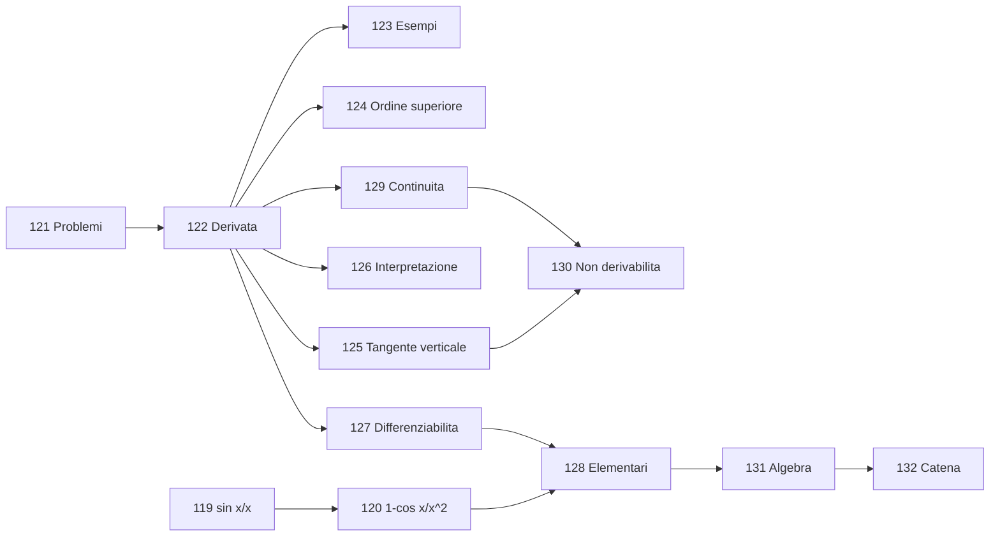

---
tags:
  - recap
  - AM1
  - claude-workspace
data: 2026-11-12
materia: Analisi Matematica 1
fonte:
  - "Dimostrazioni primi limiti notevoli.pdf (1 pag.)"
  - "AM1 L17 26-27.pdf (33 pag., 11-11-2026)"
---

# Recap 2026-11-12 — AM1 L17 e dimostrazioni dei primi limiti notevoli

Ho integrato nel vault le dimostrazioni di $\sin x/x$ e $(1-\cos x)/x^2$ (foglio di esercitazione + lezione L17) e l'intera lezione L17 sull'inizio delle derivate: **14 note nuove (119-132)**, **11 note vecchie** con nuovi link, **MOC aggiornato** (nuova sezione "Derivate" e riga "Lezione 17"). Questo recap è di lavoro: puoi spostarlo o eliminarlo dopo le verifiche.

## Analisi Matematica 1

### Lezione 17 (11-11-2026)
**Limiti notevoli.** Le dimostrazioni sono due per ciascun limite: quella di lezione (confronto tra lunghezze $\sin x\le x\le\tan x$; bisezione $1-\cos x=2\sin^2\frac x2$) e quella del foglio di esercitazione (confronto tra aree; moltiplicazione per $1+\cos x$). Stanno in `09_Limiti_di_Funzioni`.
- [[119_Dimostrazione_del_Limite_Notevole_sin_x_su_x]]
- [[120_Dimostrazione_del_Limite_Notevole_1_meno_cos_x_su_x_quadro]]

**Derivate.** Nuova cartella `12_Derivate`: problemi motivanti, rapporto incrementale e derivata, esempi, derivate di ordine superiore, tangente verticale, interpretazione fisica, differenziabilità, tabella delle derivate elementari, derivabile $\Rightarrow$ continua, classificazione dei punti di non derivabilità, algebra delle derivate, regola della catena.
- [[121_Problemi_Motivanti_delle_Derivate]]
- [[122_Rapporto_Incrementale_e_Derivata_in_un_Punto]]
- [[123_Esempi_di_Derivata_e_Retta_Tangente]]
- [[124_Funzione_Derivata_e_Derivate_di_Ordine_Superiore]]
- [[125_Derivata_Infinita_e_Tangente_Verticale]]
- [[126_Interpretazione_della_Derivata_nelle_Applicazioni]]
- [[127_Differenziabilita_e_Approssimazione_Lineare]]
- [[128_Derivate_delle_Funzioni_Elementari]]
- [[129_Derivabilita_e_Continuita]]
- [[130_Classificazione_dei_Punti_di_Non_Derivabilita]]
- [[131_Algebra_delle_Derivate]]
- [[132_Regola_della_Catena]]



## Dove sono finite le note
Integrazione diretta nel vault (come nelle ultime sessioni): 119-120 in `10_Analisi_1/09_Limiti_di_Funzioni`, 121-132 nella nuova cartella `10_Analisi_1/12_Derivate`. Il PDF `AM1 L17 26-27.pdf` era già in `90_Lezioni_pdf/A1`; il foglio "Dimostrazioni primi limiti notevoli.pdf" non l'ho copiato (se vuoi, mettilo in `90_Lezioni_pdf/A1`).
Note vecchie con nuovi link: 46, 91, 93, 97, 103, 105, 106, 108 (anche testo "dimostrazioni in seguito"), 117, 118 (aggiornata l'osservazione sulle dimostrazioni mancanti).

## Cose da controllare
- **DISEGNO NON RAPPRESENTABILE** (callout con pagina e descrizione): 119 (circonferenza goniometrica L17 pag. 2; figura del foglio di esercitazione), 121 (parabola e rette, $|x|$, $x^2\sin\frac1x$: pag. 4-5), 122 (secante, pag. 7), 125 ($x^{1/3}$ pag. 15, $\operatorname{sgn}x$ pag. 16), 130 ($|x|$, flessi a tangente verticale, cuspidi, $x\sin\frac1x$: pag. 25-29).
- **Osservazioni mie (non negli appunti)**: in 131 il fatto che $(e^{-x})'=-e^{-x}$ segue dalla regola della catena; in 123 ho aggiunto che per $|x|$ esistono solo le tangenti da destra/sinistra $y=\pm x$.
- **Passaggio al limite nelle disuguaglianze (119)**: nel foglio di esercitazione compare $\lim\cos x<\lim\frac{\sin x}{x}<1$ con disuguaglianze strette; con il passaggio al limite si conservano solo quelle larghe ($\le$), quindi nella nota ho scritto $\cos x<\frac{\sin x}{x}<1$ prima del limite e poi ho applicato il confronto.
- **Lacune**: restano senza dimostrazione $\tan x/x\to1$ e $\arctan x/x\to1$. Le dimostrazioni dell'algebra delle derivate (131) e della regola della catena (132) non sono negli appunti. Nessun esercizio per casa nella lezione.
- Punti aperti AM1 precedenti non toccati (serie geometrica, Bertrand, Leibniz, nota 36).

## Prossima numerazione
- AM1: note da **133**; ultima lezione L17 (11-11-2026). AM1 non ha indici per lezione: si aggiorna la tabella "Cronologia delle lezioni" del MOC.

## Query Dataview
```dataview
TABLE lezione, fonte
FROM #AM1/derivate
SORT file.name ASC
```

## Note collegate
- [[00_MOC_Analisi_1]]
- [[108_Limiti_Notevoli_di_Funzioni]]

#recap/2026-11-12
