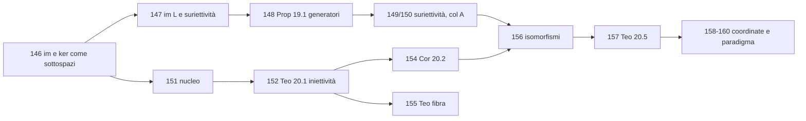

# Recap 2026-11-12 — GAL Lezioni 19 e 20

Integrati nel vault GAL gli appunti di L19 (11-11, slide 156-164) e L20 (12-11, slide 165-174): **16 note nuove** (145-160), 2 indici (`20_Indice_Lezione_19`, `21_Indice_Lezione_20`), MOC aggiornato (cronologia con riga L18 "nessun PDF") e 14 note vecchie con nuovi link. Recap di lavoro: può essere spostato o eliminato.

## GAL
### Lezione 19 (2026-11-11)
Analisi della prova in itinere, poi immagine/controimmagine di sottospazi, $\mathrm{im}(L)$, suriettività, generatori e $\mathrm{im}(L_A)=\mathrm{col}(A)$.
- [[145_Analisi_degli_Esiti_della_Prova_in_Itinere]]
- [[146_Immagine_e_Controimmagine_di_Sottospazi_Vettoriali]]
- [[147_Immagine_di_una_Applicazione_Lineare_e_Suriettivita]]
- [[148_Proposizione_19_1_Immagine_dei_Generatori]]
- [[149_Conseguenze_della_Suriettivita_Generatori_e_Dimensione]]
- [[150_Suriettivita_di_L_A_e_Spazio_delle_Colonne]]

### Lezione 20 (2026-11-12)
Nucleo, criterio di iniettività, teorema della fibra, isomorfismi, teorema di isomorfismo, mappe di coordinate e parametrizzazione, paradigma della matrice associata.
- [[151_Nucleo_di_una_Applicazione_Lineare]]
- [[152_Teorema_20_1_Criterio_di_Iniettivita]]
- [[153_Conseguenze_del_Criterio_di_Iniettivita_L_A_e_Rango]]
- [[154_Corollario_20_2_Iniettivita_e_Indipendenza_Lineare]]
- [[155_Teorema_20_3_Teorema_della_Fibra]]
- [[156_Isomorfismi_Definizione_20_4_e_Conservazione_delle_Basi]]
- [[157_Teorema_20_5_Teorema_di_Isomorfismo_tra_Spazi_Finitamente_Generati]]
- [[158_Mappa_delle_Coordinate_e_Mappa_di_Parametrizzazione_Definizione_20_6]]
- [[159_Esempio_Mappa_di_Parametrizzazione_Polinomi_di_Grado_al_piu_2]]
- [[160_Paradigma_Rappresentare_una_Applicazione_Lineare_con_una_Matrice]]



## Dove sono finite le note
Inserite direttamente nel vault: 146-160 in `16_Applicazioni_Lineari`, 145 in `99_Organizzazione`, indici in `90_Indici_Lezioni`. Consiglio: la 145 potrebbe stare anche fuori dal vault GAL (statistiche della prova, non teoria).

## Cose da controllare
- **DISEGNO NON RAPPRESENTABILE (3):** [[145_Analisi_degli_Esiti_della_Prova_in_Itinere]] (istogrammi slide 157-159), [[155_Teorema_20_3_Teorema_della_Fibra]] (insiemi annidati slide 170), [[157_Teorema_20_5_Teorema_di_Isomorfismo_tra_Spazi_Finitamente_Generati]] (strati slide 172). Diagrammi di slide 160 resi in mermaid; slide 174 in LaTeX.
- **Letture incerte (145):** Q5 38+130=168≠167; etichetta Q5 "prodotto, inverse"; "box, dim ker(A)" nel punteggio (i).
- **Numerazione:** nella slide 161 la proposizione è scritta "13.1", nella nota 148 è 19.1.
- **Lacune:** il fatto su im/controimmagine di sottospazi (146) è senza dimostrazione; slide 164 quasi vuota (completamento $L_A(\underline{e}_j)=C_j(A)$); costruzione della matrice $A$ del paradigma (160) non ancora data.
- Lezione 18: nessun PDF (slide continue 155 → 156). Esercizi per casa: nessuno.

## Prossima numerazione
GAL: note da **161**; prossimo indice `22_Indice_Lezione_21` (L21). AM1: invariato (note da 119).

## Query Dataview
```dataview
TABLE lezione, data
FROM "20_Geometria_Algebra_Lineare"
WHERE lezione = 19 OR lezione = 20
SORT file.name ASC
```

## Note collegate
- [[00_MOC_GAL]] · [[20_Indice_Lezione_19]] · [[21_Indice_Lezione_20]]

#recap/2026-11-12
