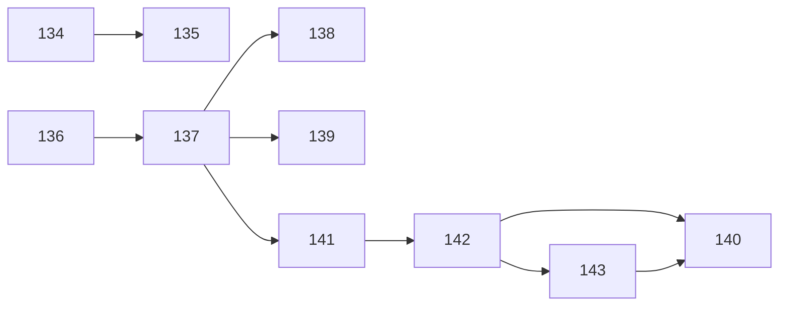

---
tags:
  - recap
  - AM1
  - claude-workspace
data: 2026-11-16
materia: Analisi Matematica 1
fonte: "AM1 L18 26-27.pdf (22 pagine, lezione del 13-11-2026)"
---

# Recap — AM1 L18 (13-11-2026)

Ho integrato direttamente nel vault la lezione 18: **11 note nuove (133-143)**, MOC AM1 aggiornato, link aggiunti in 10 note vecchie e guida di studio aggiornata. Questo recap è di lavoro: puoi spostarlo o eliminarlo dopo le verifiche.

## Analisi 1 — Lezione 18
La lezione chiude la parte "derivate" (derivata dell'inversa, esempi con modulo) e apre i **teoremi del calcolo differenziale**: estremi, Fermat, Rolle, Lagrange e le loro conseguenze (funzioni costanti, test di monotonia).

**In `10_Analisi_1/12_Derivate`**
- [[133_Derivate_con_Valore_Assoluto_e_Segno]]
- [[134_Teorema_della_Derivata_della_Funzione_Inversa]]
- [[135_Derivate_di_arctan_log_arcsin]]

**In `10_Analisi_1/13_Teoremi_del_Calcolo_Differenziale` (cartella nuova)**
- [[136_Massimi_e_Minimi_Locali_e_Globali]]
- [[137_Teorema_di_Fermat]]
- [[138_Punti_Stazionari_e_Punti_Critici]]
- [[139_Ricerca_di_Massimi_e_Minimi_Assoluti_su_Intervallo_Chiuso]]
- [[140_Test_di_Monotonia]]
- [[141_Teorema_di_Rolle]]
- [[142_Teorema_di_Lagrange]]
- [[143_Caratterizzazione_delle_Funzioni_Costanti_su_un_Intervallo]]



## Dove sono finite le note
Direttamente nel vault (non nel workspace), come nelle ultime sessioni. La cartella `13_Teoremi_del_Calcolo_Differenziale` è nuova: l'ho creata perché l'argomento è distinto dalle derivate "di calcolo". Se preferisci tenere tutto in `12_Derivate`, basta spostarla. Il PDF è stato copiato in `90_Lezioni_pdf/A1/AM1 L18 26-27.pdf`.

## Cose da controllare
- **DISEGNO NON RAPPRESENTABILE** (callout da sistemare): grafici di $|x|$ e della funzione discontinua (pag. 8, nota 136); $x^3$ (pag. 11) e $x^2\sin\frac1x$ con parabole $\pm x^2$ (pag. 12), nota 138; sinusoide con tangenti orizzontali per Rolle (pag. 18, nota 141); secante e tangenti parallele per Lagrange (pag. 18, nota 142).
- **Osservazioni mie** (callout "non presente negli appunti"): in 135 (segno $+$ della radice e esclusione di $y=\pm1$) e in 140 ($x^3$ mostra che 3 e 4 non si invertono). Nelle note 133 e 136 le osservazioni sono quelle del quaderno (in rosso).
- **Lacune**: il teorema della derivata dell'inversa e il test di monotonia sono solo enunciati (nel quaderno si dice che serviranno Rolle e Lagrange per la dimostrazione); nessun esercizio per casa.
- La pagina 2 del quaderno scrive "Es: $f(x)=|x^2-2|$" con derivata $\operatorname{sgn}(x^2-2)\,2x$: trascritta così.

## Prossima numerazione
AM1: note da **144**. Ultima lezione: L18 (13-11-2026). Le prossime note sui teoremi (Cauchy? derivata successive, convessità, de l'Hôpital, Taylor) vanno in `13_Teoremi_del_Calcolo_Differenziale` o in una cartella nuova se l'argomento cambia.

## Query Dataview
```dataview
TABLE data, lezione
FROM "10_Analisi_1/13_Teoremi_del_Calcolo_Differenziale"
SORT file.name ASC
```

## Note collegate
- [[00_MOC_Analisi_1]]
- [[00_MOC_Analisi_1]]

#recap/2026-11-16
