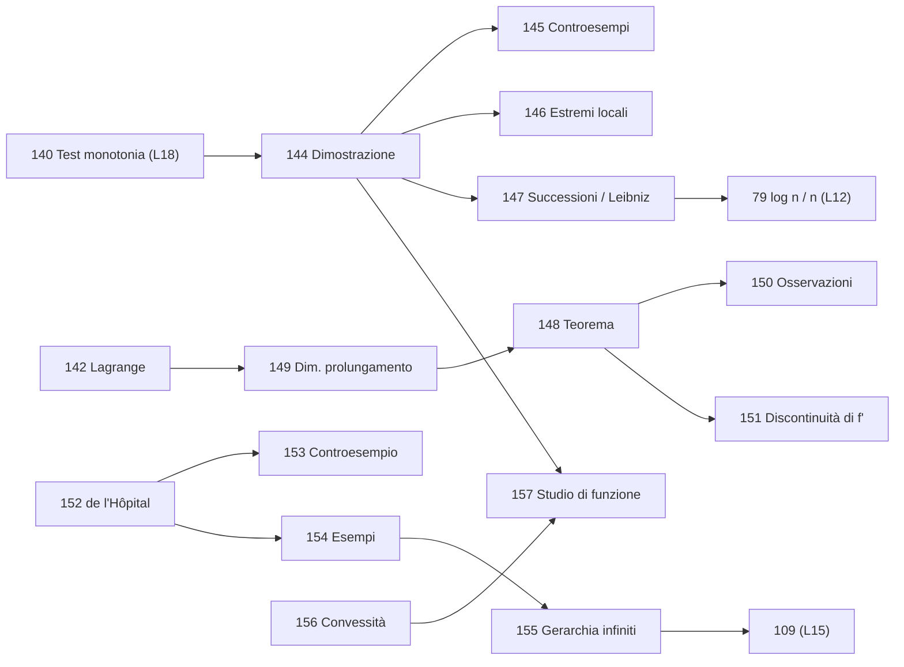

---
tags:
  - recap
  - AM1
  - claude-workspace
data: 2026-11-19
materia: Analisi 1
fonte: "AM1 L19 26-27.pdf (26 pagine, lezione del 18-11-2026)"
---

# Recap 2026-11-19 — AM1 L19 (18-11-2026)

Integrata la lezione 19 di Analisi 1: **14 note nuove (144-157)**, 2 cartelle coinvolte (una nuova), **25 note vecchie** con nuovi link, MOC aggiornato. Il PDF è in `90_Lezioni_pdf/A1/AM1 L19 26-27.pdf`. Questo recap è di lavoro: puoi spostarlo o eliminarlo dopo le verifiche.

## Analisi 1

### Test di monotonia (pag. 2-12)
La lezione chiude il [[140_Test_di_Monotonia|test di monotonia]] di L18: ora c'è la **dimostrazione** (D23), i controesempi ($x^3$ e $1/x$ su dominio non intervallo), l'uso per gli estremi locali e una tecnica per studiare la monotonia delle successioni con una funzione che le interpola (esempio $\frac{\log n}{n}$, serie di Leibniz).
- [[144_Dimostrazione_del_Test_di_Monotonia]]
- [[145_Test_di_Monotonia_Controesempi_e_Osservazioni]]
- [[146_Test_di_Monotonia_e_Estremi_Locali]]
- [[147_Monotonia_di_Successioni_tramite_Funzioni_Derivabili]]

### Teorema di prolungamento della derivata (pag. 20-25)
Se $f$ è continua in $a$ e $\lim_{x\to a^+}f'(x)=m$, allora $f'_+(a)=m$ (dimostrato con Lagrange). Controesempi ($x^2\sin\frac1x$, $(\operatorname{sgn}x)^2$) e corollario: una derivata non può avere discontinuità eliminabili né a salto.
- [[148_Teorema_di_Prolungamento_della_Derivata_Prima]]
- [[149_Dimostrazione_del_Teorema_di_Prolungamento_della_Derivata]]
- [[150_Osservazioni_sul_Prolungamento_della_Derivata]]
- [[151_Discontinuita_della_Funzione_Derivata]]

### De l'Hôpital, convessità, studio di funzione (pag. 13-19, 26)
Nuova cartella **`14_Derivate_Successive_e_Studio_di_Funzione`**. De l'Hôpital senza dimostrazione, con il controesempio $\frac{2x+\sin x}{2x-\sin x}$ e la dimostrazione completa della gerarchia degli infiniti per funzioni (completa la 109). Solo la definizione di funzione convessa/concava; schema in 10 punti per lo studio del grafico.
- [[152_Teorema_di_de_l_Hopital]]
- [[153_Controesempio_de_l_Hopital_Limite_delle_Derivate_Inesistente]]
- [[154_Esempi_di_Applicazione_de_l_Hopital]]
- [[155_Dimostrazione_della_Gerarchia_degli_Infiniti_con_de_l_Hopital]]
- [[156_Funzioni_Convesse_e_Concave]]
- [[157_Studio_del_Grafico_di_una_Funzione]]



## Dove sono finite le note
Come nelle ultime sessioni ho integrato direttamente nel vault (non nel workspace):
- 144-151 → `10_Analisi_1/13_Teoremi_del_Calcolo_Differenziale` (la 147, sulle successioni, sta lì perché usa il test di monotonia: la collego da 31, 76, 79).
- 152-157 → `10_Analisi_1/14_Derivate_Successive_e_Studio_di_Funzione` (cartella nuova, blocco 14 del MOC).
- Note vecchie con nuovi link (Note collegate): 23, 27, 31, 36, 76, 79, 96, 97, 98, 100, 101, 104, 108, 109, 110, 124, 129, 130, 133, 136, 138, 139, 140, 142, 143. In 140 ho tolto la frase "la dimostrazione non è negli appunti" e messo il rimando alla 144; in 109 il rimando alla 155 al posto di "(dimostrazione con de l'Hôpital)"; in 79 il rimando alla 147.
- `00_MOC_Analisi_1`: blocco 13 esteso, blocco 14 avviato (voci trasformate in link, senza toccare le spunte), riga Lezione 19 in cronologia, tabella cartelle, D23, flowchart (B14 non più "futuro").

## Cose da controllare
- **DISEGNO NON RAPPRESENTABILE** (2) in [[147_Monotonia_di_Successioni_tramite_Funzioni_Derivabili]]: pag. 10, grafico di $f$ decrescente con i punti $(n,a_n)$ e grafico di $f$ oscillante che passa per punti decrescenti. Gli altri grafici (di $x^3$, $1/x$, $\log x/x$, $x^2\sin\frac1x$) li ho riusati dagli screenshot già nel vault (`GraficoxCubo.png`, `grafico 1suX.png`, `LogXsuX.png`, `xquadratosin1sux.png`): verifica che siano quelli giusti.
- **Osservazioni mie** (callout "non presente negli appunti"): 145 ($f(-1)<f(1)$ per $1/x$), 147 ($a_2<a_3$, quindi $\frac{\log n}{n}$ decresce da $n\ge3$, non da $n\ge2$: risolve il "forse" del quaderno), 156 (interpretazione geometrica della convessità).
- **Notazione** in 155: nel quaderno gli esponenti hanno lettere diverse da quelle della nota 109 (stessi enunciati); l'ho segnalato in un box.
- Pag. 1 è solo la copertina (titolo, data) con un motivo grafico, non trascritta.
- **Lacune:** de l'Hôpital senza dimostrazione (come a lezione); convessità solo come definizione (niente derivata seconda/flessi: voce "nota da creare" nel MOC); nessun esercizio per casa; i punti 9-10 dello studio di funzione sono solo elencati.

## Prossima numerazione
- AM1: note da **158**. Ultima lezione: **L19** (18-11-2026). Le prossime note su convessità/flessi, Taylor vanno in `14_Derivate_Successive_e_Studio_di_Funzione`.

## Query Dataview
```dataview
TABLE data, fonte
FROM "10_Analisi_1"
WHERE lezione = 19
SORT file.name ASC
```

## Note collegate
- [[00_MOC_Analisi_1]]
- [[140_Test_di_Monotonia]]
- [[109_Gerarchia_degli_Infiniti_per_Funzioni]]

#recap/2026-11-19
