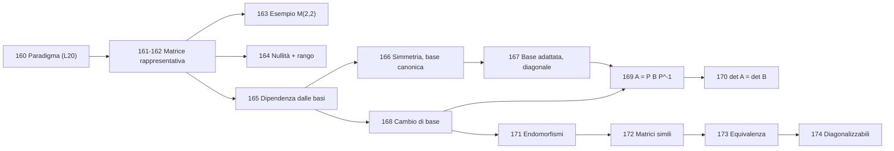

# Recap 2026-11-19 — GAL Lezioni 22 e 23

Integrate nel vault le lezioni **L22 (18-11)** e **L23 (19-11)** di GAL: **14 note nuove** (161-174), 2 indici lezione, 2 nuove cartelle, MOC aggiornato e 14 note vecchie con link nuovi. Questo recap è di lavoro: puoi spostarlo o eliminarlo dopo le verifiche.

## GAL

### Lezione 22 (18-11) — slide 175-184
Si completa il paradigma della L20: si costruisce la matrice $A$ di $L$ rispetto a due basi (colonne = coordinate delle immagini dei vettori della base), si dà la definizione di matrice rappresentativa e un esempio su $M_{\mathbb{R}}(2,2)$. Segue il teorema di nullità più rango, dimostrato passando a $L_A$ e usando Rouché–Capelli. Infine si osserva che la matrice dipende dalle basi (D1, D2) e si apre l'esempio della simmetria assiale nella base canonica.
- [[161_Obiettivo_Costruire_la_Matrice_del_Paradigma]]
- [[162_Matrice_Rappresentativa_Definizione_22_1]]
- [[163_Esempio_Matrice_Rappresentativa_del_Prodotto_a_Sinistra_per_una_Matrice]]
- [[164_Teorema_22_2_Teorema_di_Nullita_piu_Rango]]
- [[165_Dipendenza_della_Matrice_Rappresentativa_dalle_Basi]]
- [[166_Esempio_Simmetria_Assiale_Matrice_nella_Base_Canonica]]

### Lezione 23 (19-11) — slide 185-194
Simmetria assiale con base adattata (matrice diagonale: meno memoria, meno prodotti/somme), matrice del cambio di base (Def. 23.1) e relazioni tra matrici rappresentative, esempio $A=PBP^{-1}$ con $\det A=\det B$ (Binet). Poi endomorfismi, matrici simili (Def. 23.2), similitudine come relazione di equivalenza e matrici diagonalizzabili (Def. 23.3).
- [[167_Simmetria_Assiale_Base_Adattata_e_Matrice_Diagonale]]
- [[168_Matrice_del_Cambio_di_Base_Definizione_23_1]]
- [[169_Esempio_Cambio_di_Base_per_la_Simmetria_Assiale]]
- [[170_Determinante_e_Matrici_Rappresentative_della_Stessa_Applicazione_Lineare]]
- [[171_Endomorfismi_e_Matrici_Rappresentative]]
- [[172_Matrici_Simili_Definizione_23_2]]
- [[173_La_Similitudine_tra_Matrici_e_una_Relazione_di_Equivalenza]]
- [[174_Matrici_Diagonalizzabili_Definizione_23_3]]



## Dove sono finite le note
Come da prassi recente, integrate direttamente nel vault (`2026-2027/20_Geometria_Algebra_Lineare`):
- `17_Matrice_Rappresentativa_e_Cambio_di_Base` (nuova): 161, 162, 163, 165-170.
- `18_Endomorfismi_Similitudine_e_Diagonalizzazione` (nuova): 171-174.
- `16_Applicazioni_Lineari`: 164 (nullità + rango, legata a nucleo e immagine).
- `90_Indici_Lezioni`: `23_Indice_Lezione_22`, `24_Indice_Lezione_23`.
- PDF originali copiati in `90_Lezioni_pdf/GAL`.
- **Note vecchie con nuovi link:** 14, 45, 60, 74, 82, 141, 144, 147, 150, 151, 153, 158, 160 e l'indice L20. La 160 ora rimanda alla costruzione di $A$ data a L22.
- **MOC GAL:** nuovi blocchi 13.5, 14 (ora non più "prossimamente") e 15, flowchart, cronologia (L21 assente, L22, L23), tabella delle cartelle, stato del corso. Le checkbox già presenti non sono state toccate.

## Cose da controllare
- **DISEGNO NON RAPPRESENTABILE:** i disegni da inserire (callout con descrizione nelle note) sono qui sotto, con il link alla nota in cui va messo ciascuno.

| Slide | Cosa disegna | Nota in cui inserirlo |
|---|---|---|
| 182 | simmetria assiale: $P$, $L(P)$, retta, distanze $d$, angolo retto | [[165_Dipendenza_della_Matrice_Rappresentativa_dalle_Basi]] |
| 183 | simmetria con origine $O$ sulla retta, vettori $\vec v_P$, $\vec v_{L(P)}$ e assi cartesiani | [[166_Esempio_Simmetria_Assiale_Matrice_nella_Base_Canonica]] |
| 184 | $\vec i$ e $L(\vec i)$, $\vec j$ e $L(\vec j)$ con gli angoli | [[166_Esempio_Simmetria_Assiale_Matrice_nella_Base_Canonica]] |
| 186 | $\vec v$ sulla retta e $\vec w$ perpendicolare con $L(\vec w)=-\vec w$ | [[167_Simmetria_Assiale_Base_Adattata_e_Matrice_Diagonale]] |
| 187 | griglie nelle basi $\mathcal{B}$ ed $\mathcal{C}$ con $\vec u$ | [[167_Simmetria_Assiale_Base_Adattata_e_Matrice_Diagonale]] |
| 188-189 | diagramma dei quattro cambi di base ($\mathcal{B}_1,\mathcal{B}_2,\mathcal{C}_1,\mathcal{C}_2$) | [[168_Matrice_del_Cambio_di_Base_Definizione_23_1]] |
| 190 | angoli di $\vec v$, $\vec w$ e diagramma con $A,B,P$ | [[169_Esempio_Cambio_di_Base_per_la_Simmetria_Assiale]] |
| 192 | diagramma di cambio di base per un endomorfismo | [[171_Endomorfismi_e_Matrici_Rappresentative]] |
| 193 | ellisse $M_{\mathbb{K}}(n,n)$ divisa in classi di similitudine | [[173_La_Similitudine_tra_Matrici_e_una_Relazione_di_Equivalenza]] |

- **Dubbi di trascrizione da rivedere** (con la nota in cui controllare):

| Slide | Dubbio | Nota |
|---|---|---|
| 176 | parola poco leggibile nell'"Idea": ho letto "cerco di usare le matrici per studiare tutte le applicazioni lineari…" | [[161_Obiettivo_Costruire_la_Matrice_del_Paradigma]] |
| 184 | fattore "$1\cdot$" davanti a $\cos 2\theta$ e $\sin 2\theta$, riportato come scritto | [[166_Esempio_Simmetria_Assiale_Matrice_nella_Base_Canonica]] |
| 187 | coordinate di $\vec u$ nella base $\mathcal{C}$ lette come $(2+\varepsilon_1,\ 1-\varepsilon_2)$ | [[167_Simmetria_Assiale_Base_Adattata_e_Matrice_Diagonale]] |
| 191 | nel quaderno "$A,B$ rappresentano entrambe una applicazione lineare": l'ho scritto come "la stessa applicazione lineare (rispetto a basi diverse)" | [[170_Determinante_e_Matrici_Rappresentative_della_Stessa_Applicazione_Lineare]] |

- **Notazione:** la base del codominio era stata letta da me come una "e" (\mathcal{e}), ma è una $\mathcal{C}$ corsiva maiuscola: corretto in tutte le note L22-L23 (161, 162, 167, 168, 169, 171). Resta una differenza voluta: a slide 179 la variabile dell'esempio si chiama $A$ nel quaderno e $X$ nella nota [[163_Esempio_Matrice_Rappresentativa_del_Prodotto_a_Sinistra_per_una_Matrice]] (per non confonderla con la matrice rappresentativa $A\in M_{\mathbb{R}}(4,4)$).
- **Chiarimenti miei** (non scritti negli appunti), da confermare nelle note:
  - [[161_Obiettivo_Costruire_la_Matrice_del_Paradigma]]: "$\mathcal{X}_{\mathcal{B}}(\underline v_i)=\underline e_i$".
  - [[164_Teorema_22_2_Teorema_di_Nullita_piu_Rango]]: uso del fatto che le mappe delle coordinate conservano le basi (nucleo→nucleo, immagine→immagine).
  - [[166_Esempio_Simmetria_Assiale_Matrice_nella_Base_Canonica]]: la frase "$L(\vec i)$ è $\vec i$ ruotato di $2\theta$".
  - [[169_Esempio_Cambio_di_Base_per_la_Simmetria_Assiale]]: la lettura "da $\mathcal{B}$ a $\mathcal{C}$ con $P^{-1}$, poi $B$, poi $P$".
- **Lacune ed esercizi per casa:** per casa a slide 189 "scrivere tutte le relazioni tra due matrici rappresentative di $L$" (non svolto, annotato in [[168_Matrice_del_Cambio_di_Base_Definizione_23_1]] e in [[24_Indice_Lezione_23]]). Mancano la ricerca di $P$ e $D$ (autovalori/autovettori) e il calcolo di $A$ con $\mathcal{B}\neq\mathcal{C}$ per spazi diversi da quelli degli esempi.
- **Lezioni mancanti:** L21 non è nel vault (la numerazione delle slide prosegue da 174 a 175).

## Prossima numerazione
- GAL: note da **175**; indice lezione: prossimo L24 → `25_Indice_Lezione_24`. Ultima slide vista: **194**.
- Nuove note su diagonalizzazione/autovalori: `18_Endomorfismi_Similitudine_e_Diagonalizzazione`, salvo nuova cartella se l'argomento cambia.

## Query Dataview

```dataview
TABLE lezione, data
FROM "20_Geometria_Algebra_Lineare"
WHERE lezione = 22 OR lezione = 23
SORT file.name ASC
```

## Note collegate
- [[00_MOC_GAL]]
- [[23_Indice_Lezione_22]] · [[24_Indice_Lezione_23]]

#recap/2026-11-19
