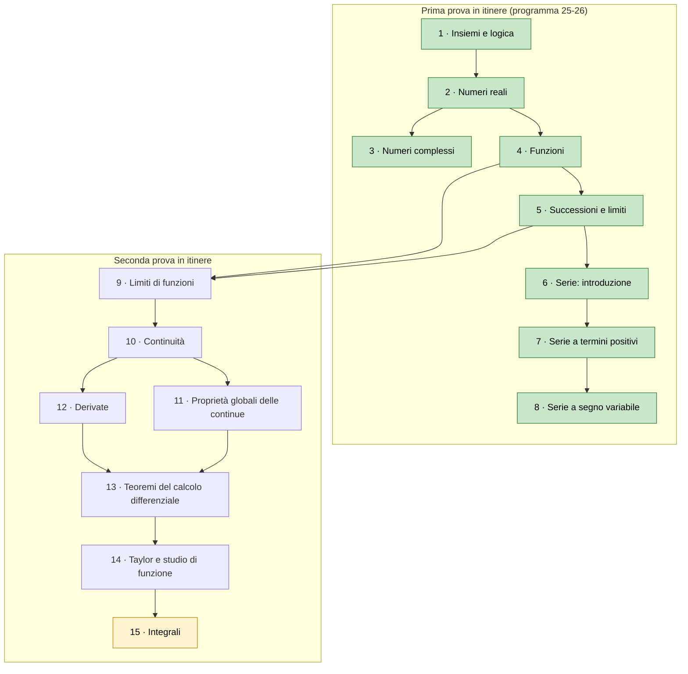

---
tags:
  - AM1
  - MOC
  - indice
  - guida-studio
data: 2026-11-26
corso: Analisi Matematica 1
ultima_lezione: 21
---

# Analisi Matematica 1 — MOC e guida allo studio

Mappa del corso e percorso di studio in un unico punto. Ogni **macroargomento** ha una descrizione di cosa stai per affrontare, i contenuti fondamentali da imparare, un checkpoint di autoverifica e l'elenco delle note con la lezione in cui sono state trattate. In fondo trovi la cronologia delle lezioni e la mappa delle cartelle.

Salto rapido: [[#Dashboard]] · [[#Flowchart della progressione]] · [[#Dimostrazioni richieste allo scritto]] · [[#Cronologia delle lezioni]] · [[#Struttura delle cartelle]]

> [!tip] Come usarlo
> - Spunta `- [x]` quando hai **studiato e capito** la nota: dashboard e barre di progresso si aggiornano da sole.
> - Tra parentesi, in corsivo, la lezione in cui la nota è stata trattata *(L5)*; sotto ogni titolo l'intervallo di lezioni del blocco.
> - Nel flowchart, per segnare un blocco come fatto togli i `%%` dalla riga `class ... fatto` e aggiungi gli id dei blocchi.
> - La cronologia completa delle lezioni e la mappa delle cartelle sono in fondo alla nota.
> - Le dimostrazioni segnate **(D#)** sono nell'elenco delle dimostrazioni richieste allo scritto.

> [!info] Stato del corso
> **Prima prova in itinere superata (voto 23):** i blocchi 1-8 e le dimostrazioni D1-D14 sono segnati come svolti; lo studio riparte dagli argomenti del secondo compitino (dal blocco 9).
>
> Ultima lezione integrata: **L21** (25-11-2026). I blocchi 1-14 hanno note (il 14 è quasi completo: de l'Hôpital, convessità e flessi, Taylor con resto di Peano (dimostrato) e di Lagrange, sviluppi notevoli, serie di Taylor, esponenziale complesso; resta lo studio completo di funzione); il **blocco 15 (integrali) è appena iniziato** con le primitive. Il resto del blocco 15 è ricavato dal programma 25-26 e va confermato a lezione.

## Dashboard

```dataviewjs
const rows = [], idx = new Map();
for (const t of dv.current().file.tasks) {
  const k = (t.section && t.section.subpath) ? t.section.subpath : "—";
  if (!idx.has(k)) { idx.set(k, rows.length); rows.push({k, d: 0, n: 0}); }
  const r = rows[idx.get(k)]; r.n++; if (t.completed) r.d++;
}
const tot = rows.reduce((a, r) => a + r.n, 0), done = rows.reduce((a, r) => a + r.d, 0);
dv.table(["Blocco", "Fatte", "Progresso"],
  rows.map(r => [r.k, `${r.d} / ${r.n}`, `<progress value="${r.d}" max="${r.n}" style="width:140px"></progress>`]));
dv.paragraph(`**Totale:** ${done} / ${tot} voci (${tot ? Math.round(100 * done / tot) : 0}%) <progress value="${done}" max="${tot}" style="width:240px"></progress>`);
```

### Prossime note da studiare

```dataviewjs
const next = dv.current().file.tasks
  .where(t => !t.completed && t.outlinks.length > 0 && !(t.section.subpath ?? "").startsWith("Dimostrazioni"))
  .slice(0, 8);
dv.taskList(next, false);
```

## Flowchart della progressione



---

## 1 · Fondamenti: insiemi e logica

*Lezione 1 (14-09)*

> [!abstract] Stai per affrontare
> Il linguaggio con cui è scritto tutto il corso: insiemi numerici, connettivi, quantificatori e le tre tecniche dimostrative di base. Serve a leggere e scrivere correttamente definizioni come quella di limite.

> [!important] Da imparare
> - Quantificatori $\forall,\exists$ e **negazione** di enunciati con più quantificatori.
> - Implicazione, contronominale, doppia implicazione.
> - Dimostrazione per **assurdo** (modello: $\sqrt2\notin\mathbb{Q}$, **D1**).
> - Dimostrazione per **induzione** (modello: disuguaglianza di Bernoulli, **D2**).

> [!question] Checkpoint
> Sai negare "$\forall \varepsilon>0\ \exists N:\dots$"? Sai impostare una dimostrazione per induzione completa (base + passo)?

- [x] [[01_Insiemi_Numerici]] — $\mathbb{N},\mathbb{Z},\mathbb{Q},\mathbb{R}$ *(L1)* ✅ 2026-11-13
- [x] [[02_Logica]] — connettivi, quantificatori, negazioni *(L1)* ✅ 2026-11-13
- [x] [[03_Dimostrazioni]] — panoramica delle tecniche *(L1)* ✅ 2026-11-13
- [x] [[04_Dimostrazione_per_Assurdo]] — irrazionalità di $\sqrt2$ (D1) *(L1)* ✅ 2026-11-13
- [x] [[05_Dimostrazione_per_Induzione]] — principio di induzione, Bernoulli (D2) *(L1)* ✅ 2026-11-13

---

## 2 · I numeri reali

*Lezioni 2 → 3 (16-09 → 18-09)*

> [!abstract] Stai per affrontare
> La struttura di $\mathbb{R}$ come campo ordinato **completo**: è la proprietà di completezza (estremo superiore) che sta dietro limiti, continuità e teoremi globali.

> [!important] Da imparare
> - Definizione di campo ordinato; maggioranti, minoranti, insiemi limitati.
> - **Massimo/minimo** vs **estremo superiore/inferiore**: quando coincidono e quando no.
> - Caratterizzazione dell'estremo superiore con $\varepsilon$ e assioma di completezza.
> - Valore assoluto e disuguaglianza triangolare; intervalli.
> - Potenze, radici e logaritmi: proprietà e domini.

> [!question] Checkpoint
> Dato $A=\{1-\tfrac1n\}$, sai calcolare $\sup A$ e dire se è massimo? Sai risolvere disequazioni con modulo?

- [x] [[06_Campi_Ordinati]] — assiomi di campo ordinato *(L2)* ✅ 2026-11-13
- [x] [[07_Insiemi_Limitati_Max_Min]] — maggioranti, minoranti, max, min *(L2)* ✅ 2026-11-16
- [x] [[08_Estremo_Superiore_Inferiore]] — sup, inf, completezza *(L2)* ✅ 2026-11-16
- [x] [[09_Valore_Assoluto]] — modulo, disuguaglianza triangolare *(L2)* ✅ 2026-11-16
- [x] [[10_Retta_Reale_Intervalli]] — retta reale e intervalli *(L2)* ✅ 2026-11-16
- [x] [[11_Radici_e_Potenze]] — potenze e radici *(L2)* ✅ 2026-11-13
- [x] [[12_Logaritmi]] — logaritmi e proprietà *(L3)* ✅ 2026-11-13

---

## 3 · I numeri complessi

*Lezioni 3 → 4 (18-09 → 23-09)*

> [!abstract] Stai per affrontare
> L'estensione $\mathbb{C}$ in cui ogni polinomio ha radici: tre rappresentazioni (algebrica, trigonometrica, esponenziale) e il loro significato geometrico nel piano di Gauss.

> [!important] Da imparare
> - Parte reale/immaginaria, coniugato, modulo, argomento.
> - Passare da forma algebrica a trigonometrica/esponenziale e viceversa.
> - **Formule di De Moivre** per prodotti e potenze (**D3**).
> - **Radici $n$-esime** di un numero complesso (**D4**): $n$ radici sui vertici di un poligono regolare.
> - Equazioni di secondo grado in $\mathbb{C}$ e teorema fondamentale dell'algebra.

> [!question] Checkpoint
> Sai calcolare $(1+i)^{10}$ e le radici cubiche di $-8$ senza formulario?

- [x] [[13_Numeri_Complessi]] — forma algebrica, operazioni *(L3)* ✅ 2026-11-13
- [x] [[14_Piano_di_Argand_Gauss]] — interpretazione geometrica *(L3)* ✅ 2026-11-13
- [x] [[15_Forma_Trigonometrica_Esponenziale]] — modulo, argomento, Eulero *(L3, L4)* ✅ 2026-11-13
- [x] [[16_Formule_di_De_Moivre]] — prodotti e potenze (D3) *(L4)* ✅ 2026-11-19
- [x] [[17_Radici_Complesse]] — radici $n$-esime (D4) *(L4)*
- [x] [[18_Equazioni_in_C]] — equazioni in $\mathbb{C}$ *(L3, L4)* ✅ 2026-11-13

---

## 4 · Funzioni

*Lezioni 4 → 6 (23-09 → 30-09)*

> [!abstract] Stai per affrontare
> Il vocabolario delle funzioni reali: tutto ciò che servirà per studiare limiti, continuità e derivate di una funzione e per tracciarne il grafico.

> [!important] Da imparare
> - Dominio, codominio, immagine, controimmagine, grafico; **campo di esistenza**.
> - Funzioni limitate, pari/dispari, periodiche, monotone.
> - **Composizione** di funzioni e suo dominio.
> - Iniettività, suriettività, **invertibilità**; strettamente monotona ⇒ iniettiva ⇒ invertibile.
> - Grafici delle funzioni elementari e delle loro inverse.

> [!question] Checkpoint
> Sai trovare il campo di esistenza di $\log(\sqrt{x}-1)$ e dire se $f(x)=x^2$ è invertibile su $\mathbb{R}$ e su $[0,+\infty)$?

- [x] [[19_Funzioni_Generalità]] — concetto di funzione, immagine, controimmagine *(L4)* ✅ 2026-11-13
- [x] [[20_Funzioni_Limitate_Estremi]] — limitatezza, estremi di una funzione *(L5)* ✅ 2026-11-13
- [x] [[21_Campo_di_Esistenza]] — dominio naturale *(L5)* ✅ 2026-11-13
- [x] [[22_Funzioni_Pari_Dispari]] — simmetrie del grafico *(L5)* ✅ 2026-11-13
- [x] [[23_Monotonia]] — crescente/decrescente *(L5)* ✅ 2026-11-13
- [x] [[24_Funzioni_Periodiche]] — periodicità *(L5)* ✅ 2026-11-13
- [x] [[25_Composizione_di_Funzioni]] — $g\circ f$ *(L5)* ✅ 2026-11-13
- [x] [[26_Iniettivita_Suriettivita_Inversa]] — funzione inversa *(L5)* ✅ 2026-11-13
- [x] [[27_Teorema_Monotone_Invertibili]] — monotone ⇒ invertibili *(L5)* ✅ 2026-11-13
- [x] [[28_Esempi_Funzioni_Inverse]] — esempi e grafici *(L6)* ✅ 2026-11-13

---

## 5 · Successioni e limiti

*Lezioni 6 → 11 (30-09 → 16-10)*

> [!abstract] Stai per affrontare
> Il primo incontro con il **limite**, nel caso più semplice (variabile $n\to+\infty$). Tutte le idee (definizione, teoremi, asintotici) verranno riprese per le funzioni.

### 5.1 · Definizione di limite e teoremi fondamentali

*Lezioni 6 → 7 (30-09 → 02-10)*

> [!important] Da imparare
> - Definizione di successione, successioni monotone e limitate.
> - Definizione $\varepsilon$–$N$ di limite; convergente, divergente, irregolare; proprietà "definitivamente".
> - **Unicità del limite** (D5), **convergente ⇒ limitata** (D6), **permanenza del segno** (D7), **due carabinieri** (D8), **regolarità delle monotone** (D9).
> - Algebra dei limiti.

> [!question] Checkpoint
> Sai verificare un limite con la definizione e dimostrare che una successione convergente è limitata?

- [x] [[29_Successioni_Definizioni_Base]] — successioni, grafico *(L6)* ✅ 2026-11-13
- [x] [[30_Limiti_di_Successioni]] — definizione di limite, unicità (D5) *(L6)*
- [x] [[31_Successioni_Monotone]] — regolarità (D9) *(L6, L7)*
- [x] [[32_Successione_Convergente_e_Limitata]] — (D6) *(L7)*
- [x] [[33_Teorema_Permanenza_del_Segno]] — (D7) *(L7)*
- [x] [[34_Algebra_dei_Limiti]] — somma, prodotto, quoziente *(L7)* ✅ 2026-11-13
- [x] [[35_Teoremi_del_Confronto]] — carabinieri (D8) *(L7)*

### 5.2 · Infiniti, forme indeterminate, numero di Nepero

*Lezioni 7 → 8 (02-10 → 07-10)*

> [!important] Da imparare
> - Aritmetica parziale di $\pm\infty$ e **forme indeterminate**.
> - **Gerarchia degli infiniti**: $\log n\ll n^a\ll b^n\ll n!\ll n^n$.
> - Il numero $e=\lim(1+\tfrac1n)^n$ e perché esiste (monotonia + Bernoulli).
> - Criterio del rapporto per successioni.

- [x] [[36_Gerarchia_degli_Infiniti]] — confronto tra infiniti *(L7, L8)* ✅ 2026-11-13
- [x] [[37_Algebra_Limiti_Infiniti]] — forme indeterminate *(L8)* ✅ 2026-11-13
- [x] [[38_Numero_di_Nepero]] — $e$ *(L8)* ✅ 2026-11-13
- [x] [[39_Criterio_del_Rapporto]] — rapporto per successioni *(L8)* ✅ 2026-11-13

### 5.3 · Confronti asintotici

*Lezioni 8 → 11 (07-10 → 16-10)*

> [!important] Da imparare
> - Relazioni $\sim$ (asintotico) e $o$-piccolo: definizione e proprietà.
> - **Limiti notevoli** (per successioni) e loro uso per risolvere forme indeterminate.
> - Sostituzione di asintotici in prodotti, quozienti, potenze (non in somme!).
> - Formula di Stirling.

> [!question] Checkpoint
> Sai calcolare $\lim n\sin(1/n)$ e $\lim n^2\bigl(\sqrt{1+1/n^2}-1\bigr)$ con gli asintotici?

- [x] [[40_Confronti_Asintotici]] — definizione di $\sim$ *(L8)* ✅ 2026-11-19
- [x] [[41_o_piccolo_e_Asintotico]] — $o$-piccolo *(L8)* ✅ 2026-11-19
- [x] [[42_Confronti_Asintotici_Proprieta_e_Notevoli]] — proprietà e notevoli *(L9)*
- [x] [[43_Asintotici_con_Funzioni_Composte]] — composizione con funzioni *(L10)* ✅ 2026-11-19
- [x] [[44_Esempio_Asintotici_con_Logaritmo_e_Arctan]] — esempio guidato *(L10)* ✅ 2026-11-13
- [x] [[45_Esercizio_Asintotici_Limite_21]] — esercizio *(L10)* ✅ 2026-11-13
- [x] [[46_Asintotici_Notevoli_e_Limiti_Notevoli]] — raccolta *(L10)* ✅ 2026-11-19
- [x] [[68_Formula_di_Stirling]] — $n!\sim\sqrt{2\pi n}(n/e)^n$ *(L11)*

---

## 6 · Serie numeriche: introduzione

*Lezioni 10 → 11 (14-10 → 16-10)*

> [!abstract] Stai per affrontare
> Somme di infiniti termini, definite come limite delle somme parziali. Il problema centrale è decidere il **carattere** (convergente/divergente/irregolare) e, quando possibile, la somma.

> [!important] Da imparare
> - Serie come limite della successione delle somme parziali; resto $N$-esimo.
> - **Serie geometrica**: converge se e solo se $|q|<1$, con somma $\frac1{1-q}$ (se parte da $n=0$).
> - **Serie telescopiche** (Mengoli) e linearità.
> - **Condizione necessaria** $a_n\to0$ (D10): è necessaria, **non** sufficiente.
> - **Serie armonica**: diverge, pur con $a_n\to0$.

> [!question] Checkpoint
> Perché $\sum 1/n$ diverge anche se $1/n\to0$? Sai calcolare $\sum\frac1{n(n+1)}$?

- [x] [[47_Serie_Introduzione_e_Somme_Parziali]] — definizione *(L10)* ✅ 2026-11-19
- [x] [[48_Studio_del_Carattere_di_una_Serie]] — carattere *(L10)* ✅ 2026-11-19
- [x] [[49_Esempi_Elementari_di_Serie]] — esempi *(L10)* ✅ 2026-11-13
- [x] [[50_Serie_Geometrica]] — geometrica *(L10)* ✅ 2026-11-19
- [x] [[51_Rappresentazione_Decimale_e_Serie]] — $0{,}\overline9=1$ *(L10)* ✅ 2026-11-19
- [x] [[52_Linearita_delle_Serie]] — linearità *(L10)* ✅ 2026-11-19
- [x] [[53_Serie_Telescopiche_e_Mengoli]] — telescopiche, Mengoli *(L10)* ✅ 2026-11-19
- [x] [[54_Condizione_Necessaria_di_Convergenza]] — $a_n\to0$ (D10) *(L10)*
- [x] [[55_Serie_Armonica]] — armonica *(L10)* ✅ 2026-11-19
- [x] [[56_Resto_N-esimo_della_Serie]] — resto *(L11)* ✅ 2026-11-19

---

## 7 · Serie a termini positivi

*Lezioni 11 → 12 (16-10 → 21-10)*

> [!abstract] Stai per affrontare
> Il caso in cui la serie non può essere irregolare: o converge o diverge a $+\infty$. Qui nasce il "kit" di **criteri** da applicare in sequenza.

> [!important] Da imparare
> - Regolarità delle serie a termini $\ge0$.
> - **Confronto** (D11) e **confronto asintotico** (D12).
> - Serie di riferimento: **armonica generalizzata** $\sum n^{-\alpha}$ (converge $\iff\alpha>1$) e serie di **Bertrand**.
> - **Criterio del rapporto** (D13) e **criterio della radice**; quando non decidono ($L=1$).
> - Studio di serie con **parametro**.

> [!question] Checkpoint
> Dato $\sum\frac{n^a}{b^n}$ o $\sum\frac{\log^b n}{n^a}$, sai dire per quali parametri converge e con quale criterio?

- [x] [[57_Serie_a_Termini_Positivi]] — regolarità *(L11)* ✅ 2026-11-19
- [x] [[58_Criterio_del_Confronto_per_Serie]] — confronto (D11) *(L11)*
- [x] [[59_Esempio_Confronto_Serie_18_cos_n]] — esempio *(L11)* ✅ 2026-11-13
- [x] [[60_Serie_Armonica_Generalizzata]] — $\sum n^{-\alpha}$ *(L11)* ✅ 2026-11-19
- [x] [[61_Serie_di_Bertrand_Generalizzata]] — Bertrand *(L11)* ✅ 2026-11-19
- [x] [[62_Criterio_del_Confronto_Asintotico_per_Serie]] — (D12) *(L11)*
- [x] [[63_Esempio_Confronto_Asintotico_con_Parametro]] — esempio con parametro *(L11)* ✅ 2026-11-13
- [x] [[81_Esempio_Confronto_Asintotico_con_Bertrand]] — esempio con Bertrand *(L12)* ✅ 2026-11-19
- [x] [[64_Criterio_del_Rapporto_per_Serie]] — rapporto *(L11)* ✅ 2026-11-19
- [x] [[69_Dimostrazione_del_Criterio_del_Rapporto_per_Serie]] — dimostrazione (D13) *(L12)*
- [x] [[65_Criterio_della_Radice_per_Serie]] — radice *(L11)* ✅ 2026-11-13
- [x] [[66_Esempio_Rapporto_e_Radice_su_Armonica_Generalizzata]] — esempio *(L11)* ✅ 2026-11-13
- [x] [[67_Esempio_Serie_n_Fattoriale_su_n_alla_n]] — esempio *(L11)* ✅ 2026-11-13
- [x] [[70_Esempio_Serie_a_alla_n_su_n_alla_n]] — esempio *(L12)* ✅ 2026-11-13
- [x] [[71_Esempio_Serie_n_alla_a_per_b_alla_n]] — esempio *(L12)* ✅ 2026-11-13
- [x] [[72_Esempio_Serie_a_alla_n_per_log_n_alla_b]] — esempio *(L12)* ✅ 2026-11-13

---

## 8 · Serie a termini di segno variabile

*Lezione 12 (21-10)*

> [!abstract] Stai per affrontare
> Cosa succede quando i termini cambiano segno: si introduce la convergenza **assoluta** e si studia il caso alternato con il criterio di Leibniz.

> [!important] Da imparare
> - Convergenza assoluta vs semplice; **assoluta ⇒ semplice** (D14).
> - Strategia: studiare $\sum|a_n|$ con i criteri del blocco 7; se non basta, passare ad altro.
> - **Criterio di Leibniz** per serie a segno alterno (ipotesi: $b_n\ge0$, decrescente, $\to0$).

> [!question] Checkpoint
> Sai distinguere "converge assolutamente", "converge solo semplicemente" e "non converge" per $\sum\frac{(-1)^n}{n^\alpha}$ al variare di $\alpha$?

- [x] [[73_Convergenza_Assoluta_e_Semplice]] — assoluta e semplice *(L12)* ✅ 2026-11-19
- [x] [[74_Criterio_di_Convergenza_Assoluta]] — assoluta ⇒ semplice (D14) *(L12)*
- [x] [[75_Esempio_Convergenza_Assoluta_sin_n_su_n_alla_3_su_2]] — esempio *(L12)* ✅ 2026-11-19
- [x] [[76_Serie_a_Segno_Alterno_e_Criterio_di_Leibniz]] — Leibniz *(L12)* ✅ 2026-11-19
- [x] [[77_Esempio_Serie_Alternata_con_Parametro_alpha]] — esempio con $\alpha$ *(L12)* ✅ 2026-11-19
- [x] [[78_Osservazioni_sul_Criterio_di_Leibniz]] — osservazioni *(L12)* ✅ 2026-11-19
- [x] [[79_Esempio_Serie_Alternata_log_n_su_n]] — esempio *(L12)* ✅ 2026-11-19
- [x] [[80_Esempio_Serie_alpha_meno_1_alla_n_su_n_2_alla_n]] — esempio *(L12)* ✅ 2026-11-19

---

## 9 · Limiti di funzioni

*Lezioni 13 → 17 (23-10 → 11-11)*

> [!abstract] Stai per affrontare
> Il limite per funzioni $f(x)$ con $x\to x_0$ (finito o infinito). Le idee sono quelle delle successioni, ma servono intorni e punti di accumulazione. In fondo trovi i limiti notevoli e gli asintotici, strumenti principali per calcolare limiti.

### 9.1 · Definizioni e primi risultati

*Lezioni 13 → 14 (23-10 → 28-10)*

> [!important] Da imparare
> - Intorni di un punto e di $\pm\infty$; **punti di accumulazione**.
> - Tre definizioni equivalenti: **successionale**, **topologica**, **metrica** ($\varepsilon$–$\delta$ / $\varepsilon$–$M$).
> - Limite finito/infinito in un punto finito, limiti **destro e sinistro**, per eccesso/difetto.
> - **Asintoti**: orizzontale, verticale, obliquo.
> - Unicità del limite; uso della def. successionale per mostrare la **non esistenza**.

- [x] [[82_Intorni_di_un_Punto_e_di_Infinito]] — intorni *(L13)* ✅ 2026-11-13
- [x] [[83_Punti_di_Accumulazione]] — punti di accumulazione *(L13)* ✅ 2026-11-13
- [x] [[84_Definizione_Successionale_di_Limite]] — def. successionale *(L13)* ✅ 2026-11-27
- [x] [[85_Teorema_di_Unicita_del_Limite]] — unicità *(L13)* ✅ 2026-11-13
- [ ] [[86_Definizione_Topologica_di_Limite]] — def. topologica *(L13)*
- [ ] [[87_Definizioni_Metriche_di_Limite_all_Infinito]] — def. metriche *(L13)*
- [x] [[88_Asintoto_Orizzontale_e_Limiti_per_Eccesso_e_per_Difetto]] — asintoto orizzontale *(L13)* ✅ 2026-11-13
- [x] [[89_Asintoto_Obliquo]] — asintoto obliquo *(L13)* ✅ 2026-11-13
- [x] [[90_Limite_Infinito_in_un_Punto_Finito]] — limite infinito in un punto *(L14)* ✅ 2026-11-16
- [x] [[91_Limiti_Destro_e_Sinistro_e_Asintoto_Verticale]] — destro/sinistro, asintoto verticale *(L14)* ✅ 2026-11-16
- [x] [[92_Limite_Finito_in_un_Punto_Finito]] — limite finito in un punto *(L14)* ✅ 2026-11-16
- [x] [[99_Proprieta_Valida_Definitivamente]] — "definitivamente" per funzioni *(L14)* ✅ 2026-11-16

### 9.2 · Teoremi sui limiti

*Lezioni 14 → 15 (28-10 → 04-11)*

> [!important] Da imparare
> - **Permanenza del segno**, **confronto** (carabinieri), **algebra** dei limiti e forme indeterminate.
> - **Cambio di variabile** nel limite.

- [x] [[100_Teorema_del_Confronto_per_Limiti_di_Funzioni]] — confronto *(L14)* ✅ 2026-11-16
- [x] [[101_Teorema_di_Permanenza_del_Segno_per_Funzioni]] — permanenza del segno *(L14)* ✅ 2026-11-16
- [x] [[102_Algebra_dei_Limiti_di_Funzioni]] — algebra dei limiti *(L14)* ✅ 2026-11-16
- [ ] [[104_Cambio_di_Variabile_nei_Limiti]] — cambio di variabile *(L15)*

### 9.3 · Asintotici, limiti notevoli e grafici

*Lezioni 15 → 17 (04-11 → 11-11)*

> [!important] Da imparare
> - $\sim$ e $o$ per funzioni; regole di calcolo (prodotti, quozienti, potenze sì, somme con attenzione).
> - **Limiti notevoli**: $\frac{\sin x}{x}$, $\frac{1-\cos x}{x^2}$, $\frac{\log(1+x)}{x}$, $\frac{e^x-1}{x}$, $\frac{(1+x)^a-1}{x}$ e le loro conseguenze asintotiche.
> - Gerarchia degli infiniti per funzioni.
> - **Grafici locali / probabili**: ricostruire il grafico a partire da limiti e asintotici.

> [!question] Checkpoint
> Sai calcolare $\lim_{x\to0}\frac{\sin x-x\cos x}{x^3}$ ragionando con asintotici e $o$-piccolo?

- [ ] [[106_Asintotico_e_o_piccolo_per_Funzioni]] — $\sim$ e $o$ per funzioni *(L15)*
- [ ] [[107_Proprieta_degli_Asintotici_per_Funzioni]] — proprietà *(L15)*
- [ ] [[108_Limiti_Notevoli_di_Funzioni]] — limiti notevoli *(L15)*
- [ ] [[109_Gerarchia_degli_Infiniti_per_Funzioni]] — gerarchia *(L15)*
- [ ] [[110_Grafici_Locali_e_Grafici_Probabili]] — grafici locali *(L15)*
- [ ] [[118_Dimostrazione_dei_Limiti_Notevoli]] — log, esp, potenza *(L16)*
- [ ] [[119_Dimostrazione_del_Limite_Notevole_sin_x_su_x]] — $\sin x/x$ *(L17)*
- [ ] [[120_Dimostrazione_del_Limite_Notevole_1_meno_cos_x_su_x_quadro]] — $(1-\cos x)/x^2$ *(L17)*

---

## 10 · Continuità

*Lezioni 14 → 16 (28-10 → 06-11)*

> [!abstract] Stai per affrontare
> Una funzione è continua in $x_0$ se il limite coincide con il valore: "il grafico non si spezza". Si classificano i modi in cui la continuità può fallire e si dimostra che le funzioni elementari sono continue.

> [!important] Da imparare
> - Definizione: $\lim_{x\to x_0}f(x)=f(x_0)$.
> - **Classificazione delle discontinuità**: eliminabile (prolungamento per continuità), di prima specie (salto), di seconda specie.
> - Algebra delle continue e **continuità della composta**.
> - Continuità delle **funzioni elementari**.
> - Continuità e **invertibilità**.

> [!question] Checkpoint
> Data $f$ definita a tratti con un parametro, sai trovare i valori che la rendono continua e classificare le discontinuità restanti?

- [ ] [[93_Continuita_in_un_Punto]] — definizione *(L14)*
- [ ] [[94_Esempio_Continuita_di_e_alla_x]] — esempio *(L14)*
- [ ] [[95_Funzione_di_Dirichlet]] — Dirichlet (mai continua) *(L14)*
- [ ] [[96_Discontinuita_Eliminabile_e_Prolungamento_per_Continuita]] — eliminabile *(L14)*
- [ ] [[97_Discontinuita_di_Prima_Specie_a_Salto]] — salto *(L14)*
- [ ] [[98_Discontinuita_di_Seconda_Specie]] — seconda specie *(L14)*
- [ ] [[103_Algebra_delle_Funzioni_Continue]] — algebra *(L15)*
- [ ] [[105_Continuita_della_Funzione_Composta]] — composta *(L15)*
- [ ] [[117_Continuita_delle_Funzioni_Elementari]] — elementari *(L16)*
- [ ] [[116_Continuita_e_Invertibilita]] — continuità e inversa *(L16)*

---

## 11 · Proprietà globali delle funzioni continue

*Lezioni 15 → 16 (04-11 → 06-11)*

> [!abstract] Stai per affrontare
> I tre grandi teoremi che valgono per le funzioni continue su un **intervallo**: zeri, valori intermedi e Weierstrass. Sono i primi risultati "globali" e le ipotesi (intervallo, chiuso, limitato) sono decisive.

> [!important] Da imparare
> - **Teorema degli zeri** (D15): enunciato, ipotesi, uso per provare l'esistenza di soluzioni.
> - **Teorema dei valori intermedi** (D16).
> - **Teorema di Weierstrass** (D17): massimo e minimo su $[a,b]$; contro-esempi quando manca una ipotesi.
> - Immagine di una continua su $[a,b]$ è $[\min,\max]$.
> - Limiti di funzioni monotone.

> [!question] Checkpoint
> Sai dimostrare con lo teorema degli zeri che $x^3+x-1=0$ ha una soluzione in $[0,1]$ e spiegare perché Weierstrass fallisce su $(0,1]$ per $1/x$?

- [ ] [[111_Teorema_degli_Zeri]] — zeri (D15) *(L15)*
- [ ] [[113_Teorema_dei_Valori_Intermedi]] — valori intermedi (D16) *(L16)*
- [ ] [[112_Teorema_di_Weierstrass]] — Weierstrass (D17) *(L15, L16)*
- [ ] [[114_Immagine_di_una_Funzione_Continua_su_un_Intervallo_Chiuso]] — immagine $[\min,\max]$ *(L16)*
- [ ] [[115_Teorema_sui_Limiti_di_Funzioni_Monotone]] — limiti di monotone *(L16)*

---

## 12 · Derivate

*Lezioni 17 → 18 (11-11 → 13-11)*

> [!abstract] Stai per affrontare
> L'inizio del calcolo differenziale: la derivata come limite del rapporto incrementale, pendenza della retta tangente e tasso di variazione.

> [!important] Da imparare
> - **Rapporto incrementale** e definizione di derivata; derivata destra/sinistra; retta tangente $y=f(x_0)+f'(x_0)(x-x_0)$.
> - **Funzione derivata** e derivate di ordine superiore.
> - **Derivabile ⇒ continua** (D18) e non viceversa ($|x|$).
> - **Differenziabilità** $\iff$ derivabilità (D19) e approssimazione lineare.
> - Punti di non derivabilità: **angoloso**, **cuspide**, **flesso a tangente verticale**; derivata infinita.
> - Derivate delle funzioni elementari, **algebra** (somma, prodotto, quoziente) e **regola della catena**.

> [!question] Checkpoint
> Sai derivare $e^{\sin(x^2)}$ e dire in quali punti $\sqrt[3]{x}$ o $|x^2-1|$ non sono derivabili, classificandoli?

- [ ] [[121_Problemi_Motivanti_delle_Derivate]] — tangente e velocità *(L17)*
- [ ] [[122_Rapporto_Incrementale_e_Derivata_in_un_Punto]] — definizione *(L17)*
- [ ] [[123_Esempi_di_Derivata_e_Retta_Tangente]] — esempi *(L17)*
- [ ] [[124_Funzione_Derivata_e_Derivate_di_Ordine_Superiore]] — $f'$, $f''$, … *(L17)*
- [ ] [[125_Derivata_Infinita_e_Tangente_Verticale]] — tangente verticale *(L17)*
- [ ] [[126_Interpretazione_della_Derivata_nelle_Applicazioni]] — interpretazioni *(L17)*
- [ ] [[127_Differenziabilita_e_Approssimazione_Lineare]] — differenziabilità (D19) *(L17)*
- [ ] [[129_Derivabilita_e_Continuita]] — derivabile ⇒ continua (D18) *(L17)*
- [ ] [[130_Classificazione_dei_Punti_di_Non_Derivabilita]] — angoli, cuspidi, flessi *(L17)*
- [ ] [[128_Derivate_delle_Funzioni_Elementari]] — derivate elementari *(L17)*
- [ ] [[131_Algebra_delle_Derivate]] — algebra *(L17)*
- [ ] [[132_Regola_della_Catena]] — catena *(L17)*
- [ ] [[133_Derivate_con_Valore_Assoluto_e_Segno]] — derivate con modulo e sgn *(L18)*
- [ ] [[134_Teorema_della_Derivata_della_Funzione_Inversa]] — derivata dell'inversa *(L18)*
- [ ] [[135_Derivate_di_arctan_log_arcsin]] — arctan, log, arcsin *(L18)*

---

## 13 · Teoremi del calcolo differenziale

*Lezioni 18 → 19 (13-11 → 18-11)*

> [!abstract] Stai per affrontare
> Dalla derivata alle sue conseguenze globali: derivata della funzione inversa, punti stazionari e i teoremi di Fermat, Rolle e Lagrange. Da qui si ricava il legame tra **segno della derivata e monotonia**.

> [!important] Da imparare
> - Derivata della **funzione inversa**.
> - Punti stazionari, massimi/minimi locali; **teorema di Fermat** (D20).
> - **Rolle** (D21) → **Lagrange** (D22): la catena logica e le ipotesi.
> - Funzioni a derivata nulla ⇒ costanti; **test di monotonia** (D23) con dimostrazione: $f'\ge0\iff$ crescente, $f'>0\Rightarrow$ strettamente crescente (il viceversa è falso: $x^3$).
> - **Teorema di prolungamento della derivata** (con dimostrazione via Lagrange) e corollario: $f'$ non può avere discontinuità eliminabili né a salto.
> - Monotonia di una successione tramite una funzione derivabile che la interpola (utile per Leibniz).
> - Massimi e minimi assoluti di continue su $[a,b]$; derivabilità di funzioni definite a tratti.

> [!info] Nota
> Lezioni 18 (13-11-2026) e 19 (18-11-2026) integrate. La dimostrazione del test di monotonia è stata data a L19; resta senza dimostrazione la derivata della funzione inversa. Ancora da fare: derivabilità di funzioni definite a tratti.

- [ ] [[134_Teorema_della_Derivata_della_Funzione_Inversa]] — derivata della funzione inversa *(L18)*
- [ ] [[136_Massimi_e_Minimi_Locali_e_Globali]] — estremi locali/globali *(L18)*
- [ ] [[137_Teorema_di_Fermat]] — Fermat (D20) *(L18)*
- [ ] [[138_Punti_Stazionari_e_Punti_Critici]] — punti stazionari *(L18)*
- [ ] [[141_Teorema_di_Rolle]] — Rolle (D21) *(L18)*
- [ ] [[142_Teorema_di_Lagrange]] — Lagrange (D22) *(L18)*
- [ ] [[143_Caratterizzazione_delle_Funzioni_Costanti_su_un_Intervallo]] — funzioni costanti (D23) *(L18)*
- [ ] [[140_Test_di_Monotonia]] — test di monotonia (D23, enunciato) *(L18)*
- [ ] [[144_Dimostrazione_del_Test_di_Monotonia]] — dimostrazione del test (D23) *(L19)*
- [ ] [[145_Test_di_Monotonia_Controesempi_e_Osservazioni]] — $x^3$, $\frac1x$, invertibilità *(L19)*
- [ ] [[146_Test_di_Monotonia_e_Estremi_Locali]] — estremi locali dal cambio di monotonia *(L19)*
- [ ] [[147_Monotonia_di_Successioni_tramite_Funzioni_Derivabili]] — successioni via $f$ interpolante, $\frac{\log n}{n}$ *(L19)*
- [ ] [[139_Ricerca_di_Massimi_e_Minimi_Assoluti_su_Intervallo_Chiuso]] — max/min assoluti su $[a,b]$ *(L18)*
- [ ] [[148_Teorema_di_Prolungamento_della_Derivata_Prima]] — prolungamento della derivata prima *(L19)*
- [ ] [[149_Dimostrazione_del_Teorema_di_Prolungamento_della_Derivata]] — dimostrazione (via Lagrange) *(L19)*
- [ ] [[150_Osservazioni_sul_Prolungamento_della_Derivata]] — controesempi e versioni *(L19)*
- [ ] [[151_Discontinuita_della_Funzione_Derivata]] — $f'$ solo discontinuità di II specie *(L19)*

---

## 14 · Derivate successive: de l'Hôpital, convessità, Taylor e studio di funzione

*Lezioni 19 (18-11), 20 (20-11) e 21 (25-11) — blocco quasi completo*

> [!abstract] Stai per affrontare
> Derivate successive: convessità, flessi, De L'Hospital e soprattutto la **formula di Taylor**, che unifica asintotici, $o$-piccolo e derivate e permette di calcolare limiti difficili.

> [!important] Da imparare
> - Convessità/concavità e derivata seconda; **punti di flesso**, cambio di concavità e $f''$ (L20).
> - **De L'Hôpital**: ipotesi, forme $\frac00$ e $\frac\infty\infty$, perché non si inverte.
> - **Polinomio di Taylor**; resto di **Peano** (D24, con dimostrazione per induzione e de l'Hôpital) e di **Lagrange**.
> - Sviluppi di Taylor delle funzioni elementari ($e^x,\sin x,\cos x,\log(1+x),\dots$), algebra degli $o$-piccoli e **calcolo di limiti**.
> - **Serie di Taylor** (non sempre converge, non sempre a $f$); $e^z$ in $\mathbb{C}$ e formula di Eulero.
> - **Studio completo del grafico** di una funzione.

- [ ] [[156_Funzioni_Convesse_e_Concave]] — definizione di convessa/concava *(L19)*
- [ ] [[158_Segmento_e_Retta_per_due_Punti]] — preliminare: segmento e retta per due punti *(L20)*
- [ ] [[159_Interpretazione_Geometrica_della_Convessita]] — corde sopra il grafico *(L20)*
- [ ] [[160_Teorema_di_Regolarita_delle_Funzioni_Convesse]] — continuità e derivate laterali *(L20)*
- [ ] [[161_Convessita_e_Rette_Tangenti]] — grafico sopra le tangenti *(L20)*
- [ ] [[162_Test_di_Convessita]] — $f'$ monotona, segno di $f''$, $\log_a x$ *(L20)*
- [ ] [[163_Punti_di_Flesso]] — definizione di flesso *(L20)*
- [ ] [[164_Punti_di_Cambio_di_Concavita]] — cambio di concavità vs flesso *(L20)*
- [ ] [[165_Flessi_e_Derivata_Seconda]] — $f''(x_0)=0$, $x^4$, $x^{5/3}$ *(L20)*
- [ ] [[152_Teorema_di_de_l_Hopital]] — de l'Hôpital *(L19)*
- [ ] [[153_Controesempio_de_l_Hopital_Limite_delle_Derivate_Inesistente]] — quando $\nexists\lim\frac{f'}{g'}$ *(L19)*
- [ ] [[154_Esempi_di_Applicazione_de_l_Hopital]] — esempi *(L19)*
- [ ] [[155_Dimostrazione_della_Gerarchia_degli_Infiniti_con_de_l_Hopital]] — gerarchia degli infiniti per funzioni *(L19)*
- [ ] [[166_Approssimazioni_Polinomiali_e_Sviluppo_del_Seno]] — da $\sin x=x+o(x)$ a $x-\frac{x^3}{6}+o(x^3)$ *(L20)*
- [ ] [[167_Polinomio_di_Taylor]] — definizione, Maclaurin *(L20)*
- [ ] [[168_Teorema_di_Taylor_con_Resto_di_Peano]] — resto di Peano, enunciato (D24) *(L20)*
- [ ] [[169_Derivata_del_Polinomio_di_Taylor]] — $P_n'$ è il polinomio di Taylor di $f'$ *(L21)*
- [ ] [[170_Dimostrazione_del_Teorema_di_Taylor_con_Resto_di_Peano]] — dimostrazione (D24) *(L21)*
- [ ] [[171_Corollario_Taylor_Punti_Stazionari_di_Ordine_Superiore]] — flessi e estremi con le derivate successive *(L21)*
- [ ] [[172_Sviluppi_di_Maclaurin_di_e_alla_x_sin_cos]] — sviluppi di $e^x,\sin x,\cos x$ *(L21)*
- [ ] [[173_Taylor_Peano_Unicita_e_Controesempio_senza_Derivate_Successive]] — unicità e controesempio $x^2+x^3\sin\frac1x$ *(L21)*
- [ ] [[174_Teorema_di_Taylor_con_Resto_di_Lagrange]] — resto di Lagrange, $n=0$ *(L21)*
- [ ] [[175_Esempio_Stima_del_Resto_di_e_alla_x]] — stima dell'errore per $e^x$ *(L21)*
- [ ] [[178_Algebra_degli_o_piccoli]] — richiamo sulle proprietà *(L21)*
- [ ] [[176_Esempio_Limite_con_Sviluppi_di_Taylor]] — limite $\frac00$ risolto con Taylor ($-\frac{80}{3\pi}$) *(L21)*
- [ ] [[177_Esempio_Sviluppo_di_e_alla_x_quadro]] — sviluppo composto di $e^{x^2}$ *(L21)*
- [ ] [[179_Serie_di_Taylor]] — definizione e osservazioni *(L21)*
- [ ] [[180_Esponenziale_Complesso_e_Formula_di_Eulero]] — $e^z$ e $e^{i\theta}$ *(L21)*
- [ ] [[157_Studio_del_Grafico_di_una_Funzione]] — schema in 10 punti *(L19)*

---

## 15 · Integrali *(in corso)*

*Lezione 21 (25-11): inizio con le primitive; il resto del blocco non è ancora stato trattato*

> [!abstract] Stai per affrontare
> L'operazione inversa della derivata (primitive) e l'integrale di Riemann come limite di somme, collegati dal teorema fondamentale del calcolo.

> [!important] Da imparare
> - **Primitive** e integrale indefinito (D25); metodi: immediati, scomposizione, **sostituzione**, **per parti**, funzioni razionali.
> - **Integrale di Riemann**, classi di funzioni integrabili, proprietà; **media integrale** (D26).
> - **Teoremi fondamentali del calcolo integrale** (D27); funzione integrale.
> - **Integrali impropri**, criteri del confronto (D28) e confronto asintotico, assoluta integrabilità.

- [ ] [[181_Primitiva_di_una_Funzione]] — definizione di primitiva *(L21)*
- [ ] [[182_Funzione_a_Salto_senza_Primitive]] — controesempio con salto *(L21)*
- [ ] [[183_Funzione_Discontinua_con_Primitiva]] — $x^2\sin\frac1x$ *(L21)*
- [ ] Struttura dell'integrale indefinito (D25) *(nota da creare)*
- [ ] Metodi di integrazione *(nota da creare)*
- [ ] Integrale di Riemann e proprietà *(nota da creare)*
- [ ] Teorema della media integrale (D26) *(nota da creare)*
- [ ] Teoremi fondamentali del calcolo integrale (D27) *(nota da creare)*
- [ ] Integrali impropri e confronto (D28) *(nota da creare)*

---

## Dimostrazioni richieste allo scritto

> [!warning] Priorità alta
> Elenco ufficiale dal regolamento AM1 26-27. Le altre dimostrazioni del corso possono comparire solo all'orale. La seconda parte dell'esame (10 punti, soglia 5) è di **teoria**: queste dimostrazioni sono lì.

- [x] **D1** Irrazionalità di $\sqrt2$ → [[04_Dimostrazione_per_Assurdo]]
- [x] **D2** Disuguaglianza di Bernoulli → [[05_Dimostrazione_per_Induzione]]
- [x] **D3** Formule di De Moivre → [[16_Formule_di_De_Moivre]]
- [x] **D4** Radici $n$-esime di un numero complesso → [[17_Radici_Complesse]]
- [x] **D5** Unicità del limite → [[30_Limiti_di_Successioni]]
- [x] **D6** Limitatezza delle successioni convergenti → [[32_Successione_Convergente_e_Limitata]]
- [x] **D7** Permanenza del segno → [[33_Teorema_Permanenza_del_Segno]]
- [x] **D8** Due carabinieri → [[35_Teoremi_del_Confronto]]
- [x] **D9** Regolarità delle successioni monotone → [[31_Successioni_Monotone]]
- [x] **D10** Condizione necessaria di convergenza di una serie → [[54_Condizione_Necessaria_di_Convergenza]]
- [x] **D11** Criterio del confronto → [[58_Criterio_del_Confronto_per_Serie]]
- [x] **D12** Criterio del confronto asintotico → [[62_Criterio_del_Confronto_Asintotico_per_Serie]]
- [x] **D13** Criterio del rapporto per le serie → [[69_Dimostrazione_del_Criterio_del_Rapporto_per_Serie]]
- [x] **D14** Convergenza assoluta ⇒ semplice → [[74_Criterio_di_Convergenza_Assoluta]]
- [ ] **D15** Teorema di esistenza degli zeri → [[111_Teorema_degli_Zeri]]
- [ ] **D16** Teorema dei valori intermedi → [[113_Teorema_dei_Valori_Intermedi]]
- [ ] **D17** Teorema di Weierstrass → [[112_Teorema_di_Weierstrass]]
- [ ] **D18** Derivabilità ⇒ continuità → [[129_Derivabilita_e_Continuita]]
- [ ] **D19** Derivabilità ⇔ differenziabilità → [[127_Differenziabilita_e_Approssimazione_Lineare]]
- [ ] **D20** Teorema di Fermat → [[137_Teorema_di_Fermat]]
- [ ] **D21** Teorema di Rolle → [[141_Teorema_di_Rolle]]
- [ ] **D22** Teorema di Lagrange → [[142_Teorema_di_Lagrange]]
- [ ] **D23** Test di monotonia e caratterizzazione delle costanti → [[144_Dimostrazione_del_Test_di_Monotonia]], [[140_Test_di_Monotonia]], [[143_Caratterizzazione_delle_Funzioni_Costanti_su_un_Intervallo]]
- [ ] **D24** Formula di Taylor con resto di Peano → [[170_Dimostrazione_del_Teorema_di_Taylor_con_Resto_di_Peano]], [[168_Teorema_di_Taylor_con_Resto_di_Peano]]
- [ ] **D25** Struttura dell'integrale indefinito *(nota da creare)*
- [ ] **D26** Teorema della media integrale *(nota da creare)*
- [ ] **D27** Primo e secondo teorema fondamentale del calcolo integrale *(nota da creare)*
- [ ] **D28** Teorema del confronto per integrali impropri *(nota da creare)*

> [!note] Struttura dell'esame (regolamento 26-27)
> Appello completo: 32 punti in 2 ore = **14** (test, soglia 7) + **10** (teoria, soglia 5) + **8** (esercizi). Prove in itinere: 1 ora ciascuna, stessa struttura, voto finale = media, almeno 15 in ciascuna.

---

## Cronologia delle lezioni
| Lezione   | Data       | Note principali                                                                                                                                                                                                                                        |
| --------- | ---------- | ------------------------------------------------------------------------------------------------------------------------------------------------------------------------------------------------------------------------------------------------------ |
| Lezione 1 | 14-09-2026 | [[01_Insiemi_Numerici]], [[02_Logica]], [[03_Dimostrazioni]], [[04_Dimostrazione_per_Assurdo]], [[05_Dimostrazione_per_Induzione]]                                                                                                                     |
| Lezione 2 | 16-09-2026 | [[06_Campi_Ordinati]], [[07_Insiemi_Limitati_Max_Min]], [[08_Estremo_Superiore_Inferiore]], [[09_Valore_Assoluto]], [[10_Retta_Reale_Intervalli]], [[11_Radici_e_Potenze]]                                                                             |
| Lezione 3 | 18-09-2026 | [[12_Logaritmi]], [[13_Numeri_Complessi]], [[14_Piano_di_Argand_Gauss]], [[15_Forma_Trigonometrica_Esponenziale]], [[18_Equazioni_in_C]]                                                                                                               |
| Lezione 4 | 23-09-2026 | [[15_Forma_Trigonometrica_Esponenziale]], [[16_Formule_di_De_Moivre]], [[17_Radici_Complesse]], [[18_Equazioni_in_C]], [[19_Funzioni_Generalità]]                                                                                                      |
| Lezione 5 | 25-09-2026 | [[20_Funzioni_Limitate_Estremi]], [[21_Campo_di_Esistenza]], [[22_Funzioni_Pari_Dispari]], [[23_Monotonia]], [[24_Funzioni_Periodiche]], [[25_Composizione_di_Funzioni]], [[26_Iniettivita_Suriettivita_Inversa]], [[27_Teorema_Monotone_Invertibili]] |
| Lezione 6 | 30-09-2026 | [[28_Esempi_Funzioni_Inverse]], [[29_Successioni_Definizioni_Base]], [[30_Limiti_di_Successioni]], [[31_Successioni_Monotone]]                                                                                                                         |
| Lezione 7 | 02-10-2026 | [[31_Successioni_Monotone]], [[32_Successione_Convergente_e_Limitata]], [[33_Teorema_Permanenza_del_Segno]], [[34_Algebra_dei_Limiti]], [[35_Teoremi_del_Confronto]], [[36_Gerarchia_degli_Infiniti]]                                                  |
| Lezione 8 | 07-10-2026 | [[37_Algebra_Limiti_Infiniti]], [[38_Numero_di_Nepero]], [[39_Criterio_del_Rapporto]], [[36_Gerarchia_degli_Infiniti]], [[40_Confronti_Asintotici]], [[41_o_piccolo_e_Asintotico]]                                                                     |
| Lezione 9 | 09-10-2026 | [[42_Confronti_Asintotici_Proprieta_e_Notevoli]]                                                                                                                                                                                                        |
| Lezione 10 | 14-10-2026 | [[43_Asintotici_con_Funzioni_Composte]], [[44_Esempio_Asintotici_con_Logaritmo_e_Arctan]], [[45_Esercizio_Asintotici_Limite_21]], [[46_Asintotici_Notevoli_e_Limiti_Notevoli]], [[47_Serie_Introduzione_e_Somme_Parziali]], [[48_Studio_del_Carattere_di_una_Serie]], [[49_Esempi_Elementari_di_Serie]], [[50_Serie_Geometrica]], [[51_Rappresentazione_Decimale_e_Serie]], [[52_Linearita_delle_Serie]], [[53_Serie_Telescopiche_e_Mengoli]], [[54_Condizione_Necessaria_di_Convergenza]], [[55_Serie_Armonica]] |
| Lezione 11 | 16-10-2026 | [[56_Resto_N-esimo_della_Serie]], [[57_Serie_a_Termini_Positivi]], [[58_Criterio_del_Confronto_per_Serie]], [[59_Esempio_Confronto_Serie_18_cos_n]], [[60_Serie_Armonica_Generalizzata]], [[61_Serie_di_Bertrand_Generalizzata]], [[62_Criterio_del_Confronto_Asintotico_per_Serie]], [[63_Esempio_Confronto_Asintotico_con_Parametro]], [[64_Criterio_del_Rapporto_per_Serie]], [[65_Criterio_della_Radice_per_Serie]], [[66_Esempio_Rapporto_e_Radice_su_Armonica_Generalizzata]], [[67_Esempio_Serie_n_Fattoriale_su_n_alla_n]], [[68_Formula_di_Stirling]] |
| Lezione 12 | 21-10-2026 | [[69_Dimostrazione_del_Criterio_del_Rapporto_per_Serie]], [[70_Esempio_Serie_a_alla_n_su_n_alla_n]], [[71_Esempio_Serie_n_alla_a_per_b_alla_n]], [[72_Esempio_Serie_a_alla_n_per_log_n_alla_b]], [[73_Convergenza_Assoluta_e_Semplice]], [[74_Criterio_di_Convergenza_Assoluta]], [[75_Esempio_Convergenza_Assoluta_sin_n_su_n_alla_3_su_2]], [[76_Serie_a_Segno_Alterno_e_Criterio_di_Leibniz]], [[77_Esempio_Serie_Alternata_con_Parametro_alpha]], [[78_Osservazioni_sul_Criterio_di_Leibniz]], [[79_Esempio_Serie_Alternata_log_n_su_n]], [[80_Esempio_Serie_alpha_meno_1_alla_n_su_n_2_alla_n]], [[81_Esempio_Confronto_Asintotico_con_Bertrand]] |
| Lezione 13 | 23-10-2026 | [[82_Intorni_di_un_Punto_e_di_Infinito]], [[83_Punti_di_Accumulazione]], [[84_Definizione_Successionale_di_Limite]], [[85_Teorema_di_Unicita_del_Limite]], [[86_Definizione_Topologica_di_Limite]], [[87_Definizioni_Metriche_di_Limite_all_Infinito]], [[88_Asintoto_Orizzontale_e_Limiti_per_Eccesso_e_per_Difetto]], [[89_Asintoto_Obliquo]] |
| Lezione 14 | 28-10-2026 | [[90_Limite_Infinito_in_un_Punto_Finito]], [[91_Limiti_Destro_e_Sinistro_e_Asintoto_Verticale]], [[92_Limite_Finito_in_un_Punto_Finito]], [[93_Continuita_in_un_Punto]], [[94_Esempio_Continuita_di_e_alla_x]], [[95_Funzione_di_Dirichlet]], [[96_Discontinuita_Eliminabile_e_Prolungamento_per_Continuita]], [[97_Discontinuita_di_Prima_Specie_a_Salto]], [[98_Discontinuita_di_Seconda_Specie]], [[99_Proprieta_Valida_Definitivamente]], [[100_Teorema_del_Confronto_per_Limiti_di_Funzioni]], [[101_Teorema_di_Permanenza_del_Segno_per_Funzioni]], [[102_Algebra_dei_Limiti_di_Funzioni]] |
| Lezione 15 | 04-11-2026 | [[103_Algebra_delle_Funzioni_Continue]], [[104_Cambio_di_Variabile_nei_Limiti]], [[105_Continuita_della_Funzione_Composta]], [[106_Asintotico_e_o_piccolo_per_Funzioni]], [[107_Proprieta_degli_Asintotici_per_Funzioni]], [[108_Limiti_Notevoli_di_Funzioni]], [[109_Gerarchia_degli_Infiniti_per_Funzioni]], [[110_Grafici_Locali_e_Grafici_Probabili]], [[111_Teorema_degli_Zeri]], [[112_Teorema_di_Weierstrass]] (enunciato) |
| Lezione 16 | 06-11-2026 | [[112_Teorema_di_Weierstrass]] (dimostrazione), [[113_Teorema_dei_Valori_Intermedi]], [[114_Immagine_di_una_Funzione_Continua_su_un_Intervallo_Chiuso]], [[115_Teorema_sui_Limiti_di_Funzioni_Monotone]], [[116_Continuita_e_Invertibilita]], [[117_Continuita_delle_Funzioni_Elementari]], [[118_Dimostrazione_dei_Limiti_Notevoli]] |
| Lezione 17 | 11-11-2026 | [[119_Dimostrazione_del_Limite_Notevole_sin_x_su_x]], [[120_Dimostrazione_del_Limite_Notevole_1_meno_cos_x_su_x_quadro]], [[121_Problemi_Motivanti_delle_Derivate]], [[122_Rapporto_Incrementale_e_Derivata_in_un_Punto]], [[123_Esempi_di_Derivata_e_Retta_Tangente]], [[124_Funzione_Derivata_e_Derivate_di_Ordine_Superiore]], [[125_Derivata_Infinita_e_Tangente_Verticale]], [[126_Interpretazione_della_Derivata_nelle_Applicazioni]], [[127_Differenziabilita_e_Approssimazione_Lineare]], [[128_Derivate_delle_Funzioni_Elementari]], [[129_Derivabilita_e_Continuita]], [[130_Classificazione_dei_Punti_di_Non_Derivabilita]], [[131_Algebra_delle_Derivate]], [[132_Regola_della_Catena]] |
| Lezione 18 | 13-11-2026 | [[133_Derivate_con_Valore_Assoluto_e_Segno]], [[134_Teorema_della_Derivata_della_Funzione_Inversa]], [[135_Derivate_di_arctan_log_arcsin]], [[136_Massimi_e_Minimi_Locali_e_Globali]], [[137_Teorema_di_Fermat]], [[138_Punti_Stazionari_e_Punti_Critici]], [[139_Ricerca_di_Massimi_e_Minimi_Assoluti_su_Intervallo_Chiuso]], [[140_Test_di_Monotonia]], [[141_Teorema_di_Rolle]], [[142_Teorema_di_Lagrange]], [[143_Caratterizzazione_delle_Funzioni_Costanti_su_un_Intervallo]] |
| Lezione 19 | 18-11-2026 | [[144_Dimostrazione_del_Test_di_Monotonia]], [[145_Test_di_Monotonia_Controesempi_e_Osservazioni]], [[146_Test_di_Monotonia_e_Estremi_Locali]], [[147_Monotonia_di_Successioni_tramite_Funzioni_Derivabili]], [[157_Studio_del_Grafico_di_una_Funzione]], [[152_Teorema_di_de_l_Hopital]], [[153_Controesempio_de_l_Hopital_Limite_delle_Derivate_Inesistente]], [[154_Esempi_di_Applicazione_de_l_Hopital]], [[155_Dimostrazione_della_Gerarchia_degli_Infiniti_con_de_l_Hopital]], [[148_Teorema_di_Prolungamento_della_Derivata_Prima]], [[150_Osservazioni_sul_Prolungamento_della_Derivata]], [[149_Dimostrazione_del_Teorema_di_Prolungamento_della_Derivata]], [[151_Discontinuita_della_Funzione_Derivata]], [[156_Funzioni_Convesse_e_Concave]] |
| Lezione 20 | 20-11-2026 | [[158_Segmento_e_Retta_per_due_Punti]], [[159_Interpretazione_Geometrica_della_Convessita]], [[160_Teorema_di_Regolarita_delle_Funzioni_Convesse]], [[161_Convessita_e_Rette_Tangenti]], [[162_Test_di_Convessita]], [[163_Punti_di_Flesso]], [[164_Punti_di_Cambio_di_Concavita]], [[165_Flessi_e_Derivata_Seconda]], [[166_Approssimazioni_Polinomiali_e_Sviluppo_del_Seno]], [[167_Polinomio_di_Taylor]], [[168_Teorema_di_Taylor_con_Resto_di_Peano]] |
| Lezione 21 | 25-11-2026 | [[169_Derivata_del_Polinomio_di_Taylor]], [[170_Dimostrazione_del_Teorema_di_Taylor_con_Resto_di_Peano]], [[171_Corollario_Taylor_Punti_Stazionari_di_Ordine_Superiore]], [[172_Sviluppi_di_Maclaurin_di_e_alla_x_sin_cos]], [[173_Taylor_Peano_Unicita_e_Controesempio_senza_Derivate_Successive]], [[174_Teorema_di_Taylor_con_Resto_di_Lagrange]], [[175_Esempio_Stima_del_Resto_di_e_alla_x]], [[176_Esempio_Limite_con_Sviluppi_di_Taylor]], [[177_Esempio_Sviluppo_di_e_alla_x_quadro]], [[178_Algebra_degli_o_piccoli]], [[179_Serie_di_Taylor]], [[180_Esponenziale_Complesso_e_Formula_di_Eulero]], [[181_Primitiva_di_una_Funzione]], [[182_Funzione_a_Salto_senza_Primitive]], [[183_Funzione_Discontinua_con_Primitiva]] |

## Struttura delle cartelle

| Blocco | Cartella | Note | Nota |
|---|---|---|---|
| 1 · Insiemi e logica | `10_Analisi_1/01_Insiemi_e_Logica` | 5 |  |
| 2 · Numeri reali | `10_Analisi_1/02_Numeri_Reali` | 7 |  |
| 3 · Numeri complessi | `10_Analisi_1/03_Numeri_Complessi` | 6 |  |
| 4 · Funzioni | `10_Analisi_1/04_Funzioni` | 10 |  |
| 5 · Successioni e limiti | `10_Analisi_1/05_Successioni_e_Limiti` | 19 | include anche 68 (Stirling) |
| 6 · Serie: introduzione | `10_Analisi_1/06_Serie` | 10 |  |
| 7 · Serie a termini positivi | `10_Analisi_1/07_Serie_a_Termini_Positivi` | 16 |  |
| 8 · Serie a segno variabile | `10_Analisi_1/08_Serie_a_Termini_di_Segno_Variabile` | 8 |  |
| 9 · Limiti di funzioni | `10_Analisi_1/09_Limiti_di_Funzioni` | 24 | include 118-120 (dimostrazioni dei limiti notevoli) |
| 10 · Continuità | `10_Analisi_1/10_Continuita` | 10 |  |
| 11 · Proprietà globali | `10_Analisi_1/11_Proprieta_Globali_Funzioni_Continue` | 5 |  |
| 12 · Derivate | `10_Analisi_1/12_Derivate` | 15 | 134 (derivata dell'inversa) è anche nel blocco 13 |
| 13 · Teoremi del calcolo differenziale | `10_Analisi_1/13_Teoremi_del_Calcolo_Differenziale` | 16 | include 147 (monotonia di successioni, collegata ai blocchi 5 e 8) e 148-151 (prolungamento della derivata) |
| 14 · Derivate successive, de l'Hôpital, studio di funzione | `10_Analisi_1/14_Derivate_Successive_e_Studio_di_Funzione` | 29 | include 169-180 (Taylor Peano/Lagrange, sviluppi, serie di Taylor, esponenziale complesso); restano Taylor di $\log(1+x)$ e altre funzioni elementari |
| 15 · Integrali | `10_Analisi_1/15_Integrali_Indefiniti` | 3 | blocco avviato (181-183); prossimi: struttura dell'integrale indefinito, metodi di integrazione |

#AM1/moc
