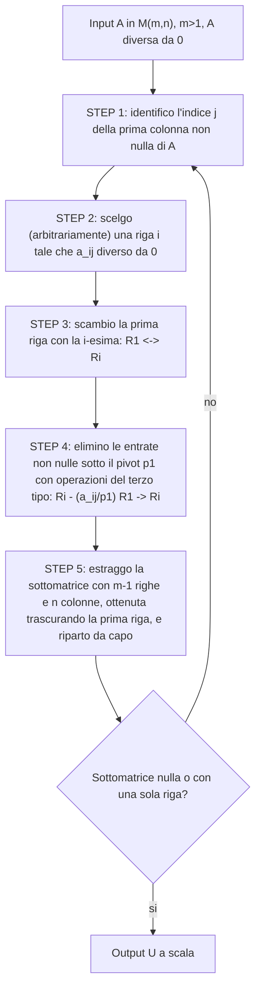

[[00_GAL_Eliminazione_di_Gauss|⬅️ Torna a Eliminazione di Gauss]]

# Metodo di Eliminazione di Gauss

**Casi base**: se $A = 0$ allora $U = 0$; se $A \in M_{\mathbb{K}}(1,n)$ allora $U = A$. Possiamo supporre $m > 1$ e $A \neq 0$.

Osservazioni:

- l'algoritmo termina sempre in un numero finito di passi;
- nell'algoritmo ci sono due scelte arbitrarie (la riga $i$ allo STEP 2), per cui l'**output non è univocamente determinato**.

![[2026-10-07-MEG-step2-scelta-riga.png]]
![[2026-10-07-MEG-step3-scambio-righe.png]]
![[2026-10-07-MEG-step4-eliminazione.png]]
![[2026-10-07-MEG-step4-forma-finale.png]]

## Esempio

$$
A = \begin{bmatrix} 0 & 0 & 2 & 0 \\ 1 & 0 & 1 & -1 \\ 2 & 0 & 1 & 4 \end{bmatrix}, \qquad m = 3 > 1,\ A \neq 0
$$

- **STEP 1**: la prima colonna non nulla è la prima.
- **STEP 2**: scelgo la seconda riga (oppure la terza).
- **STEP 3**: sposto la seconda riga in prima posizione, $\mathrm{I} \leftrightarrow \mathrm{II}$:

$$
\begin{bmatrix} 1 & 0 & 1 & -1 \\ 0 & 0 & 2 & 0 \\ 2 & 0 & 1 & 4 \end{bmatrix} \quad (p_1 = 1)
$$

- **STEP 4**: $\mathrm{III} - \frac{2}{1}\mathrm{I} \to \mathrm{III}$:

$$
\begin{bmatrix} 1 & 0 & 1 & -1 \\ 0 & 0 & 2 & 0 \\ 0 & 0 & -1 & 6 \end{bmatrix}
$$

- **STEP 5**: estraggo le ultime due righe e ripeto sulla sottomatrice $\begin{bmatrix} 0 & 0 & 2 & 0 \\ 0 & 0 & -1 & 6 \end{bmatrix}$.
  - STEP 1–2: la prima colonna non nulla è la terza; scelgo la terza riga.
  - STEP 3: scambio $\mathrm{II} \leftrightarrow \mathrm{III}$, ottenendo $p_2 = -1$:

$$
\begin{bmatrix} 1 & 0 & 1 & -1 \\ 0 & 0 & -1 & 6 \\ 0 & 0 & 2 & 0 \end{bmatrix}
$$

  - STEP 4: $\mathrm{III} - \frac{2}{-1}\mathrm{II} \to \mathrm{III}$:

$$
U = \begin{bmatrix} 1 & 0 & 1 & -1 \\ 0 & 0 & -1 & 6 \\ 0 & 0 & 0 & 12 \end{bmatrix}
$$

![[2026-10-07-MEG-esempio-completo.png]]

---
Precedente: [[Operazioni Elementari sulle Righe]] · Successivo: [[Pivot e Matrice a Scala]]
