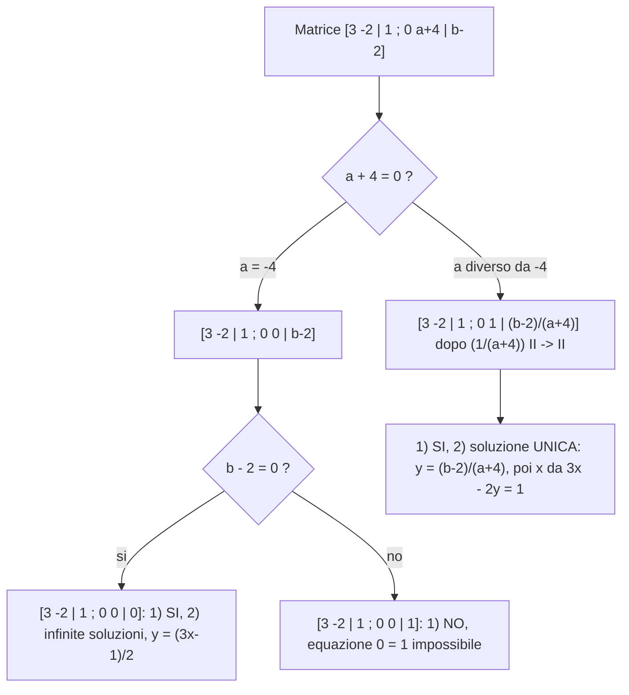

[[00_GAL_Sistemi_Lineari|⬅️ Torna a Sistemi Lineari]]

# Risoluzione di un Sistema con il MEG

Due domande:

1. il sistema è risolubile?
2. se la risposta a 1 è sì, quante e quali sono le soluzioni?

### Esempio con parametri

$$
\begin{cases} 3x - 2y = 1 \\ 6x + ay = b \end{cases}
\qquad x,y \text{ incognite};\ a,b \in \mathbb{R} \text{ parametri}
$$

Rappresentazione del III tipo:

$$
\left[\begin{array}{cc|c} 3 & -2 & 1 \\ 6 & a & b \end{array}\right] \in M_{\mathbb{R}}(2,2+1) = M_{\mathbb{R}}(2,3)
$$

**Quale metodo risolutivo?** confronto, sostituzione, **riduzione** (scelto: la riduzione, che corrisponde al MEG). Il passo $\mathrm{II} - 2\mathrm{I} \to \mathrm{II}$ sul sistema e sulla matrice dà

$$
\begin{cases} 3x - 2y = 1 \\ (a+4)y = b - 2 \end{cases}
\qquad\longleftrightarrow\qquad
\left[\begin{array}{cc|c} 3 & -2 & 1 \\ 0 & a+4 & b-2 \end{array}\right]
$$

**Caso $a = -4$.**

- Se $b - 2 = 0$: la matrice è $\left[\begin{array}{cc|c} 3 & -2 & 1 \\ 0 & 0 & 0 \end{array}\right]$. (1) **Sì**, è risolubile; (2) **infinite soluzioni**: resta l'equazione $3x - 2y = 1$ (la riga $0=0$ si elimina), cioè $2y = 3x - 1$, $y = \frac12(3x-1)$.
- Se $b - 2 \neq 0$: con $\frac{1}{b-2}\mathrm{II}\to\mathrm{II}$ si ottiene $\left[\begin{array}{cc|c} 3 & -2 & 1 \\ 0 & 0 & 1 \end{array}\right]$. (1) **No**: l'equazione $0 = 1$ è **impossibile**.

**Caso $a \neq -4$.** Con $\frac{1}{a+4}\mathrm{II}\to\mathrm{II}$ si ottiene $\left[\begin{array}{cc|c} 3 & -2 & 1 \\ 0 & 1 & \tfrac{b-2}{a+4} \end{array}\right]$. (1) **Sì**; (2) soluzione **unica**: $y = \frac{b-2}{a+4}$ e $3x - 2\frac{b-2}{a+4} = 1$.

### Riepilogo

**Domanda 1 — il sistema è risolubile?**

- **Sì**, soluzione **unica**: un pivot nelle prime due colonne.
$$
\left[\begin{array}{cc|c} 3 & -2 & 1 \\ 0 & 1 & \tfrac{b-2}{a+4} \end{array}\right]
$$
- **Sì**, soluzioni **infinite**: un solo pivot.
$$
\left[\begin{array}{cc|c} 3 & -2 & 1 \\ 0 & 0 & 0 \end{array}\right]
$$
- **No**, nessuna soluzione ($\emptyset$): il secondo pivot cade nella colonna dei termini noti.
$$
\left[\begin{array}{cc|c} 3 & -2 & 1 \\ 0 & 0 & 1 \end{array}\right]
$$

> **Figura (disegno senza immagine disponibile):**
>
> Tre matrici a scala con una linea rossa a gradini e pallini blu sui pivot. (1) *Sol. unica*: pivot nelle prime due colonne (una per riga), colonna dei termini noti libera. (2) *Sol. infinite*: un solo pivot nella prima riga, seconda riga tutta nulla. (3) *$\emptyset$*: primo pivot nella prima colonna, secondo pivot nella colonna dei termini noti (a destra della barra verticale).

---
Precedente: [[Rappresentazioni Matriciali di un Sistema]] · Successivo: [[Teorema di Rouché-Capelli]]
