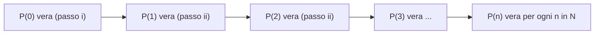

[[00_A1_Fondamenti|⬅️ Torna a Fondamenti]]

# Dimostrazione per Induzione e Bernoulli

Si usa per dimostrare la verità di una «implicazione universale» della forma $\forall n \in \mathbb{N}\ \ P(n)$ vera. Si articola in 2 passi:

- **(i)** si dimostra che $P(0)$ è vera ($n = 0$);
- **(ii)** si dimostra che **se** è vera $P(n)$ **allora** è vera anche $P(n+1)$, cioè che è vera $\forall n \in \mathbb{N}\ \ P(n) \Rightarrow P(n+1)$.

$P(n)$ prende il nome di **ipotesi di induzione**. Informalmente: $P(0)$ vera (i) $\Rightarrow$ $P(1)$ vera (ii) $\Rightarrow$ $P(2)$ vera (ii) $\Rightarrow \dots$

**Teorema (disuguaglianza di Bernoulli)**: $\forall n \in \mathbb{N}$, $\forall x \in \mathbb{R}$ con $x > -1$:

$$
(1+x)^n \ge 1 + nx
$$

*Dim.* Per induzione. $P(n)$: $\forall x \in \mathbb{R}$, $x > -1$: $(1+x)^n \ge 1 + nx$.

**(i)** $P(0)$: $(1+x)^0 \ge 1 + 0\cdot x$, cioè $1 \ge 1$, quindi $P(0)$ è vera.

**(ii)** Verifichiamo che $P(n) \Rightarrow P(n+1)$ è vera $\forall n \in \mathbb{N}$. $P(n+1)$: $(1+x)^{n+1} \ge 1 + (n+1)x$. Assumendo $P(n)$ vera, partiamo da $(1+x)^{n+1} = (1+x)^n(1+x)$, dove $1+x > 0$ e $(1+x)^n \ge 1 + nx$ per ipotesi di induzione $P(n)$. Quindi

$$
(1+x)^{n+1} = (1+x)^n(1+x) \ge (1+nx)(1+x) = 1 + nx + x + nx^2 = \big(1 + (n+1)x\big) + \underbrace{nx^2}_{\ge 0} \ge 1 + (n+1)x
$$

cioè $P(n+1)$ è vera. Pertanto $P(n) \Rightarrow P(n+1)$ è vera $\forall n \in \mathbb{N}$, e per induzione $P(n)$ è vera $\forall n \in \mathbb{N}$. $\square$

---
Precedente: [[Dimostrazione per Assurdo]]
