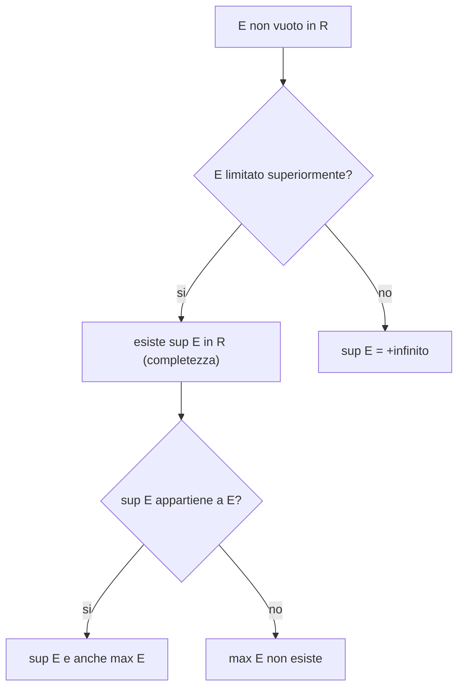

[[00_A1_Numeri_Reali|⬅️ Torna a Numeri Reali]]

# Assioma di Completezza

> **Proprietà dell'estremo superiore (completezza):** ogni sottoinsieme non vuoto di $\mathbb{R}$ limitato superiormente ammette estremo superiore in $\mathbb{R}$.

$\mathbb{R}$ è l'**unico** campo ordinato che soddisfa questa proprietà (a meno di isomorfismi); $\mathbb{Q}$ **non** la soddisfa (esempio precedente). Analogamente, ogni insieme non vuoto limitato inferiormente ha estremo inferiore.

Se $E$ non è limitato superiormente si pone $\sup E=+\infty$; se non è limitato inferiormente $\inf E=-\infty$. Si lavora così nei **reali estesi** $\overline{\mathbb{R}}=\mathbb{R}\cup\{\pm\infty\}$.

### Caratterizzazione dell'estremo superiore
$$x_0=\sup E \iff \begin{cases} (1)\ x\le x_0 \ \ \forall x\in E \quad(\text{è maggiorante})\\ (2)\ \forall k<x_0\ \ \exists x\in E:\ k<x\le x_0 \quad(\text{il minimo})\end{cases}$$

Analogamente per l'estremo inferiore:
$$x_0=\inf E \iff \begin{cases} (1)\ x\ge x_0 \ \ \forall x\in E\\ (2)\ \forall k>x_0\ \ \exists x\in E:\ x_0\le x<k \end{cases}$$

---
Precedente: [[Maggioranti, Minoranti ed Estremi]] · Successivo: [[Valore Assoluto]]
