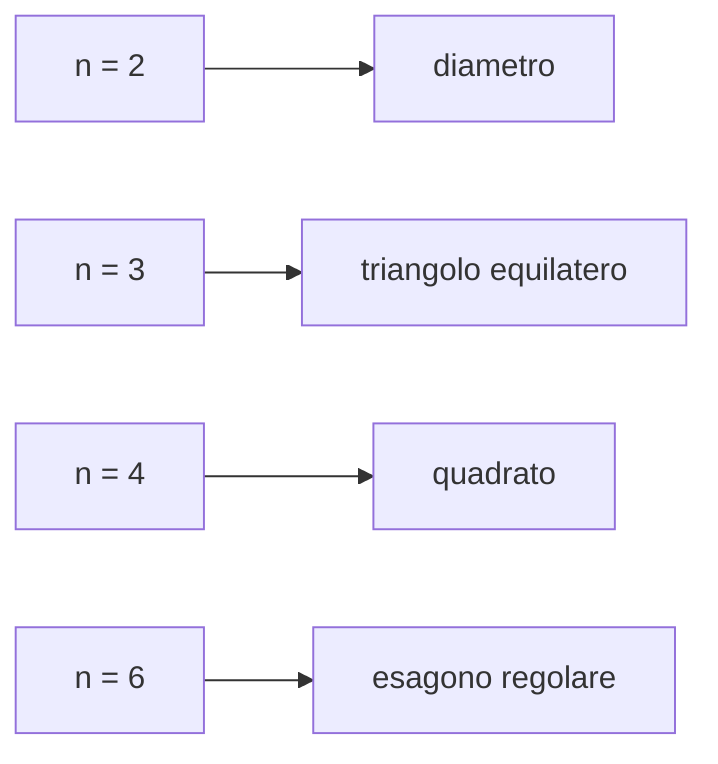

[[00_A1_Numeri_Complessi|⬅️ Torna a Numeri Complessi]]

# Radici n-esime Complesse

**Definizione.** Sia $w\in\mathbb{C}$, $n\in\mathbb{N}$, $n\ge1$. Ogni $z\in\mathbb{C}$ tale che $z^n=w$ si chiama **radice $n$-esima complessa** di $w$.

Esempio: $\sqrt[2]{4}=2$ in $\mathbb{R}$, ma $\sqrt[2]{4}=\pm2$ in $\mathbb{C}$ (cfr. [[2026-09-16 A1 Lezione 2|radice reale]]).

> **Teorema (radici $n$-esime complesse).** Sia $w\in\mathbb{C}$, $w\neq0$, $n\ge1$. Esistono **esattamente $n$ radici $n$-esime complesse distinte** di $w$. Se $w=re^{i\varphi}=r(\cos\varphi+i\sin\varphi)$, esse sono
> $$z_k=r^{1/n}(\cos\theta_k+i\sin\theta_k)=r^{1/n}e^{i\theta_k},\qquad \theta_k=\frac\varphi n+\frac{2k\pi}n,\quad k=0,\dots,n-1.$$

**Dimostrazione.** Cerchiamo $z=\rho e^{i\theta}$ con $z^n=w$. Per de Moivre $z^n=\rho^ne^{in\theta}=re^{i\varphi}$, cioè
$$\begin{cases}\rho^n=r\\ n\theta=\varphi+2h\pi\quad h\in\mathbb{Z}\end{cases}\Rightarrow\begin{cases}\rho=r^{1/n}\ \ (\text{radice reale})\\ \theta=\dfrac\varphi n+\dfrac{2h\pi}n\quad h\in\mathbb{Z}\end{cases}\tag{$*$}$$
Queste sono **tutte e sole** le radici, ma **non distinte**. Si scrive $h=qn+k$ con $q$ quoziente e $k$ resto della divisione di $h$ per $n$, quindi $q\in\mathbb{Z}$, $k\in\{0,1,\dots,n-1\}$:
$$\frac{2\pi h}{n}=\frac{2\pi(qn+k)}n=2\pi q+\frac{2\pi k}n.$$
Due interi $h_1,h_2$ con lo stesso resto $k$ individuano in $(*)$ lo stesso numero complesso $z_k$, perché gli argomenti differiscono per un multiplo intero di $2\pi$. Le radici distinte sono dunque tante quanti i possibili resti della divisione per $n$, cioè $n$: $z_k=r^{1/n}e^{i\theta_k}$ con $\theta_k=\frac\varphi n+\frac{2k\pi}n$, $k=0,\dots,n-1$. $\square$

### Osservazioni geometriche
- Tutte le radici hanno lo stesso modulo: $|z_0|=\dots=|z_{n-1}|=r^{1/n}$; giacciono sulla **circonferenza** di centro $O$ e raggio $r^{1/n}$.
- Due radici successive hanno argomenti che differiscono di $\frac{2\pi}n$: si dispongono ai vertici di un **poligono regolare di $n$ lati** inscritto in quella circonferenza.

![[radici-quadrate-diametro.png]]
![[radici-cubiche-triangolo-equilatero.png]]

- Per $n\ge2$ le radici $n$-esime complesse di $w\neq0$ formano un insieme di $n$ valori: la radice complessa $n$-esima **non è una funzione** da $\mathbb{C}$ in $\mathbb{C}$.

### Esempio: radici seste di $w=-1$
$z^6=-1$, $|w|=1$, $\arg w=\pi$ (scrivere $w=-1e^{i0}$ è vero ma non serve).
$$z_k=1^{1/6}\,e^{i\left(\frac\pi6+\frac{2k\pi}6\right)}=e^{i\left(\frac\pi6+\frac{k\pi}3\right)},\quad k=0,\dots,5.$$

| $k$ | $z_k$ | forma algebrica |
|---|---|---|
| 0 | $e^{i\pi/6}$ | $\tfrac{\sqrt3}2+\tfrac i2$ |
| 1 | $e^{i\pi/2}$ | $i$ |
| 2 | $e^{i5\pi/6}$ | $-\tfrac{\sqrt3}2+\tfrac i2$ |
| 3 | $e^{i7\pi/6}$ | $-\tfrac{\sqrt3}2-\tfrac i2$ |
| 4 | $e^{i3\pi/2}$ | $-i$ |
| 5 | $e^{i11\pi/6}$ | $\tfrac{\sqrt3}2-\tfrac i2$ |

![[radici-seste-di-meno-uno-punto-w.png]]
![[radici-seste-di-meno-uno-esagono.png]]

---
Precedente: [[Formule di de Moivre]] · Successivo: [[Equazioni di Secondo Grado e Teorema Fondamentale dell'Algebra]]
