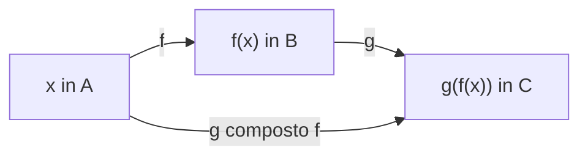

[[00_A1_Funzioni|⬅️ Torna a Funzioni]]

# Composizione di Funzioni

**Definizione.** Date $f:A\to B$ e $g:B\to C$, la **funzione composta** $g\circ f:A\to C$ è definita da
$$g\circ f(x)=g(f(x))\qquad\forall x\in A.$$

![[composizione-di-funzioni-diagramma.png]]

**Esempio.** $h(x)=\log(x^2+1)$, $x\in\mathbb{R}$: $h=g\circ f$ con $f(x)=x^2+1$ ($x\in\mathbb{R}$) e $g(t)=\log t$ ($t\in(0,\infty)$).

**Osservazioni.**
- Si possono comporre 3 o più funzioni; vale sempre $(h\circ g)\circ f=h\circ(g\circ f)$ (**associatività**).
- In generale $f\circ g\neq g\circ f$. Esempio: $f(x)=x+1$, $g(x)=x^2$: $g\circ f(x)=(x+1)^2=x^2+2x+1$, mentre $f\circ g(x)=x^2+1$.
- **Non tutte** le funzioni si possono comporre: con $g(t)=\log t$ e $f(x)=-x^2$, $g\circ f(x)=\log(-x^2)$ non è definita per alcun $x\in\mathbb{R}$.

### Composizione con dominio ristretto
Se $f:A\to B$ e $g:D\subseteq B\to C$, allora
$$g\circ f:\mathcal{D}'\subseteq A\to C,\qquad g\circ f(x)=g(f(x))\ \ \forall x\in\mathcal{D}',\qquad \mathcal{D}'=\{x\in A:f(x)\in D\}\subseteq A.$$

![[composizione-dominio-ristretto.png]]

**Esempi.**
- $f(x)=1-x^2$, $g(t)=\log t$: $g\circ f(x)=\log(1-x^2)$, con dominio $\{x:1-x^2>0\}=(-1,1)$.
- $f(x)=\sqrt x$, $g(t)=t^2$: $g\circ f(x)=(\sqrt x)^2=x$, con dominio $\{x\in[0,\infty):\sqrt x\in\mathbb{R}\}=[0,\infty)$.

---
Precedente: [[Funzioni Periodiche]] · Successivo: [[Iniettività e Suriettività]]
