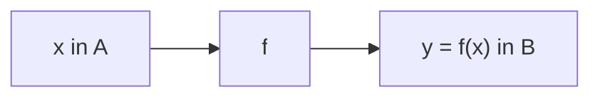

[[00_A1_Funzioni|⬅️ Torna a Funzioni]]

# Generalità sulle Funzioni

**Definizione.** Dati due insiemi $A,B$, una **funzione** $f:A\to B$ è una legge che associa a ciascun $x\in A$ **uno e un solo** elemento $y\in B$. Si scrive $y=f(x)$.

- $A$ è il **dominio** di $f$ (talvolta indicato $\mathcal{D}(f)=A$);
- $B$ è il **codominio** di $f$;
- $y=f(x)\in B$ è l'**immagine** di $x$ tramite $f$.

**Definizione.** L'**immagine di $A$ tramite $f$** (o immagine di $f$) è
$$\operatorname{Im}f=f(A)=\{y\in B:\ \exists x\in A\ \text{tale che } f(x)=y\}\subseteq B,$$
gli elementi di $B$ che «provengono» da qualche elemento di $A$ tramite $f$. In generale $\operatorname{Im}f\subseteq B$, ma può essere $\operatorname{Im}f\subsetneq B$.

**Esempio.** $f:\mathbb{R}\to\mathbb{R}$, $f(x)=x^2$: l'immagine di $\pm2$ è $4$; dominio $\mathbb{R}$, codominio $\mathbb{R}$, $\operatorname{Im}f=f(\mathbb{R})=[0,\infty)\subsetneq\mathbb{R}$.

**Osservazione.** Le funzioni
- $f:\mathbb{R}\to\mathbb{R}$, $f(x)=x^2$
- $g:\mathbb{R}\to[0,\infty)$, $g(x)=x^2$
- $h:[0,\infty)\to[0,\infty)$, $h(x)=x^2$
- $u:[0,\infty)\to\mathbb{R}$, $u(x)=x^2$

sono pensate come funzioni **diverse**: una funzione è assegnata dichiarando dominio $A$, codominio $B$ e la legge $y=f(x)\ \forall x\in A$.

**Definizione ([[2026-09-17 GAL Lezione 1|suriettività]]).** $f:A\to B$ si dice **suriettiva** se $\operatorname{Im}f=B$. Nell'esempio, $g$ e $h$ sono suriettive; $f$ e $u$ no.

### Grafico
Il **grafico** di $f:A\to B$ è il sottoinsieme di $A\times B$ (cfr. [[2026-09-16 GAL Lezione 0|prodotto cartesiano]])
$$\mathcal{G}(f)=\{(x,y)\in A\times B:\ x\in A,\ y=f(x)\}=\{(x,f(x))\in A\times B:\ x\in A\}.$$

Se $A,B\subseteq\mathbb{R}$, allora $\mathcal{G}(f)\subset\mathbb{R}^2$.

![[grafico-di-funzione-dominio-immagine.png]]

**Lettura geometrica.**
- Per ogni $x_0\in A$ esiste un unico $y_0\in B$ immagine di $x_0$: ogni **retta verticale** $x=x_0$ interseca il grafico **al più una volta** (0 volte se $x_0\notin A$, 1 volta se $x_0\in A$, con ordinata $y_0=f(x_0)$).
- $A=\mathcal{D}(f)$ è la **proiezione** di $\mathcal{G}(f)$ sull'asse delle ascisse (in direzione parallela all'asse $y$).
- $y_0\in\operatorname{Im}f$ se e solo se esiste $(x_0,y_0)\in\mathcal{G}(f)$, cioè se e solo se la **retta orizzontale** $y=y_0$ interseca $\mathcal{G}(f)$ in almeno un punto.
- $\operatorname{Im}f$ è la proiezione di $\mathcal{G}(f)$ sull'asse delle ordinate (in direzione parallela all'asse $x$).

In questo corso ci si occupa sostanzialmente di funzioni $f:A\subseteq\mathbb{R}\to\mathbb{R}$. Quando il codominio non è dichiarato esplicitamente, è sottinteso che sia $\mathbb{R}$.

---
Successivo: [[Funzioni Limitate ed Estremi]]
