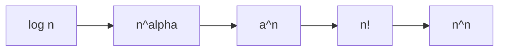

[[00_A1_Successioni_e_Limiti|⬅️ Torna a Successioni e Limiti]]

# Gerarchia degli Infiniti

> **Teorema (gerarchia degli infiniti).**
> 1. $\displaystyle\lim_{n\to\infty}\frac{\log_an}{n^\alpha}=0\qquad\forall\alpha>0,\ a>1$
> 2. $\displaystyle\lim_{n\to\infty}\frac{n^\alpha}{a^n}=0\qquad\forall\alpha>0,\ a>1$
> 3. $\displaystyle\lim_{n\to\infty}\frac{a^n}{n!}=0\qquad\forall a>1$
> 4. $\displaystyle\lim_{n\to\infty}\frac{n!}{n^n}=0$

Quindi, per $n\to\infty$, a ranghi crescenti di «velocità»:
$$\log n\ \ll\ n^\alpha\ \ll\ a^n\ \ll\ n!\ \ll\ n^n.$$

---
Precedente: [[Teoremi del Confronto]]
