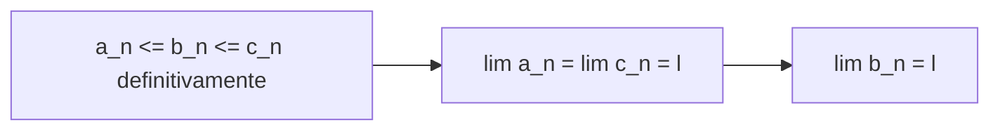

[[00_A1_Successioni_e_Limiti|⬅️ Torna a Successioni e Limiti]]

# Teoremi del Confronto

> **Teorema (confronto per successioni convergenti, o dei due carabinieri).** Date tre successioni $a_n,b_n,c_n$ tali che $a_n\le b_n\le c_n$ **definitivamente** in $n\in\mathbb{N}$ e tali che $\exists\lim a_n=\lim c_n=\ell\in\mathbb{R}$. Allora $\exists\lim b_n=\ell\in\mathbb{R}$.

**Dimostrazione.** Per definizione di limite $\forall\varepsilon>0$:
- $\exists N_1$: $\forall n\ge N_1$ $\ \ell-\varepsilon<a_n(<\ell+\varepsilon)$ **(4)**;
- $\exists N_2$: $\forall n\ge N_2$ $\ \ c_n<\ell+\varepsilon\,(>\ell-\varepsilon)$ **(3)**;
- $\exists N_3$: $\forall n\ge N_3$ $\ \ a_n\le b_n\le c_n$ **(1), (2)**.

Allora $\forall n\ge N=\max\{N_1,N_2,N_3\}$:
$$\ell-\varepsilon<a_n\le b_n\le c_n<\ell+\varepsilon,$$
cioè $\forall\varepsilon>0\ \exists N$: $\forall n\ge N$ $\ell-\varepsilon<b_n<\ell+\varepsilon$, quindi $\lim b_n=\ell$. $\square$

> **Teorema (confronto per successioni divergenti).** Date due successioni $a_n,b_n$ tali che $a_n\le b_n$ definitivamente in $n\in\mathbb{N}$:
> 1. se $\lim a_n=+\infty$ allora $\exists\lim b_n=+\infty$;
> 2. se $\lim b_n=-\infty$ allora $\exists\lim a_n=-\infty$.

**Dimostrazione** (solo 1; la 2 è analoga). Per definizione di limite $\forall M>0\ \exists N_1$: $\forall n\ge N_1$ $a_n>M$ **(1)**; inoltre $\exists N_2$: $\forall n\ge N_2$ $a_n\le b_n$ **(2)**. Quindi $\forall M>0\ \exists N=\max\{N_1,N_2\}$ tale che $\forall n\ge N$: $M<a_n\le b_n$. Cioè $\lim b_n=+\infty$. $\square$

### Corollari
1. Se $|b_n|\le c_n$ definitivamente in $n\in\mathbb{N}$ e $\lim c_n=0$, allora $\exists\lim b_n=0$ (equivalentemente $\lim|b_n|=0$).
2. Se $c_n$ è **limitata** e $\lim b_n=0$, allora $\lim c_nb_n=0$ (anche se $\nexists\lim c_n$).

**Esempio.** $\displaystyle\lim_{n\to\infty}\frac{\sin n}n$: sia $b_n=\frac1n$, $c_n=\sin n$. Allora $\lim b_n=0$ e $|c_n|=|\sin n|\le1\ \forall n$. Per il corollario precedente
$$\lim_{n\to\infty}\frac{\sin n}n=\lim b_nc_n=0\quad\text{anche se }\nexists\lim\sin n.$$

---
Precedente: [[Algebra dei Limiti]] · Successivo: [[Gerarchia degli Infiniti]]
