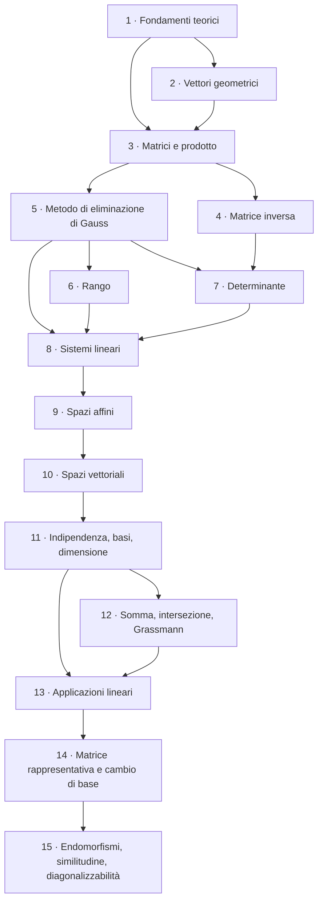

# Geometria e Algebra Lineare — MOC e guida allo studio

Mappa del corso e percorso di studio in un unico punto. I **macroargomenti** seguono la dipendenza logica tra i temi (non solo l'ordine cronologico); per ognuno trovi cosa stai per affrontare, i contenuti fondamentali, un checkpoint e l'elenco delle note con la lezione in cui sono state trattate. In fondo trovi la linea cronologica (con gli indici delle lezioni) e la mappa delle cartelle.

Salto rapido: [[#Dashboard]] · [[#Flowchart della progressione]] · [[#Linea cronologica]] · [[#Struttura delle cartelle]] · [[10_Organizzazione_del_Corso]]

> [!tip] Come usarlo
> - Spunta `- [x]` quando hai **studiato e capito** la nota: dashboard e barre di progresso si aggiornano da sole.
> - Tra parentesi, in corsivo, la lezione in cui la nota è stata trattata *(L5)*; sotto ogni titolo l'intervallo di lezioni del blocco.
> - Nel flowchart, per segnare un blocco come fatto togli i `%%` dalla riga `class ... fatto` e aggiungi gli id dei blocchi.
> - La cronologia completa delle lezioni e la mappa delle cartelle sono in fondo alla nota.
> - Le note segnate *(esercizio)* sono esercizi svolti: provali prima da solo, poi confronta.

> [!info] Stato del corso
> Ultima lezione integrata: **L23** (19-11-2026). Nel vault non esistono le lezioni 5, 8, 12, 14, 18 e 21 (nessun PDF: la numerazione delle slide prosegue senza interruzione; L20 termina a 174 e L22 inizia a 175). La lacuna sulla costruzione della matrice del paradigma (slide 174) è stata colmata a L22; il corso è ora su **matrice rappresentativa, cambio di base, similitudine e diagonalizzabilità**.

## Dashboard

```dataviewjs
const rows = [], idx = new Map();
for (const t of dv.current().file.tasks) {
  const k = (t.section && t.section.subpath) ? t.section.subpath : "—";
  if (!idx.has(k)) { idx.set(k, rows.length); rows.push({k, d: 0, n: 0}); }
  const r = rows[idx.get(k)]; r.n++; if (t.completed) r.d++;
}
const tot = rows.reduce((a, r) => a + r.n, 0), done = rows.reduce((a, r) => a + r.d, 0);
dv.table(["Blocco", "Fatte", "Progresso"],
  rows.map(r => [r.k, `${r.d} / ${r.n}`, `<progress value="${r.d}" max="${r.n}" style="width:140px"></progress>`]));
dv.paragraph(`**Totale:** ${done} / ${tot} voci (${tot ? Math.round(100 * done / tot) : 0}%) <progress value="${done}" max="${tot}" style="width:240px"></progress>`);
```

### Prossime note da studiare

```dataviewjs
const next = dv.current().file.tasks
  .where(t => !t.completed && t.outlinks.length > 0 && !(t.section.subpath ?? "").startsWith("Dimostrazioni"))
  .slice(0, 8);
dv.taskList(next, false);
```

## Flowchart della progressione



---

## 1 · Fondamenti teorici

*Lezioni 0 → 3 (16-09 → 30-09)*

> [!abstract] Stai per affrontare
> Il linguaggio di base: prodotto cartesiano, relazioni (in particolare di equivalenza e d'ordine) e funzioni. Servono per capire cosa sono i vettori geometrici (classi di equivalenza) e cosa significa "invertibile".

> [!important] Da imparare
> - Prodotto cartesiano e relazione binaria; proprietà riflessiva, simmetrica, transitiva.
> - **Relazione di equivalenza**, classi di equivalenza, partizione.
> - Relazione d'ordine.
> - Funzioni: **iniettiva, suriettiva, biettiva**; come si nega un'implicazione.
> - Il campo $\mathbb{F}_2=\{0,1\}$ con le sue operazioni.

> [!question] Checkpoint
> Sai dire se una relazione data è di equivalenza e descriverne le classi? Sai scrivere la negazione di "$f$ è iniettiva"?

- [x] [[11_Prodotto_Cartesiano]] — prodotto cartesiano *(L0)*
- [x] [[19_Prodotto_Cartesiano_di_Piu_Insiemi]] — più insiemi *(L1)*
- [x] [[12_Relazione_Binaria]] — relazione binaria *(L0)*
- [x] [[13_Proprieta_Riflessiva_Simmetrica_Transitiva]] — proprietà *(L0)* ✅ 2026-11-17
- [x] [[14_Relazione_di_Equivalenza]] — equivalenza e classi *(L0)* ✅ 2026-11-17
- [x] [[15_Relazione_di_Ordine]] — ordine *(L1)* ✅ 2026-11-17
- [x] [[16_Funzioni]] — funzioni *(L1)* ✅ 2026-11-17
- [x] [[17_Excursus_Logico_Negazione_Implicazione]] — negazione di un'implicazione *(L1)* ✅ 2026-11-17
- [x] [[18_Iniettivita_Suriettivita_Biettivita]] — iniettiva, suriettiva, biettiva *(L1)* ✅ 2026-11-17
- [x] [[31_Il_Campo_F2]] — $\mathbb{F}_2$ *(L3)* ✅ 2026-11-17

---

## 2 · Vettori geometrici

*Lezione 2 (17-09)*

> [!abstract] Stai per affrontare
> Il modello geometrico intuitivo da cui nasce l'idea di spazio vettoriale: frecce nel piano/spazio, somma e moltiplicazione per scalare, prodotto interno ed esterno.

> [!important] Da imparare
> - Segmenti orientati, **equipollenza**, vettori come classi di equivalenza.
> - Somma di vettori e prodotto per scalare: proprietà.
> - Sistema di riferimento e **coordinate**.
> - **Prodotto interno** (ortogonalità) e **prodotto esterno** in coordinate.
> - Determinanti $2\times2$ e $3\times3$ (area/volume).

> [!question] Checkpoint
> Sai calcolare angolo tra due vettori, verificare ortogonalità e area di un parallelogramma?

- [x] [[20_Segmenti_Orientati_ed_Equipollenza]] — equipollenza *(L2)* ✅ 2026-11-17
- [x] [[21_Vettori_come_Classi_di_Equivalenza]] — vettori come classi *(L2)* ✅ 2026-11-17
- [x] [[22_Operazioni_tra_Vettori]] — operazioni *(L2)* ✅ 2026-11-17
- [x] [[23_Sistemi_di_Riferimento_e_Coordinate]] — coordinate *(L2)* ✅ 2026-11-17
- [x] [[24_Proprieta_delle_Operazioni_tra_Vettori]] — proprietà *(L2)* ✅ 2026-11-17
- [x] [[25_Prodotto_Interno_e_Ortogonalita]] — prodotto interno *(L2)*
- [x] [[26_Prodotto_Interno_in_Coordinate]] — in coordinate *(L2)*
- [x] [[27_Prodotto_Esterno]] — prodotto esterno *(L2)*
- [x] [[28_Determinanti_2x2_e_3x3]] — determinanti $2\times2$, $3\times3$ *(L2)* ✅ 2026-11-17

---

## 3 · Matrici e prodotto matriciale

*Lezioni 3 → 4 (30-09 → 01-10)*

> [!abstract] Stai per affrontare
> Le matrici come oggetti algebrici e come modo di **codificare funzioni**. Il punto chiave: il prodotto righe per colonne è costruito perché corrisponda alla **composizione**.

> [!important] Da imparare
> - Definizione di matrice, casi speciali, uguaglianza.
> - Somma, opposta, prodotto per scalare.
> - **Prodotto righe per colonne** e compatibilità delle dimensioni.
> - Prodotto = composizione di funzioni.
> - Proprietà (associativa, distributiva) e **non commutatività**.
> - Matrice identità e matrici diagonali.

> [!question] Checkpoint
> Sai moltiplicare due matrici a mano e spiegare perché $AB\ne BA$ in generale?

- [x] [[30_Matrici_come_Rappresentazione_di_Funzioni]] — matrici e funzioni *(L3)* ✅ 2026-11-17
- [x] [[32_Definizione_di_Matrice]] — definizione *(L3)* ✅ 2026-11-17
- [x] [[33_Matrici_Casi_Speciali]] — casi speciali *(L3)* ✅ 2026-11-17
- [x] [[34_Confronto_e_Uguaglianza_tra_Matrici]] — uguaglianza *(L3)* ✅ 2026-11-17
- [x] [[35_Somma_tra_Matrici]] — somma *(L3)* ✅ 2026-11-17
- [x] [[40_Opposto_di_una_Matrice]] — opposta *(L4)* ✅ 2026-11-17
- [x] [[36_Prodotto_di_una_Matrice_per_uno_Scalare]] — per uno scalare *(L3)* ✅ 2026-11-17
- [x] [[37_Efficienza_Computazionale]] — efficienza *(L3)* ✅ 2026-11-17
- [x] [[41_Prodotto_Matriciale_Righe_per_Colonne]] — prodotto righe per colonne *(L4)* ✅ 2026-11-17
- [x] [[42_Prodotto_e_Composizione_di_Funzioni]] — prodotto e composizione *(L4)* ✅ 2026-11-17
- [x] [[44_Proprieta_del_Prodotto_Matriciale]] — proprietà *(L4)* ✅ 2026-11-17
- [x] [[45_Matrice_Identita_e_Matrici_Diagonali]] — identità e diagonali *(L4)* ✅ 2026-11-17
- [x] [[43_PageRank_e_Matrice_di_Google]] — applicazione: PageRank *(L4)* ✅ 2026-11-17

---

## 4 · Matrice inversa

*Lezioni 6 → 7 (07-10 → 08-10)*

> [!abstract] Stai per affrontare
> L'analogo matriciale del reciproco: quando una matrice ha un'inversa e quali proprietà ha.

> [!important] Da imparare
> - Definizione di matrice **invertibile**; l'inversa è **unica** e bilatera.
> - Non commutatività del prodotto e conseguenze sull'inversa.
> - Condizioni di esistenza (si completeranno con rango e determinante).

> [!question] Checkpoint
> Se $AB=I$, perché anche $BA=I$? E perché $(AB)^{-1}=B^{-1}A^{-1}$?

- [x] [[60_Matrice_Invertibile]] — definizione *(L6)* ✅ 2026-11-17
- [x] [[61_Unicita_e_Bilateralita_dell_Inversa]] — unicità *(L6)* ✅ 2026-11-17
- [x] [[62_Non_Commutativita_del_Prodotto_Matriciale]] — non commutatività *(L6)* ✅ 2026-11-17
- [x] [[72_Esistenza_della_Matrice_Inversa]] — esistenza *(L7)* ✅ 2026-11-17

---

## 5 · Metodo di eliminazione di Gauss (MEG)

*Lezioni 6 → 7 (07-10 → 08-10)*

> [!abstract] Stai per affrontare
> L'algoritmo centrale del corso: trasformare una matrice in forma a scala con operazioni elementari. Serve per rango, determinante, sistemi, inversa e basi.

> [!important] Da imparare
> - Le tre **operazioni elementari** sulle righe.
> - **Pivot** e matrice a scala.
> - **Reversibilità** delle operazioni.
> - Ogni operazione elementare è un prodotto per una matrice elementare.

> [!question] Checkpoint
> Sai ridurre a scala una matrice $4\times5$ senza errori di segno e individuare i pivot?

- [x] [[67_Operazioni_Elementari_sulle_Righe]] — operazioni elementari *(L6)* ✅ 2026-11-17
- [x] [[68_Metodo_di_Eliminazione_di_Gauss]] — MEG *(L6)* ✅ 2026-11-17
- [x] [[69_Pivot_e_Matrice_a_Scala]] — pivot e scala *(L6)* ✅ 2026-11-17
- [x] [[70_Reversibilita_del_MEG]] — reversibilità *(L7)* ✅ 2026-11-17
- [x] [[71_Codifica_del_MEG_con_il_Prodotto_Matriciale]] — MEG come prodotto *(L7)* ✅ 2026-11-17

---

## 6 · Rango

*Lezioni 6 → 16 (07-10 → 04-11)*

> [!abstract] Stai per affrontare
> Una misura di "quanta informazione indipendente" c'è in una matrice. Le definizioni di rango (righe, colonne, pivot) coincidono: è un risultato chiave.

> [!important] Da imparare
> - Definizione di rango e calcolo con il MEG.
> - **Rango per righe = rango per colonne**.
> - Spazio delle righe e delle colonne.
> - Rango e matrici di rango 1 (somma di $r$ matrici di rango 1).

> [!question] Checkpoint
> Sai calcolare il rango di una matrice con parametro e dire per quali valori cambia?

- [x] [[63_Rango_di_una_Matrice]] — rango *(L6)* ✅ 2026-11-17
- [x] [[64_Rango_e_Matrice_di_Probabilita_Congiunta]] — applicazione probabilistica *(L6)* ✅ 2026-11-17
- [x] [[73_MEG_e_Rango]] — MEG e rango *(L7)* ✅ 2026-11-17
- [ ] [[130_Riepilogo_sulle_Definizioni_di_Rango]] — riepilogo *(L16)*
- [ ] [[131_Spazio_delle_Righe_e_delle_Colonne]] — spazio righe/colonne *(L16)*
- [x] [[108_Esercizio_EE1_Somma_di_Matrici_di_Rango_1]] — *(esercizio)* EE1 ✅ 2026-11-17
- [x] [[109_EE1_Riduzione_a_Scala_di_A]] — *(esercizio)* ✅ 2026-11-17
- [x] [[110_EE1_Fattorizzazione_con_Matrici_Elementari]] — *(esercizio)* $A=PLU$ ✅ 2026-11-17
- [x] [[111_EE1_Somma_di_Tre_Matrici_di_Rango_1]] — *(esercizio)* ✅ 2026-11-17

---

## 7 · Determinante

*Lezioni 6 → 7 (07-10 → 08-10)*

> [!abstract] Stai per affrontare
> Un numero associato a una matrice quadrata che dice se è invertibile, e come cambia il volume. Si studia sia con lo sviluppo di Laplace sia con il MEG.

> [!important] Da imparare
> - **Sviluppo di Laplace** e matrici triangolari.
> - Proprietà: normalizzato, **alternante**, **multilineare**; righe uguali ⇒ $\det=0$.
> - Effetto delle operazioni elementari sul determinante.
> - **Teorema di Binet**: $\det(AB)=\det A\det B$.
> - Calcolo con il MEG vs Laplace vs metodo misto.

> [!question] Checkpoint
> Sai calcolare un determinante $4\times4$ con il metodo misto e dire perché scambiare due righe cambia il segno?

- [x] [[65_Determinante_Sviluppo_di_Laplace]] — Laplace *(L6)*
- [x] [[66_Matrici_Triangolari]] — triangolari *(L6)*
- [x] [[76_Determinante_Normalizzato_e_Alternante]] — normalizzato, alternante *(L7)*
- [x] [[77_Determinante_Multilineare]] — multilineare *(L7)*
- [x] [[78_Determinante_e_Sostituzione]] — sostituzione *(L7)*
- [x] [[79_Determinante_con_Righe_Uguali]] — righe uguali *(L7)*
- [x] [[74_Teorema_di_Binet]] — Binet *(L7)*
- [x] [[75_Calcolo_del_Determinante_con_il_MEG]] — calcolo con il MEG *(L7)*
- [x] [[103_Esercizio_5_1_Calcolo_del_Determinante]] — *(esercizio)* Es. 5.1
- [x] [[104_Determinante_con_il_MEG_Esempio_con_Scambio_di_Righe]] — *(esercizio)*
- [x] [[105_Determinante_Laplace_Esempio_3x3_Riga_3]] — *(esercizio)*
- [x] [[106_Determinante_Metodo_Misto_MEG_e_Laplace]] — *(esercizio)*
- [x] [[107_Confronto_Metodi_Calcolo_Determinante]] — confronto *(esercizi 09-10)*

---

## 8 · Sistemi lineari

*Lezioni 9 → 10 (12-10 → 14-10)*

> [!abstract] Stai per affrontare
> Il problema pratico che motiva tutta la teoria: risolvere $A\underline{x}=\underline{b}$. Qui convergono MEG, rango, determinante e matrice inversa.

> [!important] Da imparare
> - Rappresentazioni matriciali di un sistema.
> - Risoluzione con il MEG.
> - **Teorema di Rouché–Capelli**: esistenza e numero di soluzioni.
> - **Nucleo** e sistema omogeneo associato; **teorema di struttura** delle soluzioni.
> - **Teorema di Cramer**.
> - Ricerca dell'inversa con il MEG e teorema sull'invertibilità.
> - Sistemi con **parametro**.

> [!question] Checkpoint
> Dato un sistema con parametro $k$, sai dire per quali $k$ ha 0, 1 o $\infty^m$ soluzioni e descriverle?

- [x] [[80_Rappresentazioni_Matriciali_di_un_Sistema_Lineare]] — forma matriciale *(L9)*
- [x] [[81_Risoluzione_di_un_Sistema_con_MEG_Esempio_Parametrico]] — risoluzione con il MEG *(L9)*
- [x] [[82_Teorema_di_Rouche_Capelli]] — Rouché–Capelli *(L9)*
- [x] [[83_Esempio_Sistema_con_Parametro_k_e_Rouche_Capelli]] — esempio con $k$ *(L10)*
- [x] [[84_Nucleo_e_Sistema_Omogeneo_Associato]] — nucleo, omogeneo *(L10)* ✅ 2026-11-23
- [x] [[85_Teorema_di_Struttura_delle_Soluzioni]] — struttura *(L10)* ✅ 2026-11-23
- [x] [[86_Teorema_di_Cramer]] — Cramer *(L10)* ✅ 2026-11-23
- [x] [[87_Ricerca_della_Matrice_Inversa]] — ricerca dell'inversa *(L10)* ✅ 2026-11-23
- [x] [[88_Teorema_sull_Invertibilita_della_Matrice]] — invertibilità *(L10)* ✅ 2026-11-23
- [ ] [[112_Esercizio_5_4_Sistemi_con_Parametro]] — *(esercizio)* Es. 5.4
- [ ] [[113_Esercizio_5_4_i_Determinante_Sempre_Nullo]] — *(esercizio)* (i)
- [ ] [[114_Esercizio_5_4_ii_Cramer_e_Caso_Singolare]] — *(esercizio)* (ii)
- [ ] [[115_Esercizio_5_4_iii_Quattro_Equazioni_Tre_Incognite]] — *(esercizio)* (iii)
- [ ] [[116_Strategia_Determinante_per_Sistemi_con_Parametro]] — strategia *(osservazione)*

---

## 9 · Spazi affini

*Lezione 11 (15-10)*

> [!abstract] Stai per affrontare
> L'interpretazione geometrica delle soluzioni: l'insieme delle soluzioni di un sistema è un "sottospazio traslato". È il ponte verso gli spazi vettoriali astratti.

> [!important] Da imparare
> - Equazioni cartesiane e parametriche.
> - Perché le soluzioni di un sistema **omogeneo** sono chiuse per somma e scalari.

- [x] [[89_Interpretazione_Geometrica_dei_Sistemi_Lineari_Spazi_Affini]] — interpretazione geometrica *(L11)* ✅ 2026-11-23
- [x] [[90_Sistemi_Omogenei_e_Chiusura_della_Somma]] — chiusura *(L11)*

---

## 10 · Spazi vettoriali

*Lezioni 11 → 13 (15-10 → 19-10)*

> [!abstract] Stai per affrontare
> La struttura astratta: un insieme con somma e prodotto per scalare che rispetta gli assiomi. Da qui il corso diventa teorico: dimostrare da definizioni.

> [!important] Da imparare
> - **Assiomi** di spazio vettoriale e proprietà che ne seguono.
> - Esempi: $\mathbb{K}^n$, matrici, polinomi, funzioni.
> - **Sottospazi**: criterio per riconoscerli.
> - **Combinazioni lineari**, **span**, insiemi di **generatori**.

> [!question] Checkpoint
> Sai mostrare in tre righe che un insieme dato è (o non è) un sottospazio?

- [x] [[91_Spazio_Vettoriale_Definizione]] — definizione *(L11)* ✅ 2026-11-23
- [x] [[92_Esempi_di_Spazi_Vettoriali]] — esempi *(L11)*
- [ ] [[93_Proprieta_Fondamentali_degli_Spazi_Vettoriali]] — proprietà *(L11)*
- [ ] [[94_Sottospazi_Vettoriali]] — sottospazi *(L11)*
- [ ] [[95_Combinazioni_Lineari_e_Span]] — combinazioni e span *(L13)*
- [ ] [[96_Insieme_di_Generatori]] — generatori *(L13)*
- [ ] [[97_Esempio_Generatori_di_R3_e_Rappresentazioni_Multiple]] — esempio *(L13)*

---

## 11 · Indipendenza lineare, basi e dimensione

*Lezioni 13 → 16 (19-10 → 04-11)*

> [!abstract] Stai per affrontare
> Il cuore della teoria: quanti vettori servono davvero per descrivere uno spazio? Risposta: la **dimensione**, ben definita grazie al lemma fondamentale.

> [!important] Da imparare
> - **Indipendenza/dipendenza lineare**, vettori ridondanti.
> - **Base**; unicità della rappresentazione rispetto a una base.
> - **Lemma fondamentale** e **teorema della dimensione**.
> - Dimensione: massimo numero di indipendenti, minimo numero di generatori.
> - Basi canoniche; **estrazione** di una base da un insieme di generatori e **completamento**.
> - Calcolo pratico con il MEG (righe / pivot delle colonne).

> [!question] Checkpoint
> Dati dei vettori di $\mathbb{R}^4$, sai estrarne una base e completarla a base di $\mathbb{R}^4$?

- [ ] [[98_Vettori_Linearmente_Indipendenti]] — indipendenza *(L13)*
- [ ] [[99_Dipendenza_Lineare_e_Vettori_Ridondanti]] — dipendenza *(L13)*
- [ ] [[100_Base_di_uno_Spazio_Vettoriale]] — base *(L13)*
- [ ] [[101_Teorema_di_Unicita_della_Rappresentazione_rispetto_a_una_Base]] — unicità della rappresentazione *(L13)*
- [ ] [[102_Dimensione_di_uno_Spazio_Vettoriale]] — dimensione *(L13)*
- [ ] [[117_Lemma_Fondamentale_Teorema_15_1]] — lemma fondamentale *(L15)*
- [ ] [[118_Teorema_della_Dimensione_Teorema_15_2]] — teorema della dimensione *(L15)*
- [ ] [[119_Significato_della_Dimensione_Massimo_Indipendenti_e_Minimo_Generatori]] — significato *(L15)*
- [ ] [[132_Significato_della_Dimensione_Seconda_Parte]] — la dimensione come misura *(L16)*
- [ ] [[120_Spazi_Vettoriali_Finitamente_Generati_e_Non]] — finitamente generati *(L15)*
- [ ] [[121_Basi_Canoniche]] — basi canoniche *(L15)*
- [ ] [[122_Estrazione_e_Completamento_Due_Problemi_Classici]] — estrazione e completamento *(L15)*
- [ ] [[123_Base_per_Costruzione_Libera_con_il_MEG_sulle_Righe]] — MEG sulle righe *(L15)*
- [ ] [[124_Estrazione_di_una_Base_con_i_Pivot_delle_Colonne]] — pivot delle colonne *(L15)*
- [ ] [[125_Completamento_ad_una_Base]] — completamento *(L15)*
- [ ] [[126_Fac_simile_28_10_Esercizio_su_Sottospazi_Dimensione_e_Basi]] — *(esercizio)* fac-simile
- [ ] [[127_Fac_simile_i_V_e_un_Sottospazio_Due_Strategie]] — *(esercizio)* (i)
- [ ] [[128_Fac_simile_ii_Dimensione_e_Basi_di_V_e_W]] — *(esercizio)* (ii)
- [ ] [[129_Fac_simile_iii_Identita_come_Somma_di_un_Elemento_di_V_e_di_W]] — *(esercizio)* (iii)

---

## 12 · Somma, intersezione e formula di Grassmann

*Lezione 16 (04-11)*

> [!abstract] Stai per affrontare
> Come si combinano due sottospazi: l'intersezione resta un sottospazio, l'unione no, e si introduce il sottospazio somma. La formula di Grassmann lega le dimensioni.

> [!important] Da imparare
> - Intersezione di sottospazi (è un sottospazio).
> - Perché l'**unione** in generale non lo è; sottospazio **somma** $U+W$.
> - **Formula di Grassmann**: $\dim(U+W)=\dim U+\dim W-\dim(U\cap W)$.

> [!question] Checkpoint
> Sai calcolare base e dimensione di $U\cap W$ e di $U+W$ per due sottospazi di $\mathbb{R}^4$?

- [ ] [[133_Intersezione_di_Sottospazi_Vettoriali]] — intersezione *(L16)*
- [ ] [[134_Unione_di_Sottospazi_e_Sottospazio_Somma]] — unione e somma *(L16)*
- [ ] [[135_Formula_di_Grassmann_Teorema_16_3]] — Grassmann *(L16)*

---

## 13 · Applicazioni lineari

*Lezioni 17 → 22 (05-11 → 18-11)*

> [!abstract] Stai per affrontare
> Le funzioni "compatibili" con la struttura vettoriale. Sono il vero oggetto del corso e le matrici ne saranno la rappresentazione.

### 13.1 · Definizione, esempi e proprietà

*Lezione 17 (05-11)*

> [!important] Da imparare
> - Definizione: additività e omogeneità; **$L(\underline0)=\underline0$**.
> - Esempi e **controesempi**: $L_A$, trasposizione, traccia, derivata.
> - Composizione e inversione.
> - Una applicazione lineare è determinata dai valori sulla base (**Prop. 17.2**).
> - Applicazioni $\mathbb{K}^n\to\mathbb{K}^m$ e matrice associata.

- [ ] [[136_Applicazioni_Lineari_Definizione_17_1]] — definizione *(L17)*
- [ ] [[137_Esempi_di_Applicazioni_Lineari_Matrici_Trasposizione_Traccia]] — esempi *(L17)*
- [ ] [[138_Derivata_come_Applicazione_Lineare]] — derivata *(L17)*
- [ ] [[139_Proprieta_delle_Applicazioni_Lineari]] — proprietà *(L17)*
- [ ] [[140_Esempi_e_Controesempi_di_Applicazioni_Lineari]] — controesempi *(L17)*
- [ ] [[141_Composizione_e_Inversione_di_Applicazioni_Lineari]] — composizione e inversione *(L17)*
- [ ] [[142_Come_Definire_una_Applicazione_Lineare_Proposizione_17_2]] — Prop. 17.2 *(L17)*
- [ ] [[143_Esempio_Applicazione_Lineare_da_Polinomi_a_Matrici]] — esempio *(L17)*
- [ ] [[144_Applicazioni_Lineari_da_Kn_a_Km_e_Matrice_Associata]] — $\mathbb{K}^n\to\mathbb{K}^m$ *(L17)*

### 13.2 · Immagine e suriettività

*Lezione 19 (11-11)*

> [!important] Da imparare
> - Immagine e controimmagine di sottospazi (sono sottospazi).
> - $\operatorname{Im}L$ e **suriettività**.
> - **Prop. 19.1**: l'immagine dei generatori genera l'immagine.
> - Per $L_A$: $\operatorname{Im}L_A=\operatorname{col}(A)$, suriettiva $\iff r(A)=m$.

- [ ] [[146_Immagine_e_Controimmagine_di_Sottospazi_Vettoriali]] — immagine e controimmagine *(L19)*
- [ ] [[147_Immagine_di_una_Applicazione_Lineare_e_Suriettivita]] — immagine e suriettività *(L19)*
- [ ] [[148_Proposizione_19_1_Immagine_dei_Generatori]] — Prop. 19.1 *(L19)*
- [ ] [[149_Conseguenze_della_Suriettivita_Generatori_e_Dimensione]] — conseguenze *(L19)*
- [ ] [[150_Suriettivita_di_L_A_e_Spazio_delle_Colonne]] — $L_A$ e $\operatorname{col}(A)$ *(L19)*

### 13.3 · Nucleo e iniettività

*Lezione 20 (12-11)*

> [!important] Da imparare
> - **Nucleo** $\ker L$.
> - **Teorema 20.1**: $L$ iniettiva $\iff\ker L=\{\underline0\}$.
> - Per $L_A$: iniettiva $\iff r(A)=n$.
> - **Cor. 20.2**: iniettività e indipendenza lineare.
> - **Teorema della fibra** (20.3): le controimmagini sono "nucleo traslato".

> [!question] Checkpoint
> Sai calcolare nucleo e immagine di $L_A$ e dedurne iniettività/suriettività dal rango?

- [ ] [[151_Nucleo_di_una_Applicazione_Lineare]] — nucleo *(L20)*
- [ ] [[152_Teorema_20_1_Criterio_di_Iniettivita]] — Teorema 20.1 *(L20)*
- [ ] [[153_Conseguenze_del_Criterio_di_Iniettivita_L_A_e_Rango]] — $L_A$ e rango *(L20)*
- [ ] [[154_Corollario_20_2_Iniettivita_e_Indipendenza_Lineare]] — Cor. 20.2 *(L20)*
- [ ] [[155_Teorema_20_3_Teorema_della_Fibra]] — fibra *(L20)*

### 13.4 · Isomorfismi e coordinate

*Lezione 20 (12-11)*

> [!important] Da imparare
> - **Isomorfismo** (Def. 20.4): lineare e biettiva; conserva le basi.
> - **Teorema 20.5**: spazi finitamente generati sono isomorfi $\iff$ hanno la stessa dimensione.
> - **Mappa delle coordinate** e **mappa di parametrizzazione** (Def. 20.6).
> - Il **paradigma**: rappresentare $L$ con una matrice rispetto a due basi.

- [ ] [[156_Isomorfismi_Definizione_20_4_e_Conservazione_delle_Basi]] — isomorfismi *(L20)*
- [ ] [[157_Teorema_20_5_Teorema_di_Isomorfismo_tra_Spazi_Finitamente_Generati]] — Teorema 20.5 *(L20)*
- [ ] [[158_Mappa_delle_Coordinate_e_Mappa_di_Parametrizzazione_Definizione_20_6]] — coordinate e parametrizzazione *(L20)*
- [ ] [[159_Esempio_Mappa_di_Parametrizzazione_Polinomi_di_Grado_al_piu_2]] — esempio *(L20)*
- [ ] [[160_Paradigma_Rappresentare_una_Applicazione_Lineare_con_una_Matrice]] — paradigma *(L20)*

---

### 13.5 · Teorema di nullità più rango

*Lezione 22 (18-11)*

> [!important] Da imparare
> - **Teorema 22.2**: $\dim V=\dim\ker L+\dim\operatorname{im}L$.
> - Dimostrazione: si porta tutto in $\mathbb{K}^n$ con le mappe delle coordinate e si usa Rouché–Capelli ($\dim\ker A=n-r(A)$).

- [ ] [[164_Teorema_22_2_Teorema_di_Nullita_piu_Rango]] — nullità + rango *(L22)*

---

## 14 · Matrice rappresentativa e cambio di base

*Lezioni 22 → 23 (18-11 → 19-11)*

> [!abstract] Stai per affrontare
> Il completamento del paradigma: costruire concretamente la matrice $A$ di $L$ rispetto a due basi, vedere che dipende dalle basi scelte e capire come si passa da una matrice rappresentativa a un'altra con la **matrice del cambio di base**. L'esempio guida è la simmetria assiale in $\mathbb{R}^2$.

> [!important] Da imparare
> - Come si costruisce $A=M_{\mathcal{B}}^{\mathcal{C}}(L)$: le colonne sono $\mathcal{X}_{\mathcal{C}}(L(\underline v_j))$.
> - **Def. 22.1** (matrice rappresentativa) e notazione $M_{\mathcal{B}}^{\mathcal{C}}(L)$.
> - Ogni applicazione lineare ha infinite matrici rappresentative; si può scegliere la base "più favorevole" (matrice diagonale: meno memoria, meno calcoli).
> - **Def. 23.1**: matrice del cambio di base $M_{\mathcal{B}_2}^{\mathcal{B}_1}(\mathrm{id})$, invertibile con inversa $M_{\mathcal{B}_1}^{\mathcal{B}_2}(\mathrm{id})$.
> - Relazione $A=PBP^{-1}$ e conseguenza $\det A=\det B$.

> [!question] Checkpoint
> Sai scrivere la matrice rappresentativa di una $L$ data rispetto a due basi, e la matrice del cambio di base tra le due?

- [ ] [[161_Obiettivo_Costruire_la_Matrice_del_Paradigma]] — obiettivo e costruzione di $A$ *(L22)*
- [ ] [[162_Matrice_Rappresentativa_Definizione_22_1]] — Def. 22.1 *(L22)*
- [ ] [[163_Esempio_Matrice_Rappresentativa_del_Prodotto_a_Sinistra_per_una_Matrice]] — *(esempio)* $X\mapsto BX$ su $M_{\mathbb{R}}(2,2)$ *(L22)*
- [ ] [[165_Dipendenza_della_Matrice_Rappresentativa_dalle_Basi]] — dipendenza dalle basi, D1 e D2 *(L22)*
- [ ] [[166_Esempio_Simmetria_Assiale_Matrice_nella_Base_Canonica]] — *(esempio)* simmetria assiale, base canonica *(L22)*
- [ ] [[167_Simmetria_Assiale_Base_Adattata_e_Matrice_Diagonale]] — *(esempio)* base adattata, matrice diagonale *(L23)*
- [ ] [[168_Matrice_del_Cambio_di_Base_Definizione_23_1]] — matrice del cambio di base *(L23)*
- [ ] [[169_Esempio_Cambio_di_Base_per_la_Simmetria_Assiale]] — *(esempio)* $A=PBP^{-1}$ *(L23)*
- [ ] [[170_Determinante_e_Matrici_Rappresentative_della_Stessa_Applicazione_Lineare]] — $\det A=\det B$ *(L23)*

---

## 15 · Endomorfismi, matrici simili e diagonalizzabilità

*Lezione 23 (19-11)*

> [!abstract] Stai per affrontare
> Il caso $L:V\to V$: le matrici rappresentative sono quadrate e rappresentare lo stesso endomorfismo equivale a essere **simili**. La similitudine è una relazione di equivalenza; si cerca nello "strato" di $A$ la matrice migliore, cioè diagonale.

> [!important] Da imparare
> - **Endomorfismo**; $A=PBP^{-1}$, $B=P^{-1}AP$.
> - **Def. 23.2**: matrici simili.
> - La similitudine è riflessiva, simmetrica, transitiva: classi di similitudine $[A]$.
> - **Def. 23.3**: matrice diagonalizzabile.

> [!info] Nota
> Il corso prosegue verosimilmente con la ricerca di $P$ e $D$ (autovalori/autovettori): non è ancora stato trattato, quindi non ho creato voci per questi argomenti.

- [ ] [[171_Endomorfismi_e_Matrici_Rappresentative]] — endomorfismi *(L23)*
- [ ] [[172_Matrici_Simili_Definizione_23_2]] — Def. 23.2 *(L23)*
- [ ] [[173_La_Similitudine_tra_Matrici_e_una_Relazione_di_Equivalenza]] — similitudine come equivalenza *(L23)*
- [ ] [[174_Matrici_Diagonalizzabili_Definizione_23_3]] — Def. 23.3 *(L23)*

---

## Linea cronologica

| Lezione | Data | Argomenti principali | Link |
|---|---|---|---|
| 0 | 2026-09-16 | Introduzione al corso; prodotto cartesiano; relazione binaria; relazione di equivalenza | [[01_Indice_Lezione_0]] |
| 1 | 2026-09-17 | Relazioni d'ordine; funzioni; iniettività e suriettività; prodotto cartesiano di più insiemi | [[02_Indice_Lezione_1]] |
| 2 | 2026-09-17 | Vettori geometrici (appunti OneNote «Vettori»): equipollenza, operazioni, coordinate, prodotto interno ed esterno, determinanti | [[03_Indice_Lezione_2]] |
| 3 | 2026-09-30 | Matrici: definizione ed esempi; campo F2; somma tra matrici; prodotto tra uno scalare e una matrice | [[04_Indice_Lezione_3]] |
| 4 | 2026-10-01 | Prodotto matriciale righe per colonne; il prodotto codifica la composizione di funzioni; PageRank (parte 1); identità e diagonali | [[05_Indice_Lezione_4]] |
| 5 | — | (nessun PDF fornito: la numerazione delle slide prosegue senza interruzione, L4 termina a 44 e L6 inizia a 45) | — |
| 6 | 2026-10-07 | Matrice invertibile; rango; determinante (sviluppo di Laplace); matrici triangolari; metodo di eliminazione di Gauss; pivot e matrice a scala | [[07_Indice_Lezione_6]] |
| 7 | 2026-10-08 | Reversibilità del MEG; codifica del MEG con il prodotto matriciale; rango con il MEG; teorema di Binet; determinante con il MEG; proprietà del determinante | [[08_Indice_Lezione_7]] |
| Es. 5.1 | 2026-10-09 | Esercizi: calcolo del determinante con MEG, Laplace e metodo misto (solo matrice A svolta) | [[103_Esercizio_5_1_Calcolo_del_Determinante]] |
| Es. EE1 | 2026-10-09 | Esercizio: matrice come somma di $r$ matrici di rango 1 (MEG, matrici elementari, $A=PLU$) | [[108_Esercizio_EE1_Somma_di_Matrici_di_Rango_1]] |
| 8 | — | (nessun PDF fornito: la numerazione delle slide prosegue senza interruzione, L7 termina a 72 e L9 inizia a 73) | — |
| 9 | 2026-10-12 | Rappresentazioni matriciali di un sistema lineare; risoluzione via MEG; teorema di Rouché-Capelli | [[10_Indice_Lezione_9]] |
| 10 | 2026-10-14 | Commenti a Rouché-Capelli; nucleo; teorema di struttura; teorema di Cramer; ricerca della matrice inversa; teorema sull'invertibilità | [[11_Indice_Lezione_10]] |
| 11 | 2026-10-15 | Spazi affini (cartesiane e parametriche); spazio vettoriale: definizione ed esempi; sottospazi vettoriali | [[12_Indice_Lezione_11]] |
| 12 | — | (nessun PDF fornito: la numerazione delle slide prosegue senza interruzione, L11 termina a 107 e L13 inizia a 108) | — |
| 13 | 2026-10-19 | Combinazioni lineari e span; generatori; vettori linearmente indipendenti; base; teorema di unicità della rappresentazione; dimensione | [[14_Indice_Lezione_13]] |
| 14 | — | (nessun PDF fornito: la numerazione delle slide prosegue senza interruzione, L13 termina a 118 e L15 inizia a 119) | — |
| 15 | 2026-10-28 | Lemma fondamentale; teorema della dimensione; significato della dimensione; spazi finitamente generati; basi canoniche; estrazione e completamento di una base; fac-simile d'esame | [[16_Indice_Lezione_15]] |
| 16 | 2026-11-04 | Riepilogo sul rango; spazio delle righe e delle colonne; la dimensione come misura; intersezione e somma di sottospazi; formula di Grassmann | [[17_Indice_Lezione_16]] |
| 17 | 2026-11-05 | Applicazioni lineari (definizione, esempi, proprietà); composizione e inversione; come definire un'applicazione lineare su una base | [[18_Indice_Lezione_17]] |
| 18 | — | (nessun PDF fornito: la numerazione delle slide prosegue senza interruzione, L17 termina a 155 e L19 inizia a 156) | — |
| 19 | 2026-11-11 | Immagine e controimmagine di sottospazi; immagine di un'applicazione lineare; suriettività | [[20_Indice_Lezione_19]] |
| 20 | 2026-11-12 | Nucleo e criterio di iniettività; teorema della fibra; isomorfismi; teorema di isomorfismo; mappa delle coordinate e di parametrizzazione | [[21_Indice_Lezione_20]] |
| 21 | — | (nessun PDF fornito: la numerazione delle slide prosegue senza interruzione, L20 termina a 174 e L22 inizia a 175) | — |
| 22 | 2026-11-18 | Matrice rappresentativa; teorema di nullità più rango; dipendenza della matrice rappresentativa dalle basi; simmetria assiale | [[23_Indice_Lezione_22]] |
| 23 | 2026-11-19 | Simmetria assiale in base adattata; matrice del cambio di base; $\det A=\det B$; endomorfismi; matrici simili; matrici diagonalizzabili | [[24_Indice_Lezione_23]] |

## Organizzazione del corso
- [[10_Organizzazione_del_Corso]]

## Struttura delle cartelle

| Blocco | Cartella | Note | Nota |
|---|---|---|---|
| 1 · Fondamenti teorici | `20_Geometria_Algebra_Lineare/01_Fondamenti_Teorici` | 10 |  |
| 2 · Vettori geometrici | `20_Geometria_Algebra_Lineare/02_Vettori_Geometrici` | 9 |  |
| 3 · Matrici e prodotto | `20_Geometria_Algebra_Lineare/03_Matrici` | 12 | PageRank (43) è in `08_Applicazioni` |
| 4 · Matrice inversa | `20_Geometria_Algebra_Lineare/04_Matrice_Inversa` | 6 | 87-88 sono anche nel blocco 8 |
| 5 · Metodo di eliminazione di Gauss | `20_Geometria_Algebra_Lineare/05_Metodo_di_Eliminazione_di_Gauss` | 5 |  |
| 6 · Rango | `20_Geometria_Algebra_Lineare/06_Rango` | 9 | include gli esercizi EE1 |
| 7 · Determinante | `20_Geometria_Algebra_Lineare/07_Determinante` | 13 | include gli esercizi 5.1 |
| 8 · Sistemi lineari | `20_Geometria_Algebra_Lineare/11_Sistemi_Lineari` | 12 | 87-88 sono in `04_Matrice_Inversa` |
| 9 · Spazi affini | `20_Geometria_Algebra_Lineare/12_Spazi_Affini` | 2 |  |
| 10 · Spazi vettoriali | `20_Geometria_Algebra_Lineare/13_Spazi_Vettoriali` | 7 |  |
| 11 · Indipendenza, basi, dimensione | `20_Geometria_Algebra_Lineare/14_Indipendenza_Lineare_Basi_Dimensione` | 19 | include il fac-simile 28-10 |
| 12 · Somma, intersezione, Grassmann | `20_Geometria_Algebra_Lineare/15_Somma_Intersezione_e_Grassmann` | 3 |  |
| 13 · Applicazioni lineari | `20_Geometria_Algebra_Lineare/16_Applicazioni_Lineari` | 25 | include nullità + rango (164) |
| Indici delle lezioni | `20_Geometria_Algebra_Lineare/90_Indici_Lezioni` | 18 |  |
| Organizzazione del corso | `20_Geometria_Algebra_Lineare/99_Organizzazione` | 1 |  |
| 14 · Matrice rappresentativa e cambio di base | `20_Geometria_Algebra_Lineare/17_Matrice_Rappresentativa_e_Cambio_di_Base` | 9 | 164 è in `16_Applicazioni_Lineari` |
| 15 · Endomorfismi, simili, diagonalizzabilità | `20_Geometria_Algebra_Lineare/18_Endomorfismi_Similitudine_e_Diagonalizzazione` | 4 |  |

#GAL/moc
