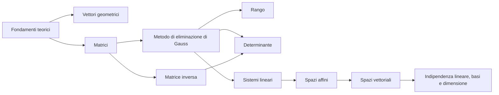

# MOC — Geometria e Algebra Lineare A.A. 2026-2027

Mappa dei contenuti (Zettelkasten). Ordine cronologico delle lezioni, poi mappa tematica.

Struttura cartelle: `01_Fondamenti_Teorici` · `02_Vettori_Geometrici` · `03_Matrici` · `04_Matrice_Inversa` · `05_Metodo_di_Eliminazione_di_Gauss` · `06_Rango` · `07_Determinante` · `08_Applicazioni` · `09_Organizzazione` · `10_Indici_Lezioni` · `11_Sistemi_Lineari` · `12_Spazi_Affini` · `13_Spazi_Vettoriali` · `14_Indipendenza_Lineare_Basi_Dimensione`

## Linea cronologica

| Lezione | Data | Argomenti principali | Link |
|---|---|---|---|
| 0 | 2026-09-16 | Introduzione al corso; prodotto cartesiano; relazione binaria; relazione di equivalenza | [[01_Indice_Lezione_0]] |
| 1 | 2026-09-17 | Relazioni d'ordine; funzioni; iniettività e suriettività; prodotto cartesiano di più insiemi | [[02_Indice_Lezione_1]] |
| 2 | 2026-09-17 | Vettori geometrici (appunti OneNote «Vettori»): equipollenza, operazioni, coordinate, prodotto interno ed esterno, determinanti | [[03_Indice_Lezione_2]] |
| 3 | 2026-09-30 | Matrici: definizione ed esempi; campo F2; somma tra matrici; prodotto tra uno scalare e una matrice | [[04_Indice_Lezione_3]] |
| 4 | 2026-10-01 | Prodotto matriciale righe per colonne; il prodotto codifica la composizione di funzioni; PageRank (parte 1); identità e diagonali | [[05_Indice_Lezione_4]] |
| 5 | — | (nessun PDF fornito: la numerazione delle slide prosegue senza interruzione, L4 termina a 44 e L6 inizia a 45) | — |
| 6 | 2026-10-07 | Matrice invertibile; rango; determinante (sviluppo di Laplace); matrici triangolari; metodo di eliminazione di Gauss; pivot e matrice a scala | [[07_Indice_Lezione_6]] |
| 7 | 2026-10-08 | Reversibilità del MEG; codifica del MEG con il prodotto matriciale; rango con il MEG; teorema di Binet; determinante con il MEG; proprietà del determinante | [[08_Indice_Lezione_7]] |
| Es. 5.1 | 2026-10-09 | Esercizi: calcolo del determinante con MEG, Laplace e metodo misto (solo matrice A svolta) | [[103_Esercizio_5_1_Calcolo_del_Determinante]] |
| Es. EE1 | 2026-10-09 | Esercizio: matrice come somma di $r$ matrici di rango 1 (MEG, matrici elementari, $A=PLU$) | [[108_Esercizio_EE1_Somma_di_Matrici_di_Rango_1]] |
| 8 | — | (nessun PDF fornito: la numerazione delle slide prosegue senza interruzione, L7 termina a 72 e L9 inizia a 73) | — |
| 9 | 2026-10-12 | Rappresentazioni matriciali di un sistema lineare; risoluzione via MEG; teorema di Rouché-Capelli | [[10_Indice_Lezione_9]] |
| 10 | 2026-10-14 | Commenti a Rouché-Capelli; nucleo; teorema di struttura; teorema di Cramer; ricerca della matrice inversa; teorema sull'invertibilità | [[11_Indice_Lezione_10]] |
| 11 | 2026-10-15 | Spazi affini (cartesiane e parametriche); spazio vettoriale: definizione ed esempi; sottospazi vettoriali | [[12_Indice_Lezione_11]] |
| 12 | — | (nessun PDF fornito: la numerazione delle slide prosegue senza interruzione, L11 termina a 107 e L13 inizia a 108) | — |
| 13 | 2026-10-19 | Combinazioni lineari e span; generatori; vettori linearmente indipendenti; base; teorema di unicità della rappresentazione; dimensione | [[14_Indice_Lezione_13]] |

## Fondamenti teorici — insiemi, relazioni, funzioni
- [[11_Prodotto_Cartesiano]] — Prodotto cartesiano *(L0)*
- [[12_Relazione_Binaria]] — Relazione binaria *(L0)*
- [[13_Proprieta_Riflessiva_Simmetrica_Transitiva]] — Proprietà riflessiva, simmetrica e transitiva *(L0)*
- [[14_Relazione_di_Equivalenza]] — Relazione di equivalenza *(L0)*
- [[15_Relazione_di_Ordine]] — Relazione d'ordine *(L1)*
- [[16_Funzioni]] — Funzioni *(L1)*
- [[17_Excursus_Logico_Negazione_Implicazione]] — Excursus logico: negazione di un'implicazione *(L1)*
- [[18_Iniettivita_Suriettivita_Biettivita]] — Iniettività, suriettività e biettività *(L1)*
- [[19_Prodotto_Cartesiano_di_Piu_Insiemi]] — Prodotto cartesiano di più insiemi *(L1)*
- [[31_Il_Campo_F2]] — Il campo $\mathbb{F}_2$ *(L3)*

## Vettori geometrici (precursori di spazi vettoriali e prodotto scalare)
- [[20_Segmenti_Orientati_ed_Equipollenza]] — Segmenti orientati ed equipollenza *(L2)*
- [[21_Vettori_come_Classi_di_Equivalenza]] — Vettori come classi di equivalenza *(L2)*
- [[22_Operazioni_tra_Vettori]] — Operazioni tra vettori *(L2)*
- [[23_Sistemi_di_Riferimento_e_Coordinate]] — Sistemi di riferimento e coordinate *(L2)*
- [[24_Proprieta_delle_Operazioni_tra_Vettori]] — Proprietà delle operazioni tra vettori *(L2)*
- [[25_Prodotto_Interno_e_Ortogonalita]] — Prodotto interno e ortogonalità *(L2)*
- [[26_Prodotto_Interno_in_Coordinate]] — Prodotto interno in coordinate *(L2)*
- [[27_Prodotto_Esterno]] — Prodotto esterno *(L2)*
- [[28_Determinanti_2x2_e_3x3]] — Determinanti 2×2 e 3×3 *(L2)*

## Matrici e algebra delle matrici
- [[30_Matrici_come_Rappresentazione_di_Funzioni]] — Matrici come rappresentazione di funzioni *(L3)*
- [[32_Definizione_di_Matrice]] — Definizione di matrice *(L3)*
- [[33_Matrici_Casi_Speciali]] — Notazione e casi speciali di matrici *(L3)*
- [[34_Confronto_e_Uguaglianza_tra_Matrici]] — Confronto e uguaglianza tra matrici *(L3)*
- [[35_Somma_tra_Matrici]] — Somma tra matrici *(L3)*
- [[40_Opposto_di_una_Matrice]] — Opposto di una matrice *(L4)*
- [[36_Prodotto_di_una_Matrice_per_uno_Scalare]] — Prodotto di una matrice per uno scalare *(L3)*
- [[37_Efficienza_Computazionale]] — Efficienza computazionale e proprietà delle operazioni *(L3)*
- [[41_Prodotto_Matriciale_Righe_per_Colonne]] — Prodotto matriciale righe per colonne *(L4)*
- [[42_Prodotto_e_Composizione_di_Funzioni]] — Il prodotto codifica la composizione di funzioni *(L4)*
- [[44_Proprieta_del_Prodotto_Matriciale]] — Proprietà del prodotto matriciale *(L4)*
- [[45_Matrice_Identita_e_Matrici_Diagonali]] — Matrice identità e matrici diagonali *(L4)*

## Applicazioni
- [[43_PageRank_e_Matrice_di_Google]] — PageRank e matrice di Google (parte 1) *(L4)*

## Organizzazione
- [[10_Organizzazione_del_Corso]] — Organizzazione del corso *(L0)*

## Matrice inversa e prodotto matriciale (Lezioni 6-7)
- [[60_Matrice_Invertibile]] — Matrice invertibile *(L6)*
- [[61_Unicita_e_Bilateralita_dell_Inversa]] — Unicità e bilateralità dell'inversa *(L6)*
- [[62_Non_Commutativita_del_Prodotto_Matriciale]] — Non commutatività del prodotto matriciale *(L6)*
- [[72_Esistenza_della_Matrice_Inversa]] — Esistenza della matrice inversa *(L7)*
- [[87_Ricerca_della_Matrice_Inversa]] — Ricerca della matrice inversa *(L10)*
- [[88_Teorema_sull_Invertibilita_della_Matrice]] — Teorema sull'invertibilità della matrice *(L10)*

## Rango
- [[63_Rango_di_una_Matrice]] — Rango di una matrice *(L6)*
- [[64_Rango_e_Matrice_di_Probabilita_Congiunta]] — Rango e matrice di probabilità congiunta *(L6)*
- [[73_MEG_e_Rango]] — MEG e rango *(L7)*
- [[108_Esercizio_EE1_Somma_di_Matrici_di_Rango_1]] — Esercizio EE1: somma di matrici di rango 1 *(esercizi 09-10)*
- [[109_EE1_Riduzione_a_Scala_di_A]] — EE1: riduzione a scala *(esercizi 09-10)*
- [[110_EE1_Fattorizzazione_con_Matrici_Elementari]] — EE1: matrici elementari e $A=PLU$ *(esercizi 09-10)*
- [[111_EE1_Somma_di_Tre_Matrici_di_Rango_1]] — EE1: somma di tre matrici di rango 1 *(esercizi 09-10)*

## Determinante
- [[65_Determinante_Sviluppo_di_Laplace]] — Determinante: sviluppo di Laplace *(L6)*
- [[66_Matrici_Triangolari]] — Matrici triangolari e loro determinante *(L6)*
- [[74_Teorema_di_Binet]] — Teorema di Binet *(L7)*
- [[75_Calcolo_del_Determinante_con_il_MEG]] — Calcolo del determinante con il MEG *(L7)*
- [[76_Determinante_Normalizzato_e_Alternante]] — Determinante normalizzato e alternante *(L7)*
- [[77_Determinante_Multilineare]] — Determinante multilineare *(L7)*
- [[78_Determinante_e_Sostituzione]] — Determinante e operazione di sostituzione *(L7)*
- [[79_Determinante_con_Righe_Uguali]] — Determinante con righe uguali *(L7)*
- [[103_Esercizio_5_1_Calcolo_del_Determinante]] — Esercizio 5.1: calcolo del determinante *(esercizi 09-10)*
- [[104_Determinante_con_il_MEG_Esempio_con_Scambio_di_Righe]] — Esempio con il MEG e scambio di righe *(esercizi 09-10)*
- [[105_Determinante_Laplace_Esempio_3x3_Riga_3]] — Esempio con Laplace sulla riga 3 *(esercizi 09-10)*
- [[106_Determinante_Metodo_Misto_MEG_e_Laplace]] — Metodo misto MEG + Laplace *(esercizi 09-10)*
- [[107_Confronto_Metodi_Calcolo_Determinante]] — Confronto tra i metodi *(esercizi 09-10)*

## Metodo di eliminazione di Gauss (MEG)
- [[67_Operazioni_Elementari_sulle_Righe]] — Operazioni elementari sulle righe *(L6)*
- [[68_Metodo_di_Eliminazione_di_Gauss]] — Metodo di eliminazione di Gauss (MEG) *(L6)*
- [[69_Pivot_e_Matrice_a_Scala]] — Pivot e matrice a scala *(L6)*
- [[70_Reversibilita_del_MEG]] — Reversibilità del MEG *(L7)*
- [[71_Codifica_del_MEG_con_il_Prodotto_Matriciale]] — Codifica del MEG con il prodotto matriciale *(L7)*

## Sistemi lineari
- [[80_Rappresentazioni_Matriciali_di_un_Sistema_Lineare]] — Rappresentazioni matriciali di un sistema lineare *(L9)*
- [[81_Risoluzione_di_un_Sistema_con_MEG_Esempio_Parametrico]] — Risoluzione con il MEG: esempio con parametri *(L9)*
- [[82_Teorema_di_Rouche_Capelli]] — Teorema di Rouché-Capelli *(L9)*
- [[83_Esempio_Sistema_con_Parametro_k_e_Rouche_Capelli]] — Esempio con parametro k *(L10)*
- [[84_Nucleo_e_Sistema_Omogeneo_Associato]] — Nucleo e sistema omogeneo associato *(L10)*
- [[85_Teorema_di_Struttura_delle_Soluzioni]] — Teorema di struttura delle soluzioni *(L10)*
- [[86_Teorema_di_Cramer]] — Teorema di Cramer *(L10)*

## Spazi affini
- [[89_Interpretazione_Geometrica_dei_Sistemi_Lineari_Spazi_Affini]] — Interpretazione geometrica dei sistemi lineari *(L11)*
- [[90_Sistemi_Omogenei_e_Chiusura_della_Somma]] — Sistemi omogenei e chiusura della somma *(L11)*

## Spazi vettoriali
- [[91_Spazio_Vettoriale_Definizione]] — Spazio vettoriale: definizione *(L11)*
- [[92_Esempi_di_Spazi_Vettoriali]] — Esempi di spazi vettoriali *(L11)*
- [[93_Proprieta_Fondamentali_degli_Spazi_Vettoriali]] — Proprietà fondamentali degli spazi vettoriali *(L11)*
- [[94_Sottospazi_Vettoriali]] — Sottospazi vettoriali *(L11)*
- [[95_Combinazioni_Lineari_e_Span]] — Combinazioni lineari e span *(L13)*
- [[96_Insieme_di_Generatori]] — Insieme di generatori *(L13)*
- [[97_Esempio_Generatori_di_R3_e_Rappresentazioni_Multiple]] — Esempio: generatori di R3 e rappresentazioni multiple *(L13)*

## Indipendenza lineare, basi e dimensione
- [[98_Vettori_Linearmente_Indipendenti]] — Vettori linearmente indipendenti *(L13)*
- [[99_Dipendenza_Lineare_e_Vettori_Ridondanti]] — Dipendenza lineare e vettori ridondanti *(L13)*
- [[100_Base_di_uno_Spazio_Vettoriale]] — Base di uno spazio vettoriale *(L13)*
- [[101_Teorema_di_Unicita_della_Rappresentazione_rispetto_a_una_Base]] — Teorema di unicità della rappresentazione *(L13)*
- [[102_Dimensione_di_uno_Spazio_Vettoriale]] — Dimensione di uno spazio vettoriale *(L13)*

## Note collegate
- [[01_Indice_Lezione_0]]
- [[02_Indice_Lezione_1]]
- [[03_Indice_Lezione_2]]
- [[04_Indice_Lezione_3]]
- [[05_Indice_Lezione_4]]
- [[07_Indice_Lezione_6]]
- [[08_Indice_Lezione_7]]
- [[10_Indice_Lezione_9]]
- [[11_Indice_Lezione_10]]
- [[12_Indice_Lezione_11]]
- [[14_Indice_Lezione_13]]

#GAL/moc
