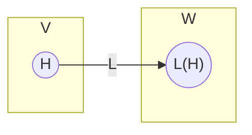
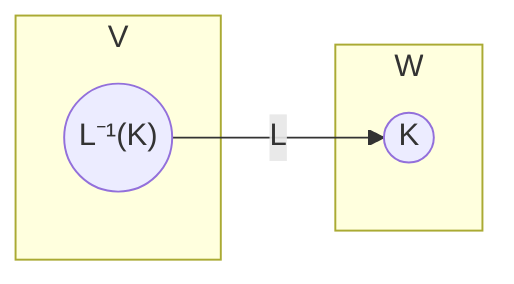

# Immagine e controimmagine di sottospazi vettoriali

> [!abstract] Fatto
> Sia $L:V\to W$ un'applicazione lineare.

## Immagine di un sottospazio
$H\subseteq V$ sottospazio. L'**immagine** di $H$ è
$$L(H)=\{\underline{w}\in W\mid \exists\,\underline{v}\in H\ \text{t.c.}\ L(\underline{v})=\underline{w}\}$$
e **$L(H)$ è un sottospazio vettoriale di $W$**.

## Controimmagine di un sottospazio
$K\subseteq W$ sottospazio. La **controimmagine** di $K$ è
$$L^{-1}(K)=\{\underline{v}\in V\mid L(\underline{v})\in K\}$$
cioè l'insieme delle controimmagini di $K$; **$L^{-1}(K)$ è un sottospazio vettoriale di $V$**.

## Due casi specifici
- $V\subseteq V$: prendo tutto il dominio e calcolo $L(V)$ $\leadsto$ [[147_Immagine_di_una_Applicazione_Lineare_e_Suriettivita]].
- $\{\underline{0}_W\}\subseteq W$: prendo il sottospazio più piccolo possibile e calcolo $L^{-1}(\{\underline{0}_W\})$ $\leadsto$ [[151_Nucleo_di_una_Applicazione_Lineare]].

> [!note] Osservazione (non presente negli appunti)
> Nelle slide i due fatti sono enunciati senza dimostrazione.

## Note collegate
- [[136_Applicazioni_Lineari_Definizione_17_1]]
- [[94_Sottospazi_Vettoriali]]
- [[139_Proprieta_delle_Applicazioni_Lineari]]
- Indice: [[20_Indice_Lezione_19]] · [[00_MOC_GAL]]

#GAL/applicazioni-lineari/immagine-controimmagine
