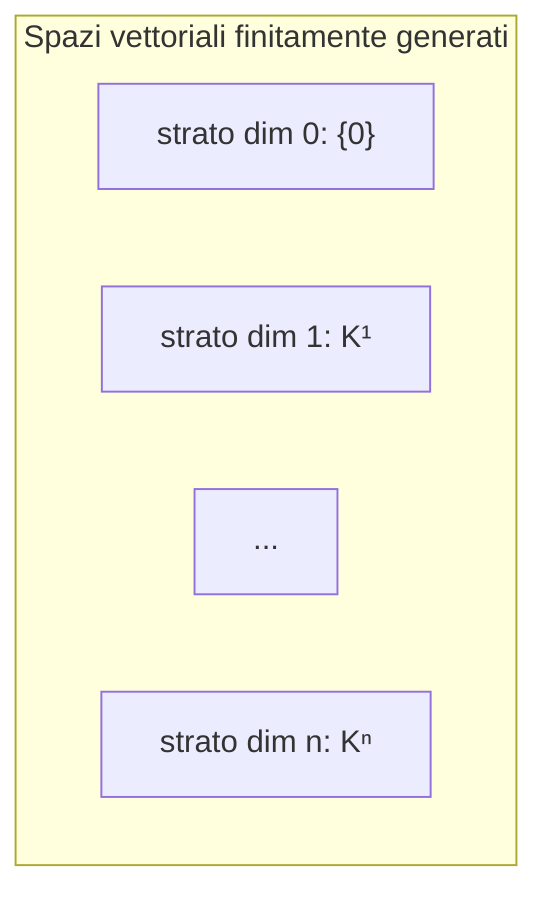

# Teorema 20.5 (teorema di isomorfismo tra spazi vettoriali finitamente generati)

> [!abstract] Teorema 20.5
> Dati due spazi vettoriali (finitamente generati) $V$ e $W$, le seguenti affermazioni sono tra loro equivalenti:
> - (I) $V$ e $W$ sono isomorfi
> - (II) $\dim V=\dim W$

## Dimostrazione
**(I) $\Rightarrow$ (II).** HP: $V,W$ isomorfi. TH: $\dim V=\dim W$.
Per ipotesi esiste un'applicazione lineare invertibile $L:V\to W$ ($L$ conserva le basi). Considero una base di $V$, $\{\underline{v}_1,\dots,\underline{v}_n\}$ ($\dim V=n$); la trasformo con $L$: $\{L(\underline{v}_1),\dots,L(\underline{v}_n)\}$. Per ipotesi è una base di $W$, quindi $\dim W=n$.

**(II) $\Rightarrow$ (I).** HP: $\dim V=\dim W$. TH: $V,W$ isomorfi.
Considero due basi $\mathcal{B}=\{\underline{v}_1,\dots,\underline{v}_n\}$ di $V$ e $\mathcal{C}=\{\underline{w}_1,\dots,\underline{w}_n\}$ di $W$. Devo costruire un'applicazione lineare $L:V\to W$: uso il teorema per la costruzione di $L$ a partire dalle immagini dei vettori di una base ([[142_Come_Definire_una_Applicazione_Lineare_Proposizione_17_2]]):
$$L(\underline{v}_1)=\underline{w}_1,\ \dots,\ L(\underline{v}_n)=\underline{w}_n\qquad(L\ \text{è ben definita}).$$
$L$ risulta essere invertibile perché conserva la proprietà di "essere base": $\{\underline{v}_1,\dots,\underline{v}_n\}\xrightarrow{\,L\,}\{\underline{w}_1,\dots,\underline{w}_n\}$ (base di $V\to$ base di $W$) $\qquad\blacksquare$

## Osservazione: gli spazi vettoriali finitamente generati a "strati"
Gli spazi vettoriali finitamente generati si dispongono in **strati** per dimensione:

> [!abstract] Morale
> **Ogni strato contiene un unico spazio vettoriale di vettori colonna (di opportuna altezza)**: tutti gli spazi di dimensione $n$ sono isomorfi a $\mathbb{K}^n$.

> [!warning] DISEGNO NON RAPPRESENTABILE
> Slide 172 (in basso): ellisse con l'etichetta "spazi vettoriali fin. gen.", divisa da curve in strati: $\{0\}$ (sp. vett. di dim 0), $\mathbb{K}^1$ (dim 1), $\dots$, $\mathbb{K}^n$ (dim $n$), con $V$ in uno strato. Il diagramma sopra è solo uno schema. Cercare nel PDF `GAL 2026-2027 - 20261112 - LEZIONE 20.pdf` la slide 172.

## Note collegate
- [[156_Isomorfismi_Definizione_20_4_e_Conservazione_delle_Basi]]
- [[158_Mappa_delle_Coordinate_e_Mappa_di_Parametrizzazione_Definizione_20_6]]
- [[102_Dimensione_di_uno_Spazio_Vettoriale]]
- [[142_Come_Definire_una_Applicazione_Lineare_Proposizione_17_2]]
- Indice: [[21_Indice_Lezione_20]] · [[00_MOC_GAL]]

#GAL/applicazioni-lineari/teorema-isomorfismo
