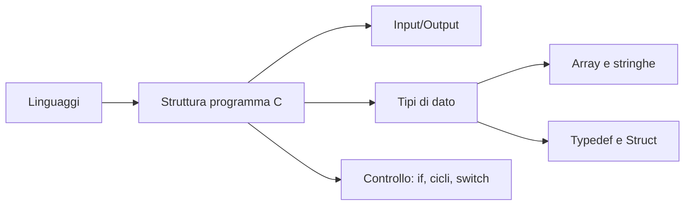

---
tags:
  - FI
  - MOC
  - indice
date: 2026-09-14
materia: Fondamenti di Informatica
---

# Fondamenti di Informatica — Indice Generale

> [!INFO] Informazioni sul Corso
> * **Libro di testo:** Kim N. King – *Programmazione in C*
> * **Laboratori:** 24/03, 08/10, 22/10, 05/11, 18/11, 03/12
> * **Modalità d'Esame:** Scritto + orale confermativo
> * **Materiale/IDE:** Disponibile su WeBeep (preparare gli esercizi in anticipo)
> * **Email:** Oggetto del messaggio formattato come `[FI] ...`

---
## Introduzione, definizioni e flow chart
[[Introduzione, flow chart e algebra di Boole]]

> [!note] Nota Excalidraw
> Questo appunto è un file Excalidraw: non è stato modificato né spezzato.

## Codifica dell'informazione
[[Codifica dell'informazione]]

> [!note] Nota Excalidraw
> Anche questo appunto è un file Excalidraw lasciato intatto.

## Linguaggio C
- [[01_Linguaggi_di_Programmazione]] — Linguaggi di Programmazione
- [[02_Compilati_vs_Interpretati]] — Compilati vs Interpretati
- [[03_Struttura_di_un_Programma_C]] — Il linguaggio C
- [[04_Input_Output_e_Stream]] — Funzioni IN → OUT
- [[05_Tipi_di_Dato]] — Tipi di dato
- [[06_Tipi_Semplici_Int_Char_Float_Double]] — Dati predefiniti semplici
- [[07_sizeof_e_Librerie_limits_float]] — sizeOf e librerie dei limiti
- [[08_Conversione_fra_Tipi]] — Conversione fra tipi
- [[09_Array_Monodimensionali]] — Array/Vettori
- [[10_Stringhe_in_C]] — Stringhe in C
- [[11_Operazioni_sulle_Stringhe]] — Operazioni sulle stringhe
- [[12_Array_Multidimensionali]] — Array multidimensionali
- [[13_Typedef]] — Definiti dall'utente: Typedef
- [[14_Struct]] — Strutture/Struct
- [[15_Condizione_if_else]] — Condizione if-else
- [[16_Cicli_Iterativi]] — Cicli iterativi
- [[17_Numeri_di_Kaprekar]] — Excursus sui numeri di Kaprekar
- [[18_Switch]] — Switch

## Disegni
- [[Disegni FI]]

#FdI/moc
