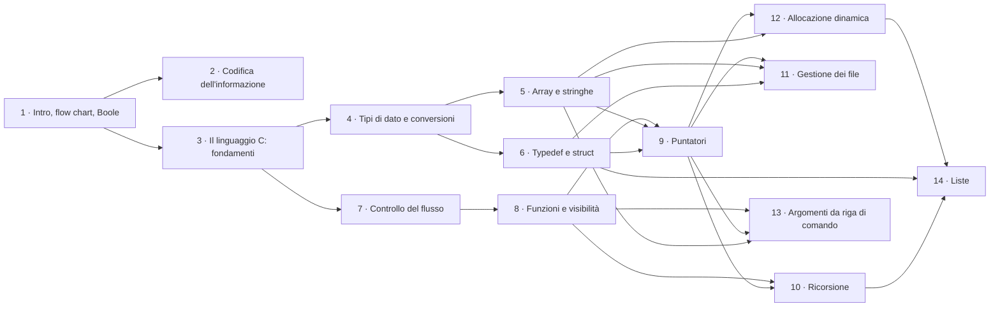

---
tags:
  - FI
  - MOC
  - indice
  - guida-studio
date: 2026-11-25
materia: Fondamenti di Informatica
---

# Fondamenti di Informatica — MOC e guida allo studio

Mappa del corso e percorso di studio in un unico punto. Ogni **macroargomento** ha una descrizione di cosa stai per affrontare, i contenuti fondamentali da imparare, un checkpoint di autoverifica e l'elenco delle note da spuntare. In fondo trovi la mappa delle cartelle.

Salto rapido: [[#Dashboard]] · [[#Flowchart della progressione]] · [[#Struttura delle cartelle]]

> [!INFO] Informazioni sul Corso
> * **Libro di testo:** Kim N. King – *Programmazione in C*
> * **Laboratori:** 24/03, 08/10, 22/10, 05/11, 18/11, 03/12
> * **Modalità d'Esame:** Scritto + orale confermativo
> * **Materiale/IDE:** Disponibile su WeBeep (preparare gli esercizi in anticipo)
> * **Email:** Oggetto del messaggio formattato come `[FI] ...`

> [!tip] Come usarlo
> - Spunta `- [x]` quando hai **studiato e capito** la nota: dashboard e barre di progresso si aggiornano da sole.
> - Nel flowchart, per segnare un blocco come fatto togli i `%%` dalla riga `class ... fatto` e aggiungi gli id dei blocchi.
> - Per il C conviene **riscrivere e far girare** gli esempi: prima del laboratorio, prepara gli esercizi da WeBeep.

## Dashboard

```dataviewjs
const rows = [], idx = new Map();
for (const t of dv.current().file.tasks) {
  const k = (t.section && t.section.subpath) ? t.section.subpath : "—";
  if (!idx.has(k)) { idx.set(k, rows.length); rows.push({k, d: 0, n: 0}); }
  const r = rows[idx.get(k)]; r.n++; if (t.completed) r.d++;
}
const tot = rows.reduce((a, r) => a + r.n, 0), done = rows.reduce((a, r) => a + r.d, 0);
dv.table(["Blocco", "Fatte", "Progresso"],
  rows.map(r => [r.k, `${r.d} / ${r.n}`, `<progress value="${r.d}" max="${r.n}" style="width:140px"></progress>`]));
dv.paragraph(`**Totale:** ${done} / ${tot} voci (${tot ? Math.round(100 * done / tot) : 0}%) <progress value="${done}" max="${tot}" style="width:240px"></progress>`);
```

### Prossime note da studiare

```dataviewjs
const next = dv.current().file.tasks
  .where(t => !t.completed && t.outlinks.length > 0)
  .slice(0, 8);
dv.taskList(next, false);
```

## Flowchart della progressione



---

## 1 · Introduzione, flow chart e algebra di Boole

> [!abstract] Stai per affrontare
> Le basi concettuali prima di programmare: cos'è un algoritmo, come lo si rappresenta con un diagramma di flusso e la logica booleana su cui si fondano condizioni e circuiti.

> [!important] Da imparare
> - Algoritmo, programma, linguaggio: differenze.
> - Simboli e costruzione di un **flow chart** (sequenza, selezione, iterazione).
> - **Algebra di Boole**: AND, OR, NOT, tabelle di verità, leggi fondamentali.

> [!question] Checkpoint
> Sai tradurre un problema semplice in un flow chart e scrivere la tabella di verità di un'espressione booleana?

- [ ] [[Introduzione, flow chart e algebra di Boole]] — introduzione, flow chart, Boole

> [!note] Nota Excalidraw
> Questo appunto è un file Excalidraw: non è stato modificato né spezzato.

---

## 2 · Codifica dell'informazione

> [!abstract] Stai per affrontare
> Come un calcolatore rappresenta numeri e caratteri con soli 0 e 1: serve per capire poi i limiti dei tipi di dato in C.

> [!important] Da imparare
> - Sistemi di numerazione e **conversioni di base** (binario, ottale, esadecimale).
> - Rappresentazione di interi con e senza segno, numeri reali, caratteri.
> - Overflow e precisione finita.

> [!question] Checkpoint
> Sai convertire un numero da decimale a binario ed esadecimale e viceversa?

- [ ] [[Codifica dell'informazione]] — basi, interi, reali, caratteri

> [!note] Nota Excalidraw
> Anche questo appunto è un file Excalidraw lasciato intatto.

---

## 3 · Il linguaggio C: fondamenti

> [!abstract] Stai per affrontare
> Cos'è un linguaggio di programmazione, come si passa dal codice sorgente all'eseguibile e com'è fatto un programma C minimo, con le prime istruzioni di ingresso/uscita.

> [!important] Da imparare
> - Linguaggi di basso/alto livello; **compilati vs interpretati** e ciclo compilazione → esecuzione.
> - Struttura di un programma C: `#include`, `main`, dichiarazioni e istruzioni.
> - Input/output da tastiera e a video con `scanf` e `printf` e relativi formati.

> [!question] Checkpoint
> Sai scrivere un programma che legge due numeri e ne stampa la somma, spiegando cosa fa il compilatore?

- [ ] [[01_Linguaggi_di_Programmazione]] — linguaggi di programmazione
- [ ] [[02_Compilati_vs_Interpretati]] — compilati vs interpretati
- [ ] [[03_Struttura_di_un_Programma_C]] — struttura di un programma C
- [ ] [[04_Input_Output_e_Stream]] — input/output, `scanf`, `printf`

---

## 4 · Tipi di dato e conversioni

> [!abstract] Stai per affrontare
> I tipi predefiniti del C, quanta memoria occupano e cosa succede quando si mescolano nello stesso calcolo.

> [!important] Da imparare
> - Tipi semplici: `int`, `char`, `float`, `double` e loro varianti.
> - `sizeof` e librerie dei limiti (`limits.h`, `float.h`).
> - **Conversione fra tipi**: implicita ed esplicita (cast), rischi di perdita di informazione.

> [!question] Checkpoint
> Sai prevedere il risultato di `7 / 2`, `7 / 2.0` e `(float)7 / 2` e spiegare perché?

- [ ] [[05_Tipi_di_Dato]] — tipi di dato
- [ ] [[06_Tipi_Semplici_Int_Char_Float_Double]] — tipi semplici
- [ ] [[07_sizeof_e_Librerie_limits_float]] — `sizeof` e librerie dei limiti
- [ ] [[08_Conversione_fra_Tipi]] — conversione fra tipi

---

## 5 · Array e stringhe

> [!abstract] Stai per affrontare
> Le prime strutture dati: collezioni di elementi dello stesso tipo, in una o più dimensioni, e le stringhe, che in C sono semplici array di caratteri.

> [!important] Da imparare
> - Dichiarazione, inizializzazione e accesso agli **array** (indici da 0, nessun controllo sui limiti).
> - **Stringhe** come array di `char` terminati da `'\0'`.
> - Funzioni di `string.h` (lunghezza, copia, confronto, concatenazione).
> - **Array multidimensionali** (matrici).

> [!question] Checkpoint
> Sai scrivere una funzione che inverte una stringa e un programma che somma due matrici?

- [ ] [[09_Array_Monodimensionali]] — array monodimensionali
- [ ] [[10_Stringhe_in_C]] — stringhe in C
- [ ] [[11_Operazioni_sulle_Stringhe]] — operazioni sulle stringhe
- [ ] [[12_Array_Multidimensionali]] — array multidimensionali

---

## 6 · Tipi definiti dall'utente: typedef e struct

> [!abstract] Stai per affrontare
> Come dare un nome ai propri tipi e raggruppare dati eterogenei in un unico record.

> [!important] Da imparare
> - `typedef` per creare alias di tipo.
> - **`struct`**: dichiarazione, accesso ai campi con `.`, inizializzazione, array di struct.

> [!question] Checkpoint
> Sai definire un tipo `Studente` (nome, matricola, voti) e gestirne un array?

- [ ] [[13_Typedef]] — typedef
- [ ] [[14_Struct]] — struct

---

## 7 · Controllo del flusso

> [!abstract] Stai per affrontare
> Gli strumenti per far prendere decisioni e ripetere azioni a un programma: è il passaggio dalla sequenza di istruzioni ad algoritmi veri e propri.

> [!important] Da imparare
> - **if-else**, operatori relazionali e logici, annidamento.
> - **Cicli** `while`, `do-while`, `for`: scelta del ciclo, condizioni di uscita, cicli annidati.
> - **switch** e uso di `break`.
> - Esempio completo: i numeri di Kaprekar.

> [!question] Checkpoint
> Sai riscrivere lo stesso algoritmo con `for` e con `while` e individuare un ciclo infinito?

- [ ] [[15_Condizione_if_else]] — condizione if-else
- [ ] [[16_Cicli_Iterativi]] — cicli iterativi
- [ ] [[17_Numeri_di_Kaprekar]] — esempio: numeri di Kaprekar
- [ ] [[18_Switch]] — switch

---

## 8 · Funzioni e regole di visibilità

> [!abstract] Stai per affrontare
> La scomposizione di un programma in sottoprogrammi: come si definisce e si chiama una funzione, cosa succede in memoria durante la chiamata e dove una variabile è visibile.

> [!important] Da imparare
> - Definizione, prototipo, parametri formali/attuali, valore di ritorno.
> - **Passaggio per valore** e record di attivazione sullo **stack**.
> - **Regole di visibilità** (scope): variabili locali e globali.

> [!question] Checkpoint
> Sai disegnare lo stack durante la chiamata di due funzioni annidate e dire quali variabili sono visibili in ogni punto?

- [ ] [[19_Sottoprogrammi_Funzioni]] — sottoprogrammi e funzioni
- [ ] [[21_Regole_di_Visibilità]] — regole di visibilità (scope)

---

## 9 · Puntatori

> [!abstract] Stai per affrontare
> Il concetto più delicato del C: variabili che contengono indirizzi di memoria. Sbloccano il passaggio per indirizzo, il legame fra array e puntatori e le strutture accessibili tramite indirizzo.

> [!important] Da imparare
> - Indirizzi di memoria, operatori `&` e `*`, dichiarazione di puntatori.
> - **Passaggio per indirizzo** (esempio tipico: scambio di due variabili).
> - **Aritmetica dei puntatori** e **puntatori a array** (array come puntatore al primo elemento).
> - **Puntatori a strutture** e operatore `->`.

> [!question] Checkpoint
> Sai prevedere l'output di un programma con puntatori e scrivere una funzione `swap` che funzioni davvero?

- [ ] [[20_Puntatori]] — puntatori
- [ ] [[22_Puntatori_a_Array]] — puntatori a array
- [ ] [[23_Puntatori_a_Strutture]] — puntatori a strutture

---

## 10 · Ricorsione

> [!abstract] Stai per affrontare
> Funzioni che chiamano se stesse: un modo alternativo ai cicli per risolvere problemi che si riducono a istanze più piccole dello stesso problema.

> [!important] Da imparare
> - **Caso base** e **passo ricorsivo**: senza caso base la ricorsione non termina.
> - Record di attivazione e crescita dello stack.
> - Ricorsione su numeri, array e stringhe; confronto con la soluzione iterativa.

> [!question] Checkpoint
> Sai scrivere in forma ricorsiva fattoriale, somma degli elementi di un array e inversione di una stringa?

- [ ] [[24_Ricorsione]] — ricorsione

---

## 11 · Gestione dei file

> [!abstract] Stai per affrontare
> Come far sopravvivere i dati alla fine del programma: lettura e scrittura su memoria di massa con file di testo e file binari.

> [!important] Da imparare
> - Memoria di massa vs memoria centrale (persistenza, velocità, accesso sequenziale/diretto).
> - `FILE *fp`, `fopen` e **modalità d'accesso** (`r`, `w`, `a`, `r+`, `w+`, `a+`, varianti `b`); controllo di `fopen` e `fclose`.
> - File di testo: `fprintf`, `fscanf` (valore di ritorno ed `EOF`), `fgets`.
> - File binari: `fread`, `fwrite`, `ftell`, `fseek` (`SEEK_SET`, `SEEK_CUR`, `SEEK_END`).

> [!question] Checkpoint
> Sai scrivere un programma che salva su file i numeri da 0 a 10 e li rilegge fino a `EOF`, controllando che `fopen` sia riuscita?

- [ ] [[25_Gestione_File]] — file di testo e binari, `fopen`, `fprintf`, `fscanf`, `fread`, `fwrite`

---

## 12 · Allocazione dinamica della memoria

> [!abstract] Stai per affrontare
> Come chiedere memoria al sistema mentre il programma gira, per array e matrici la cui dimensione si conosce solo a runtime.

> [!important] Da imparare
> - **`malloc`** e controllo del `NULL`; **`free`** per ogni blocco allocato.
> - Array dinamici e **matrici dinamiche** (array di puntatori, allocazione e deallocazione riga per riga).
> - **`calloc`** (azzera) e **`realloc`** (ridimensiona, può spostare il blocco e può fallire: usare un puntatore d'appoggio).

> [!question] Checkpoint
> Sai allocare una matrice $r \times c$ letta da tastiera, usarla e liberarla senza perdite di memoria?

- [ ] [[26_Allocazione_Dinamica_della_Memoria]] — `malloc`, `calloc`, `realloc`, `free`, matrici dinamiche

---

## 13 · Argomenti da riga di comando

> [!abstract] Stai per affrontare
> Dare dati al programma al momento dell'esecuzione tramite i parametri del `main`.

> [!important] Da imparare
> - `argc` (numero di argomenti) e `argv` (vettore di stringhe).
> - Conversione delle stringhe con `atoi` e `atof`.

> [!question] Checkpoint
> Sai scrivere un programma che somma due numeri passati da riga di comando?

- [ ] [[27_Argomenti_da_Riga_di_Comando]] — `argc`, `argv`, `atoi`, `atof`

---

## 14 · Liste

> [!abstract] Stai per affrontare
> La prima struttura dati dinamica: una sequenza di nodi allocati sull'heap e collegati da puntatori, che cresce e si accorcia a runtime.

> [!important] Da imparare
> - **Nodo** = informazione + puntatore al nodo successivo (`struct` autoreferenziale, `typedef` di `nodo_t` e `lista_t`).
> - Inserimento in **testa** e in **coda** (iterativo e ricorsivo); perché serve `lista_t*` per modificare la testa.
> - **Stampa**, **ricerca** (`cerca`) e **cancellazione** della lista con `free`.

> [!question] Checkpoint
> Sai scrivere inserimento in testa, stampa e cancellazione di una lista di interi, liberando tutti i nodi?

- [ ] [[28_Liste]] — nodi, inserimento in testa/coda, stampa, ricerca, cancellazione

---

## Disegni

- [[Disegni FI]]

---

## Struttura delle cartelle

| Blocco | Cartella | Note |
|---|---|---|
| 1-2 · Introduzione e codifica | `30_Fondamenti_Informatica/01_Introduzione_e_Codifica` | 2 (file Excalidraw, non modificati) |
| 3-14 · Linguaggio C | `30_Fondamenti_Informatica/02_Linguaggio_C` | 28 |

#FdI/moc
