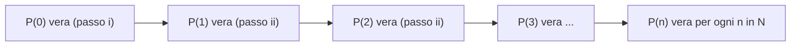

[[00_A1_Indice|⬅️ Torna all'Indice A1]]

# Insiemi Numerici, Elementi di Logica e Metodi di Dimostrazione

> Lezione 1 — 14.09.2026. Argomenti: [[#Insiemi numerici|Insiemi Numerici]], [[#Elementi di logica|Logica Proposizionale]], [[#Quantificatori|Quantificatori]], [[#4) Dimostrazione per assurdo|Dimostrazione per Assurdo]], [[#5) Dimostrazione per induzione|Principio di Induzione]], [[#5) Dimostrazione per induzione|Disuguaglianza di Bernoulli]].

## Insiemi numerici

$\mathbb{N}, \mathbb{Z}, \mathbb{Q}, \mathbb{R}, \mathbb{C}$

- $\mathbb{N} = \{0,1,2,3,\dots\}$: insieme dei **numeri naturali** (interi non negativi).
- $\mathbb{Z} = \{\dots,-3,-2,-1,0,1,2,3,\dots\}$: insieme degli **interi relativi**.
- $\mathbb{Q} = \left\{ \frac{m}{n} : m,n \in \mathbb{Z},\ n \neq 0 \right\}$: **numeri razionali**.

### Notazione

- $:$ «tale che» (anche $\mid$);
- $\in$ «appartiene»: $a \in A$ significa che l'elemento $a$ appartiene all'insieme $A$;
- $\notin$ «non appartiene»;
- $\setminus$: $A \setminus B$ è l'insieme degli elementi di $A$ che non sono elementi di $B$;
- $\subset$: $A \subset B$ significa che $A$ è un sottoinsieme di $B$;
- $\forall$ «per ogni».

### Frazioni equivalenti e rappresentazione decimale

Identifichiamo $\frac{m}{n} = \frac{a}{b}$ in $\mathbb{Q}$ (con $m,n,a,b \in \mathbb{Z}$, $n \neq 0$, $b \neq 0$) se $mb = na$. Ogni numero razionale $r \in \mathbb{Q}$ può essere rappresentato da infinite frazioni equivalenti; ad esempio $\frac37 = \frac{6}{14} = \frac{-12}{-28} = \dots$

Ogni numero razionale può essere rappresentato anche in **forma decimale**:

$$
r = \pm a_0,a_1a_2a_3a_4\dots a_k\dots, \qquad a_0 \in \mathbb{N},\ a_k \in \{0,1,\dots,9\}\ \ \forall k \in \mathbb{N},\ k \neq 0
$$

*Esempi*: $\frac32 = 1{,}50000\dots$; $\frac13 = \frac{-5}{-15} = 0{,}3333\dots = 0{,}\overline{3}$.

Le rappresentazioni decimali dei numeri razionali sono tutte **finite** (cioè solo un numero finito di cifre decimali è diverso da 0) oppure **infinite e periodiche** (un numero infinito di cifre decimali non nulle che, da un certo punto in poi, si ripetono periodicamente). Si può quindi scrivere

$$
\mathbb{Q} = \left\{ \frac{m}{n} : m,n \in \mathbb{Z},\ n \neq 0 \right\} = \{ r = \pm a_0,a_1a_2a_3\dots a_k\dots \,:\, a_0 \in \mathbb{N},\ a_k \in \{0,\dots,9\},\ \text{rappresentazione decimale finita o infinita e periodica}\}
$$

> **Osservazione**: $0{,}\overline{9} = 1 = 1{,}000\dots$; $0{,}4\overline{9} = 0{,}5$; $0{,}475\overline{9} = 0{,}476$; ecc.

### I numeri reali e i complessi

$$
\mathbb{R} = \{ r = \pm a_0,a_1a_2a_3\dots a_k\dots \,:\, a_0 \in \mathbb{N},\ a_k \in \{0,\dots,9\},\ \text{rappresentazione decimale finita o infinita, periodica o no} \}
$$

$\mathbb{R}$ è l'insieme dei **numeri reali**. I numeri in $\mathbb{R} \setminus \mathbb{Q}$, cioè i numeri $r \in \mathbb{R}$ tali che $r \notin \mathbb{Q}$, si dicono **irrazionali**.

$$
\mathbb{C} = \{ z = a + ib : a,b \in \mathbb{R},\ i^2 = -1 \}
$$

è l'insieme dei **numeri complessi**. Vale la catena di inclusioni

$$
\mathbb{N} \subset \mathbb{Z} \subset \mathbb{Q} \subset \mathbb{R} \subset \mathbb{C}
$$

## Elementi di logica

**Definizione.** Una **proposizione** è un enunciato che non contiene variabili libere a cui si possa attribuire in maniera univoca il valore vero o falso (solo uno dei due, non entrambi).

- «$3 > 4$» è una proposizione ✓ (falsa);
- «la pizza è buona» non lo è ✗;
- «$n$ è pari» non lo è ✗ (contiene la variabile libera $n$).

Le proposizioni si indicano con $P, Q, \dots$

**Definizione.** Si dice **predicato** un enunciato contenente variabili libere il cui valore di verità, vero o falso, dipende dal valore delle variabili. Tuttavia per ogni assegnazione delle variabili il predicato deve essere oggettivamente vero o falso (non entrambi) — cioè deve essere una proposizione. I predicati si indicano con $P(x,y,\dots)$, $Q(x,y,\dots)$, dove $x,y$ sono le variabili libere.

*Esempi*: $P(n)$: «$n$ è pari» ✓; $Q(f)$: «$f$ è derivabile» ✓.

> **Oss.** La dichiarazione dell'insieme in cui variano le variabili $x,y,\dots$ è parte della definizione del predicato.

### Connettivi logici

- $\wedge$ **e**: date $P,Q$ proposizioni, $P \wedge Q$ è la proposizione vera se sono vere entrambe $P$ e $Q$; falsa altrimenti.
- $\vee$ **o**: $P \vee Q$ è vera se è vera $P$, o $Q$, o entrambe (cioè almeno una delle 2); falsa altrimenti.
- $\neg$ **negazione (non)**: $\neg P$ è vera se $P$ è falsa, falsa se $P$ è vera.
- $\Rightarrow$ **implicazione** («se... allora...»): $P \Rightarrow Q$ è vera se $P$ è vera e $Q$ è vera, oppure se $P$ è falsa (qualunque sia il valore di verità di $Q$); è falsa altrimenti.
- $\Leftrightarrow$ **doppia implicazione** («se e solo se»): $P \Leftrightarrow Q$ è vera se $P,Q$ sono entrambe vere oppure entrambe false; falsa altrimenti.

| $P$ | $Q$ | $P \wedge Q$ | $P \vee Q$ | $\neg P$ | $P \Rightarrow Q$ | $P \Leftrightarrow Q$ |
|:-:|:-:|:-:|:-:|:-:|:-:|:-:|
| V | V | V | V | F | V | V |
| V | F | F | V | F | F | F |
| F | V | F | V | V | V | F |
| F | F | F | F | V | V | V |

### Quantificatori

Per assegnare un valore di verità a un predicato è necessario «saturare» le variabili libere: in tal modo si ottiene una proposizione con il suo valore di verità. Ciò può essere fatto fissando le variabili o tramite l'uso di **quantificatori**:

- $\forall$ per ogni;
- $\exists$ esiste;
- $\exists!$ esiste ed è unico;
- $\nexists$ non esiste.

*Esempio* con $P(n)$: «$n$ è pari», $n \in \mathbb{N}$:

| Proposizione | Valore |
|---|---|
| $n = 5$: $n$ è pari | F |
| $\forall n \in \mathbb{N}$: $n$ è pari | F |
| $\exists n \in \mathbb{N}$: $n$ è pari | V |
| $\exists! n \in \mathbb{N}$: $n$ è pari | F |
| $\nexists n \in \mathbb{N}$: $n$ è pari | F |

> **Oss.** Se $P(x)$ è un predicato, $x \in A$: $\forall x\ P(x)$, $\exists x : P(x)$, $\exists! x : P(x)$, $\nexists x : P(x)$, $x = x_0\ P(x)$ (cioè $P(x_0)$) sono proposizioni diverse.

**Definizione.** Un enunciato che presenta la struttura

$$
\forall x \in A \quad P(x) \Rightarrow Q(x)
$$

con $A$ insieme e $P(x), Q(x)$ per $x \in A$ predicati, prende il nome di **implicazione universale**.

### Condizioni necessarie e sufficienti

**Definizione.** Date $P,Q$ proposizioni (predicati), se $P \Rightarrow Q$ è vera diremo che $P$ è condizione **sufficiente** affinché $Q$ e $Q$ è condizione **necessaria** per $P$.

**Definizione.** Se $P \Leftrightarrow Q$ è vera diremo che $P$ è **necessaria e sufficiente** affinché $Q$, e viceversa.

*Esempio*: $Q$ := «il triangolo è isoscele», $P$ := «il triangolo è equilatero». $P \Rightarrow Q$ è vera: $P$ è sufficiente per $Q$, $Q$ è necessaria per $P$.

## Teoremi, dimostrazioni, controesempi

Un **teorema** è un asserto di cui si vuole dimostrare la verità, partendo da delle ipotesi. Le **ipotesi** sono una o più proposizioni (o predicati) $P$, la **tesi** è una o più proposizioni (o predicati) $Q$. Dimostrare il teorema significa provare che $P \Rightarrow Q$ è vera (o equivalentemente che $\neg Q \Rightarrow \neg P$ è vera). La **dimostrazione** è l'insieme di passaggi e deduzioni logiche che partono da $P$ vera e si concludono con $Q$ vera.

## Alcuni metodi di dimostrazione

### 1) Metodo deduttivo (dimostrazione diretta)

**Teorema**: $\forall n \in \mathbb{N}$, se $n$ è dispari allora $n^2$ è dispari. ($P(n)$: $n$ è dispari; $Q(n)$: $n^2$ è dispari.)

*Dim.* $n \in \mathbb{N}$ dispari $\Rightarrow$ $n = 2k+1$ per un (unico) $k \in \mathbb{N}$ $\Rightarrow$

$$
n^2 = (2k+1)^2 = 4k^2 + 4k + 1 = 2(2k^2 + 2k) + 1
$$

$\Rightarrow$ $n^2$ dispari. $\square$

### 2) Variante della dimostrazione diretta (contronominale)

$\neg Q \Rightarrow \neg P$ (equivale a $P \Rightarrow Q$).

**Teorema**: $\forall n \in \mathbb{N}$, se $n^2$ è pari allora $n$ è pari. ($P(n)$: $n^2$ è pari; $Q(n)$: $n$ è pari.)

*Dim.* Data la struttura logica di cui sopra, $\neg Q(n)$: «$n$ è dispari»; $\neg P(n)$: «$n^2$ è dispari». Pertanto $\forall n \in \mathbb{N}$, $\neg Q(n) \Rightarrow \neg P(n)$ diventa «$\forall n \in \mathbb{N}$, $n$ dispari implica $n^2$ dispari». Questa proposizione è vera per il teorema precedente. Quindi è vera anche $\forall n \in \mathbb{N}$, $P(n) \Rightarrow Q(n)$, che è il teorema in esame. $\square$

### 3) Controesempi

Mostrare che $P \Rightarrow Q$ è falsa significa mostrare che $P$ è vera e $Q$ è falsa, cioè che $P \wedge \neg Q$ è vera. Per una implicazione universale $\forall x \in A\ P(x) \Rightarrow Q(x)$, affermare che sia falsa vuol dire

$$
\exists x_0 \in A : \big(P(x_0) \Rightarrow Q(x_0)\big) \text{ sia falsa}, \quad \text{cioè} \quad \exists x_0 \in A : P(x_0) \wedge \neg Q(x_0) \text{ sia vera}
$$

$x_0$ prende il nome di **controesempio** all'implicazione universale e dimostra che essa è falsa.

*Esempio*. «$\forall n \in \mathbb{N}$, se $n$ è primo allora $n$ è dispari» è **falso**: un controesempio è $n = 2$, che è primo (soddisfa le ipotesi) ma è pari (nega la tesi).

### 4) Dimostrazione per assurdo

Per dimostrare che $P \Rightarrow Q$ è vera assumiamo $P$ vera (l'ipotesi) e che la tesi $Q$ sia falsa (cioè che sia vera la sua negazione $\neg Q$). La negazione di $Q$, $\neg Q$, prende il nome di **ipotesi di assurdo**. Tramite dimostrazione diretta, assumendo vere $P$ e $\neg Q$, si vuole arrivare a dimostrare una **contraddizione**, cioè che una certa proposizione $S$ che sappiamo essere vera (falsa) deve anche essere falsa (vera):

$$
P \wedge \neg Q \text{ vera} \Rightarrow \text{contraddizione } (S \text{ vera} \wedge \neg S \text{ vera}) \Rightarrow P \wedge \neg Q \text{ falsa} \Rightarrow \neg Q \text{ falsa} \Rightarrow Q \text{ vera}
$$

(dove si usa che $P$ è vera per ipotesi).

**Teorema**: $\nexists\, r \in \mathbb{Q}$ tale che $r^2 = 2$.

*Dim.* Per assurdo $\exists r \in \mathbb{Q} : r^2 = 2$. $r \in \mathbb{Q} \Rightarrow r = \frac{m}{n}$ con $n,m \in \mathbb{Z}$, $n \neq 0$. Possiamo assumere $m,n \in \mathbb{N}$ e inoltre possiamo scegliere $m,n$ **relativamente primi**, cioè senza fattori primi in comune. Allora

$$
2 = r^2 = \frac{m^2}{n^2} \Rightarrow m^2 = 2n^2 \Rightarrow m^2 \text{ è pari} \Rightarrow m \text{ è pari (teorema precedente)} \Rightarrow m = 2k,\ k \in \mathbb{N}
$$

$$
\Rightarrow 2n^2 = m^2 = 4k^2 \Rightarrow n^2 = 2k^2 \Rightarrow n^2 \text{ è pari} \Rightarrow n \text{ è pari (teorema precedente)} \Rightarrow n = 2h,\ h \in \mathbb{N}
$$

Allora $m$ e $n$ sono entrambi pari, cioè entrambi divisibili per 2. **Assurdo**, perché per costruzione sono privi di fattori primi comuni. $\Rightarrow \nexists\, r \in \mathbb{Q} : r^2 = 2$. $\square$

### 5) Dimostrazione per induzione

Si usa per dimostrare la verità di una «implicazione universale» della forma $\forall n \in \mathbb{N}\ \ P(n)$ vera. Si articola in 2 passi:

- **(i)** si dimostra che $P(0)$ è vera ($n = 0$);
- **(ii)** si dimostra che **se** è vera $P(n)$ **allora** è vera anche $P(n+1)$, cioè che è vera $\forall n \in \mathbb{N}\ \ P(n) \Rightarrow P(n+1)$.

$P(n)$ prende il nome di **ipotesi di induzione**. Informalmente: $P(0)$ vera (i) $\Rightarrow$ $P(1)$ vera (ii) $\Rightarrow$ $P(2)$ vera (ii) $\Rightarrow \dots$

**Teorema (disuguaglianza di Bernoulli)**: $\forall n \in \mathbb{N}$, $\forall x \in \mathbb{R}$ con $x > -1$:

$$
(1+x)^n \ge 1 + nx
$$

*Dim.* Per induzione. $P(n)$: $\forall x \in \mathbb{R}$, $x > -1$: $(1+x)^n \ge 1 + nx$.

**(i)** $P(0)$: $(1+x)^0 \ge 1 + 0\cdot x$, cioè $1 \ge 1$, quindi $P(0)$ è vera.

**(ii)** Verifichiamo che $P(n) \Rightarrow P(n+1)$ è vera $\forall n \in \mathbb{N}$. $P(n+1)$: $(1+x)^{n+1} \ge 1 + (n+1)x$. Assumendo $P(n)$ vera, partiamo da $(1+x)^{n+1} = (1+x)^n(1+x)$, dove $1+x > 0$ e $(1+x)^n \ge 1 + nx$ per ipotesi di induzione $P(n)$. Quindi

$$
(1+x)^{n+1} = (1+x)^n(1+x) \ge (1+nx)(1+x) = 1 + nx + x + nx^2 = \big(1 + (n+1)x\big) + \underbrace{nx^2}_{\ge 0} \ge 1 + (n+1)x
$$

cioè $P(n+1)$ è vera. Pertanto $P(n) \Rightarrow P(n+1)$ è vera $\forall n \in \mathbb{N}$, e per induzione $P(n)$ è vera $\forall n \in \mathbb{N}$. $\square$

Vedi anche: [[#Quantificatori|Implicazione Universale]], [[#2) Variante della dimostrazione diretta (contronominale)|Contronominale]], [[#3) Controesempi|Controesempio]], [[#I numeri reali e i complessi|Numeri Irrazionali]], [[#Frazioni equivalenti e rappresentazione decimale|Frazioni Equivalenti]].
