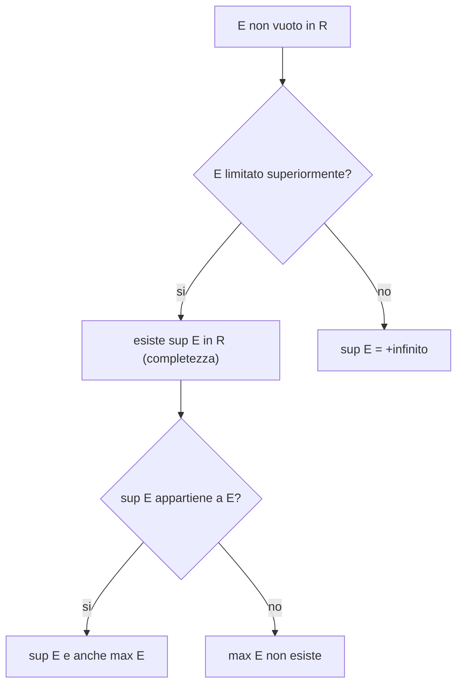

[[00_A1_Indice|⬅️ Torna all'Indice A1]]

# Campi Ordinati, Estremo Superiore e Potenze

In questa lezione si costruisce l'ambiente in cui vive l'Analisi: i **numeri reali** come **campo ordinato completo**. Si parte dagli assiomi algebrici (campo), si aggiunge l'ordine, e infine si introduce l'**assioma di completezza**, che distingue $\mathbb{R}$ da $\mathbb{Q}$. Seguono valore assoluto, intervalli, densità di $\mathbb{Q}$, radici e potenze.

## 1. Assiomi di campo

Un insieme $\mathbb{K}$ con due operazioni $+$ e $\cdot$ è un **campo** se valgono:

**Somma**
- **S1** (commutativa): $a+b=b+a$
- **S2** (associativa): $(a+b)+c=a+(b+c)$
- **S3** (elemento neutro): $\exists\, 0$ tale che $a+0=a$
- **S4** (opposto): $\forall a\ \exists (-a)$ tale che $a+(-a)=0$

**Prodotto**
- **P1** (commutativa): $a\cdot b=b\cdot a$
- **P2** (associativa): $(ab)c=a(bc)$
- **P3** (elemento neutro): $\exists\, 1\neq 0$ tale che $a\cdot 1=a$
- **P4** (inverso): $\forall a\neq 0\ \exists a^{-1}$ tale che $a\cdot a^{-1}=1$

**Distributività** (**SP**): $a(b+c)=ab+ac$

Esempi: $\mathbb{R}$, $\mathbb{Q}$, $\mathbb{C}$ sono campi; $\mathbb{N}$ e $\mathbb{Z}$ **non** lo sono (mancano opposto e/o inverso). Vedi anche [[2026-09-14-Insiemi-Numerici-Logica-e-Metodi-di-Dimostrazione|gli insiemi numerici]].

## 2. Ordine totale e campo ordinato

Una relazione $\le$ è un **ordine totale** (cfr. [[2026-09-17-Relazioni-d-Ordine-e-Funzioni|relazioni d'ordine]]) se:
- **O1** riflessiva: $a\le a$
- **O2** antisimmetrica: $a\le b \wedge b\le a \Rightarrow a=b$
- **O3** transitiva: $a\le b \wedge b\le c \Rightarrow a\le c$
- **O4** totale: $\forall a,b$ vale $a\le b$ oppure $b\le a$

Un campo è **ordinato** se in più valgono le compatibilità:
- **SO**: $a\le b \Rightarrow a+c\le b+c$
- **PO**: $c>0,\ a\le b \Rightarrow ac\le bc$

$\mathbb{R}$ e $\mathbb{Q}$ sono campi ordinati. $\mathbb{C}$ **non** lo è: l'equazione $z^2+1=0$ ha soluzioni $\pm i$, mentre in un campo ordinato $a^2+1>0$ sempre.

### Regole deducibili dagli assiomi
- $a\cdot 0=0$
- $-a=(-1)\,a$
- $1>0$
- $a^2\ge 0$ per ogni $a$
- $a^2+1\ge 1>0$, quindi $a^2+1\neq 0$ in ogni campo ordinato

## 3. Maggioranti, minoranti, estremi

Sia $E\subseteq\mathbb{R}$.

- $M$ è un **maggiorante** di $E$ se $x\le M\ \ \forall x\in E$; $E$ è **limitato superiormente** se ne ammette uno.
- $m$ è un **minorante** di $E$ se $m\le x\ \ \forall x\in E$; $E$ è **limitato inferiormente** se ne ammette uno.
- $E$ è **limitato** se lo è sia sopra sia sotto.
- **Massimo**: un maggiorante che appartiene a $E$. **Minimo**: un minorante che appartiene a $E$.
- **Estremo superiore** $\sup E$: il *minimo dei maggioranti*. **Estremo inferiore** $\inf E$: il *massimo dei minoranti*.

### Esempi
- $E=\mathbb{N}$: limitato inferiormente ($\min=0$), non superiormente.
- $E=\left\{\tfrac1n : n\in\mathbb{N}^*\right\}$: $\max E=1=\sup E$; **nessun minimo**; $\inf E=0\notin E$.
- $E=\{r\in\mathbb{Q}: r\ge 0,\ r^2\le 2\}$: in $\mathbb{R}$ si ha $\sup E=\sqrt2$; in $\mathbb{Q}$ l'insieme dei maggioranti **non ha minimo**, quindi $E$ non ha estremo superiore razionale.

## 4. Assioma di completezza

> **Proprietà dell'estremo superiore (completezza):** ogni sottoinsieme non vuoto di $\mathbb{R}$ limitato superiormente ammette estremo superiore in $\mathbb{R}$.

$\mathbb{R}$ è l'**unico** campo ordinato che soddisfa questa proprietà (a meno di isomorfismi); $\mathbb{Q}$ **non** la soddisfa (esempio precedente). Analogamente, ogni insieme non vuoto limitato inferiormente ha estremo inferiore.

Se $E$ non è limitato superiormente si pone $\sup E=+\infty$; se non è limitato inferiormente $\inf E=-\infty$. Si lavora così nei **reali estesi** $\overline{\mathbb{R}}=\mathbb{R}\cup\{\pm\infty\}$.

### Caratterizzazione dell'estremo superiore
$$x_0=\sup E \iff \begin{cases} (1)\ x\le x_0 \ \ \forall x\in E \quad(\text{è maggiorante})\\ (2)\ \forall k<x_0\ \ \exists x\in E:\ k<x\le x_0 \quad(\text{il minimo})\end{cases}$$

Analogamente per l'estremo inferiore:
$$x_0=\inf E \iff \begin{cases} (1)\ x\ge x_0 \ \ \forall x\in E\\ (2)\ \forall k>x_0\ \ \exists x\in E:\ x_0\le x<k \end{cases}$$

## 5. Valore assoluto

$$|a|=\begin{cases} a & a\ge 0\\ -a & a<0\end{cases}$$

Proprietà fondamentale: per $r\ge 0$,
$$|a|\le r \iff -r\le a\le r.$$

### Disuguaglianza triangolare
$$|x+y|\le |x|+|y|$$
e, nella forma più usata, per ogni $a,b,c$:
$$|a-b|\le |a-c|+|c-b|.$$

## 6. Rappresentazione geometrica di $\mathbb{R}$

I reali si rappresentano come punti di una **retta orientata**: fissati origine $O$ e unità di misura, a ogni numero corrisponde un punto. $|a|$ è la lunghezza del segmento $Oa$.

![[retta-reale-valore-assoluto.png]]

Esiste un punto della retta **senza controparte razionale**: costruendo la diagonale del quadrato di lato $1$ e riportandola sulla retta con il compasso, si ottiene un punto $B$ con $OB=OH=\sqrt2$ (per Pitagora), ma $\sqrt2\notin\mathbb{Q}$.

![[costruzione-radice-di-2-retta-reale.png]]

## 7. Intervalli

Per $a<b$ reali:

| Tipo | Notazione | Insieme | Estremi |
|---|---|---|---|
| Aperto | $(a,b)$ | $\{a<x<b\}$ | $\sup=b,\ \inf=a$, nessun max/min |
| Chiuso | $[a,b]$ | $\{a\le x\le b\}$ | $\max=b,\ \min=a$ |
| Semiaperto | $[a,b)$ | $\{a\le x<b\}$ | $\min=a,\ \sup=b$ |
| Semiaperto | $(a,b]$ | $\{a<x\le b\}$ | $\inf=a,\ \max=b$ |
| Illimitati | $(a,+\infty),\ [a,+\infty),\ (-\infty,b),\ (-\infty,b]$ | semirette | $\sup=+\infty$ o $\inf=-\infty$ |

Un intervallo è **aperto** se non contiene gli estremi, **chiuso** se li contiene tutti.

## 8. Densità di $\mathbb{Q}$ in $\mathbb{R}$

> **Teorema.** $\forall x<y$ in $\mathbb{R}$ $\ \exists\, r\in\mathbb{Q}$ tale che $x<r<y$.

Cioè tra due reali distinti c'è sempre un razionale (e quindi infiniti): $\mathbb{Q}$ è **denso** in $\mathbb{R}$.

## 9. Radici

> **Teorema (radice $n$-esima).** Per ogni $y\ge 0$ e $n\ge 1$ intero esiste **un unico** $x\ge 0$ tale che $x^n=y$. Si scrive $x=\sqrt[n]{y}$.

Attenzione: $\sqrt4=2$, **non** $\pm2$ (la radice è per definizione non negativa). Valgono:
$$\sqrt{a^2}=|a|,\qquad \sqrt[n]{a^n}=a\ \ (a\ge 0).$$

## 10. Potenze

Per $a\neq 0$:
- $a^0=1$
- $a^m=\underbrace{a\cdots a}_{m\text{ volte}}$ per $m\in\mathbb{N}^*$
- $a^{-m}=\dfrac{1}{a^m}$
- $a^{1/n}=\sqrt[n]{a}$ per $a>0$
- $a^{m/n}=\left(\sqrt[n]{a}\right)^m$ per $a>0$

### Esponente reale
Per $a>0$ e $b\in\mathbb{R}$ si definisce $a^b$ come limite delle potenze $a^{q}$ con $q$ **razionale** che approssima $b$ (troncamenti decimali di $b$), oppure, equivalentemente, come $\sup$ (se $a>1$) o $\inf$ (se $a<1$) delle potenze dei troncamenti. In ogni caso $a^b>0$.

> [!note] Da sapere
> Le proprietà delle potenze ($a^{x+y}=a^xa^y$, $(a^x)^y=a^{xy}$, ecc.) sono da studiare sul libro di testo.
