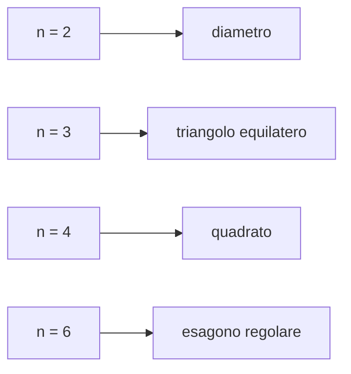

[[00_A1_Indice|⬅️ Torna all'Indice A1]]

# Forma Esponenziale, Radici Complesse e Generalità sulle Funzioni

Seconda parte sui [[2026-09-18-Logaritmi-e-Numeri-Complessi|numeri complessi]]: forme trigonometrica ed esponenziale, formule di **de Moivre**, **radici $n$-esime**, equazioni algebriche e **teorema fondamentale dell'algebra**. Poi si apre il capitolo sulle **funzioni** e sulle **successioni**.

## 1. Forma trigonometrica ed esponenziale

Sia $z=x+iy\in\mathbb{C}$, con $x=\operatorname{Re}z$, $y=\operatorname{Im}z$, $\rho=|z|$, $\theta=\arg z$.

![[numero-complesso-modulo-argomento-II-quadrante.png]]

**Argomento principale** di $z\in\mathbb{C}\setminus\{0\}$: l'unico argomento di $z$ in $[0,2\pi)$ oppure in $[-\pi,\pi)$, a seconda delle convenzioni.

**Definizione.** Dato $z=x+iy$:
- $z=x+iy$ è la **forma algebrica**;
- $z=\rho(\cos\theta+i\sin\theta)$ è la **forma trigonometrica**.

Qui $x,y\in\mathbb{R}$, $\rho\in[0,\infty)$, $\theta\in\mathbb{R}$.

**Esempio.** $z=-1=-1+i0$.
- $-1\,(\cos0+i\sin0)$ è algebricamente corretta, ma **NON** è forma trigonometrica (il modulo deve essere $\ge0$).
- $1\,(\cos\pi+i\sin\pi)$ **sì**: $1=|-1|$ e $\pi=\arg(-1)$.

**Forma esponenziale.**
$$z=x+iy=\rho(\cos\theta+i\sin\theta)=\rho\,e^{i\theta}.$$

> **Formula di Eulero.** $\forall\theta\in\mathbb{R}:\ e^{i\theta}=\cos\theta+i\sin\theta$. In particolare $e^{i\pi}+1=0$.

## 2. Formule di de Moivre

> **Teorema (prodotto e quoziente).** Siano $z=re^{i\theta}=r(\cos\theta+i\sin\theta)$ e $w=Re^{i\varphi}=R(\cos\varphi+i\sin\varphi)$. Allora
> $$w\cdot z=rR\,[\cos(\theta+\varphi)+i\sin(\theta+\varphi)]=rR\,e^{i(\theta+\varphi)},$$
> e se $w\neq0$
> $$\frac zw=\frac rR\,[\cos(\theta-\varphi)+i\sin(\theta-\varphi)]=\frac rR\,e^{i(\theta-\varphi)}.$$

**Dimostrazione (prodotto).**
$$z w=rR\big[(\cos\theta\cos\varphi-\sin\theta\sin\varphi)+i(\sin\theta\cos\varphi+\cos\theta\sin\varphi)\big]=rR[\cos(\theta+\varphi)+i\sin(\theta+\varphi)]$$
per le **identità trigonometriche** di addizione. Per il quoziente la dimostrazione è analoga, partendo da $\dfrac zw=\dfrac{z\bar w}{|w|^2}$. $\square$

### Conseguenze
- $|zw|=|z||w|$
- $\arg(zw)=\arg z+\arg w$
- $\left|\dfrac zw\right|=\dfrac{|z|}{|w|}\ (w\neq0)$
- $\arg\!\left(\dfrac zw\right)=\arg z-\arg w$
- Con $z=1=1\cdot e^{i0}$: se $w=Re^{i\varphi}\neq0$,
$$w^{-1}=\frac1w=\frac1R(\cos\varphi-i\sin\varphi)=\frac1R\,e^{-i\varphi}.$$

### Significato geometrico del prodotto
Moltiplicare $z$ per $w$ equivale a **ruotare** $z$ nel piano complesso di un angolo $\varphi=\arg w$ (positivo in senso antiorario) e a **dilatarlo** di un fattore $R=|w|$: una **roto-omotetia**.

![[prodotto-complessi-rotoomotetia.png]]

### Potenze
Se $z=re^{i\theta}=r(\cos\theta+i\sin\theta)$, per ogni $n\in\mathbb{N}$:
$$z^n=r^n(\cos n\theta+i\sin n\theta)=r^ne^{in\theta},$$
e se $z\neq0$:
$$z^{-n}=\frac1{r^n}(\cos n\theta-i\sin n\theta)=r^{-n}e^{-in\theta}.$$
Sono formule **coerenti con l'algebra degli esponenziali**, anche se coinvolgono numeri complessi.

**Esempio.** $z=-1-i\sqrt3$, $n=7$. Si ha $r=\sqrt{1+3}=2$, $\cos\theta=-\tfrac12$, $\sin\theta=-\tfrac{\sqrt3}2$, $\tan\theta=\sqrt3$, quindi (III quadrante)
$$\theta=\arctan\sqrt3+\pi=\frac\pi3+\pi=\frac43\pi,\qquad z=2e^{i\frac43\pi}.$$
$$z^7=2^7e^{i\frac{28}3\pi}=2^7e^{i\frac43\pi}=2^7\left(\cos\tfrac43\pi+i\sin\tfrac43\pi\right)=2^7\left(-\tfrac12-i\tfrac{\sqrt3}2\right)=-2^6-2^6\sqrt3\,i.$$
(Si è usato $\tfrac{28}3\pi=\tfrac43\pi+8\pi$.)

![[esempio-z-meno1-meno-i-radice3.png]]

## 3. Radici $n$-esime complesse

**Definizione.** Sia $w\in\mathbb{C}$, $n\in\mathbb{N}$, $n\ge1$. Ogni $z\in\mathbb{C}$ tale che $z^n=w$ si chiama **radice $n$-esima complessa** di $w$.

Esempio: $\sqrt[2]{4}=2$ in $\mathbb{R}$, ma $\sqrt[2]{4}=\pm2$ in $\mathbb{C}$ (cfr. [[2026-09-16-Campi-Ordinati-Estremo-Superiore-e-Potenze|radice reale]]).

> **Teorema (radici $n$-esime complesse).** Sia $w\in\mathbb{C}$, $w\neq0$, $n\ge1$. Esistono **esattamente $n$ radici $n$-esime complesse distinte** di $w$. Se $w=re^{i\varphi}=r(\cos\varphi+i\sin\varphi)$, esse sono
> $$z_k=r^{1/n}(\cos\theta_k+i\sin\theta_k)=r^{1/n}e^{i\theta_k},\qquad \theta_k=\frac\varphi n+\frac{2k\pi}n,\quad k=0,\dots,n-1.$$

**Dimostrazione.** Cerchiamo $z=\rho e^{i\theta}$ con $z^n=w$. Per de Moivre $z^n=\rho^ne^{in\theta}=re^{i\varphi}$, cioè
$$\begin{cases}\rho^n=r\\ n\theta=\varphi+2h\pi\quad h\in\mathbb{Z}\end{cases}\Rightarrow\begin{cases}\rho=r^{1/n}\ \ (\text{radice reale})\\ \theta=\dfrac\varphi n+\dfrac{2h\pi}n\quad h\in\mathbb{Z}\end{cases}\tag{$*$}$$
Queste sono **tutte e sole** le radici, ma **non distinte**. Si scrive $h=qn+k$ con $q$ quoziente e $k$ resto della divisione di $h$ per $n$, quindi $q\in\mathbb{Z}$, $k\in\{0,1,\dots,n-1\}$:
$$\frac{2\pi h}{n}=\frac{2\pi(qn+k)}n=2\pi q+\frac{2\pi k}n.$$
Due interi $h_1,h_2$ con lo stesso resto $k$ individuano in $(*)$ lo stesso numero complesso $z_k$, perché gli argomenti differiscono per un multiplo intero di $2\pi$. Le radici distinte sono dunque tante quanti i possibili resti della divisione per $n$, cioè $n$: $z_k=r^{1/n}e^{i\theta_k}$ con $\theta_k=\frac\varphi n+\frac{2k\pi}n$, $k=0,\dots,n-1$. $\square$

### Osservazioni geometriche
- Tutte le radici hanno lo stesso modulo: $|z_0|=\dots=|z_{n-1}|=r^{1/n}$; giacciono sulla **circonferenza** di centro $O$ e raggio $r^{1/n}$.
- Due radici successive hanno argomenti che differiscono di $\frac{2\pi}n$: si dispongono ai vertici di un **poligono regolare di $n$ lati** inscritto in quella circonferenza.

![[radici-quadrate-diametro.png]]
![[radici-cubiche-triangolo-equilatero.png]]

- Per $n\ge2$ le radici $n$-esime complesse di $w\neq0$ formano un insieme di $n$ valori: la radice complessa $n$-esima **non è una funzione** da $\mathbb{C}$ in $\mathbb{C}$.

### Esempio: radici seste di $w=-1$
$z^6=-1$, $|w|=1$, $\arg w=\pi$ (scrivere $w=-1e^{i0}$ è vero ma non serve).
$$z_k=1^{1/6}\,e^{i\left(\frac\pi6+\frac{2k\pi}6\right)}=e^{i\left(\frac\pi6+\frac{k\pi}3\right)},\quad k=0,\dots,5.$$

| $k$ | $z_k$ | forma algebrica |
|---|---|---|
| 0 | $e^{i\pi/6}$ | $\tfrac{\sqrt3}2+\tfrac i2$ |
| 1 | $e^{i\pi/2}$ | $i$ |
| 2 | $e^{i5\pi/6}$ | $-\tfrac{\sqrt3}2+\tfrac i2$ |
| 3 | $e^{i7\pi/6}$ | $-\tfrac{\sqrt3}2-\tfrac i2$ |
| 4 | $e^{i3\pi/2}$ | $-i$ |
| 5 | $e^{i11\pi/6}$ | $\tfrac{\sqrt3}2-\tfrac i2$ |

![[radici-seste-di-meno-uno-punto-w.png]]
![[radici-seste-di-meno-uno-esagono.png]]

## 4. Equazioni di secondo grado in $\mathbb{C}$

Se $a,b,c\in\mathbb{C}$, $a\neq0$, l'equazione $az^2+bz+c=0$ ha **2 soluzioni** (con molteplicità) in $\mathbb{C}$. Si può sempre risolvere ponendo $z=x+iy$ con $x,y\in\mathbb{R}$ e passando al sistema equivalente di due equazioni reali in due variabili reali. In alternativa, posto
$$\Delta=b^2-4ac\in\mathbb{C},$$
le due soluzioni sono
$$z_{0},z_1=\frac{-b+\sqrt\Delta}{2a},$$
dove $\sqrt\Delta$ indica le **due radici quadrate complesse** di $\Delta$ (due valori opposti in segno). Vale
$$az^2+bz+c=a(z-z_0)(z-z_1).$$

## 5. Teorema fondamentale dell'algebra

> **Teorema.** Una equazione polinomiale
> $$a_nz^n+a_{n-1}z^{n-1}+\dots+a_1z+a_0=0,\qquad a_i\in\mathbb{C},\ a_n\neq0,\ n\ge1,$$
> ha **esattamente $n$ soluzioni (radici) in $\mathbb{C}$**, se ciascuna è contata con la dovuta **molteplicità** (le $n$ soluzioni potrebbero non essere tutte distinte). Dette $z_0,\dots,z_{n-1}$ le soluzioni, $\forall z\in\mathbb{C}$:
> $$a_nz^n+\dots+a_0=a_n(z-z_0)(z-z_1)\cdots(z-z_{n-1}).$$

**Esempio.** $18(z-i)^4z^5(z-7i+4)^{18}=0$ ha $27$ soluzioni in $\mathbb{C}$, pari al grado: $i$ contato 4 volte, $0$ contato 5 volte, $-4+7i$ contato 18 volte.

**Esempio (non polinomiale).** $z-\bar z=0$ **non** è un'equazione polinomiale in $z$. Con $z=x+iy$: $0=x+iy-(x-iy)=2iy\Rightarrow y=\operatorname{Im}z=0$, quindi $z=x+i0\in\mathbb{R}$ per ogni $x\in\mathbb{R}$: **infinite soluzioni**, tutti i complessi con parte immaginaria nulla, cioè i punti dell'asse reale.

## 6. Generalità sulle funzioni

**Definizione.** Dati due insiemi $A,B$, una **funzione** $f:A\to B$ è una legge che associa a ciascun $x\in A$ **uno e un solo** elemento $y\in B$. Si scrive $y=f(x)$.

- $A$ è il **dominio** di $f$ (talvolta indicato $\mathcal{D}(f)=A$);
- $B$ è il **codominio** di $f$;
- $y=f(x)\in B$ è l'**immagine** di $x$ tramite $f$.

**Definizione.** L'**immagine di $A$ tramite $f$** (o immagine di $f$) è
$$\operatorname{Im}f=f(A)=\{y\in B:\ \exists x\in A\ \text{tale che } f(x)=y\}\subseteq B,$$
gli elementi di $B$ che «provengono» da qualche elemento di $A$ tramite $f$. In generale $\operatorname{Im}f\subseteq B$, ma può essere $\operatorname{Im}f\subsetneq B$.

**Esempio.** $f:\mathbb{R}\to\mathbb{R}$, $f(x)=x^2$: l'immagine di $\pm2$ è $4$; dominio $\mathbb{R}$, codominio $\mathbb{R}$, $\operatorname{Im}f=f(\mathbb{R})=[0,\infty)\subsetneq\mathbb{R}$.

**Osservazione.** Le funzioni
- $f:\mathbb{R}\to\mathbb{R}$, $f(x)=x^2$
- $g:\mathbb{R}\to[0,\infty)$, $g(x)=x^2$
- $h:[0,\infty)\to[0,\infty)$, $h(x)=x^2$
- $u:[0,\infty)\to\mathbb{R}$, $u(x)=x^2$

sono pensate come funzioni **diverse**: una funzione è assegnata dichiarando dominio $A$, codominio $B$ e la legge $y=f(x)\ \forall x\in A$.

**Definizione ([[2026-09-17-Relazioni-d-Ordine-e-Funzioni|suriettività]]).** $f:A\to B$ si dice **suriettiva** se $\operatorname{Im}f=B$. Nell'esempio, $g$ e $h$ sono suriettive; $f$ e $u$ no.

### Grafico
Il **grafico** di $f:A\to B$ è il sottoinsieme di $A\times B$ (cfr. [[2026-09-16-Prodotto-Cartesiano-e-Relazioni|prodotto cartesiano]])
$$\mathcal{G}(f)=\{(x,y)\in A\times B:\ x\in A,\ y=f(x)\}=\{(x,f(x))\in A\times B:\ x\in A\}.$$

Se $A,B\subseteq\mathbb{R}$, allora $\mathcal{G}(f)\subset\mathbb{R}^2$.

![[grafico-di-funzione-dominio-immagine.png]]

**Lettura geometrica.**
- Per ogni $x_0\in A$ esiste un unico $y_0\in B$ immagine di $x_0$: ogni **retta verticale** $x=x_0$ interseca il grafico **al più una volta** (0 volte se $x_0\notin A$, 1 volta se $x_0\in A$, con ordinata $y_0=f(x_0)$).
- $A=\mathcal{D}(f)$ è la **proiezione** di $\mathcal{G}(f)$ sull'asse delle ascisse (in direzione parallela all'asse $y$).
- $y_0\in\operatorname{Im}f$ se e solo se esiste $(x_0,y_0)\in\mathcal{G}(f)$, cioè se e solo se la **retta orizzontale** $y=y_0$ interseca $\mathcal{G}(f)$ in almeno un punto.
- $\operatorname{Im}f$ è la proiezione di $\mathcal{G}(f)$ sull'asse delle ordinate (in direzione parallela all'asse $x$).

In questo corso ci si occupa sostanzialmente di funzioni $f:A\subseteq\mathbb{R}\to\mathbb{R}$. Quando il codominio non è dichiarato esplicitamente, è sottinteso che sia $\mathbb{R}$.

## 7. Successioni

**Definizione.** Una funzione $f:\mathbb{N}\subset\mathbb{R}\to\mathbb{R}$ si chiama **successione di numeri reali**. Più in generale si chiamano successioni le funzioni $f:A\subseteq\mathbb{N}\to\mathbb{R}$ con
$$A=\{n\in\mathbb{N}:\ n\ge n_0\}\quad\text{per qualche } n_0\in\mathbb{N}.$$

**Esempi.**
- $f(n)=\dfrac1n$, $n\ge1$
- $g(n)=\dfrac1{(n-42)^2}$, $\forall n\ge43$
- $h(n)=\log(n-5)$, $\forall n\ge6$

**Osservazione (notazione).** Spesso si usa $a_n$, $\{a_n\}$, $\{a_n\}_{n\ge n_0}$ invece di $f(n)$ con $f:\mathbb{N}\to\mathbb{R}$.
