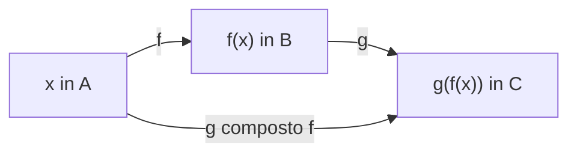

[[00_A1_Indice|⬅️ Torna all'Indice A1]]

# Proprietà delle Funzioni, Composizione e Funzione Inversa

Si prosegue lo studio delle [[2026-09-23-Forma-Esponenziale-Radici-Complesse-e-Funzioni|funzioni reali di variabile reale]]: **limitatezza**, estremi, **parità**, **monotonia**, **periodicità**, **composizione** e **invertibilità**.

## 1. Funzioni limitate

**Definizione.** Data $f:A\subseteq\mathbb{R}\to\mathbb{R}$, diciamo che $f$ è:

- **limitata superiormente** (dall'alto) se $\operatorname{Im}f\subseteq\mathbb{R}$ è limitato superiormente, cioè $\exists M\in\mathbb{R}$ tale che $f(x)\le M\ \ \forall x\in A$;
- **limitata inferiormente** (dal basso) se $\operatorname{Im}f$ è limitato inferiormente, cioè $\exists m\in\mathbb{R}$ tale che $f(x)\ge m\ \ \forall x\in A$;
- **limitata** se $\operatorname{Im}f$ è limitato, cioè $\exists m,M\in\mathbb{R}$ tali che $m\le f(x)\le M\ \ \forall x\in A$.

![[funzione-limitata-grafico.png]]

## 2. Estremi e massimo/minimo di una funzione

Data $f:A\subseteq\mathbb{R}\to\mathbb{R}$ (cfr. [[2026-09-16-Campi-Ordinati-Estremo-Superiore-e-Potenze|estremo superiore]]) si definiscono:

- $\displaystyle\sup_{x\in A}f(x)=\sup\operatorname{Im}f$ (**estremo superiore**)
- $\displaystyle\inf_{x\in A}f(x)=\inf\operatorname{Im}f$ (**estremo inferiore**)
- $\displaystyle\max_{x\in A}f(x)=\max\operatorname{Im}f$ (**massimo**, se esiste)
- $\displaystyle\min_{x\in A}f(x)=\min\operatorname{Im}f$ (**minimo**, se esiste)

**Osservazioni.**
- Sono massimo e minimo **assoluti**.
- $\sup f$ e $\inf f$ esistono **sempre** in $\overline{\mathbb{R}}=\mathbb{R}\cup\{\pm\infty\}$.
- Se esistono massimo o minimo, allora $\max f=\sup f$ e $\min f=\inf f$.

**Esempio.** $f:\mathbb{R}\to\mathbb{R}$, $f(x)=\dfrac1{1+x^2}$: $\operatorname{Im}f=(0,1]$. Allora $\inf f=0$ ma non esiste $\min f$; $\sup f=\max f=1=f(0)$.

![[grafico-1-su-1-piu-x-quadro.png]]

## 3. Campo di esistenza

In molti casi una funzione reale di variabile reale è assegnata solo tramite la sua **espressione analitica**, senza dichiarare dominio o codominio. In tal caso il codominio è $\mathbb{R}$ e il dominio è il più grande insieme $A\subseteq\mathbb{R}$ dove la regola analitica è ben definita: il **campo di esistenza**.

- $f(x)=\sqrt[4]{1-x}$: $\mathcal{D}(f)=\{x\in\mathbb{R}:1-x\ge0\}=(-\infty,1]$
- $g(x)=\log(x-7)$: $\mathcal{D}(g)=\{x\in\mathbb{R}:x-7>0\}=(7,\infty)$
- $h(x)=2^x$: $\mathcal{D}(h)=\mathbb{R}=(-\infty,\infty)$

## 4. Funzioni pari e dispari

**Definizione.** Dati $a>0$ (va bene anche $a=+\infty$) e $f:(-a,a)\subseteq\mathbb{R}\to\mathbb{R}$:

- $f$ è **pari** se $f(x)=f(-x)\ \ \forall x\in(-a,a)$. Esempi: $x^2,x^4,x^6,\dots,\cos x$.
- $f$ è **dispari** se $f(-x)=-f(x)\ \ \forall x\in(-a,a)$. Esempi: $x,x^3,x^5,\dots,\sin x$.

**Osservazioni geometriche.**
- Le funzioni pari hanno grafico $\mathcal{G}(f)$ **simmetrico rispetto all'asse $y$**.
- Le funzioni dispari hanno grafico **simmetrico rispetto all'origine**.

## 5. Monotonia

**Definizione.** $f:A\subseteq\mathbb{R}\to\mathbb{R}$ si dice, $\forall x_1,x_2\in A$:

| Tipo | Condizione |
|---|---|
| **crescente** | $x_1<x_2\Rightarrow f(x_1)\le f(x_2)$ |
| **strettamente crescente** | $x_1<x_2\Rightarrow f(x_1)<f(x_2)$ |
| **decrescente** | $x_1<x_2\Rightarrow f(x_1)\ge f(x_2)$ |
| **strettamente decrescente** | $x_1<x_2\Rightarrow f(x_1)>f(x_2)$ |

$f$ si dice **monotona** se soddisfa una di queste 4 proprietà.

![[esempi-monotonia-quattro-grafici.png]]

**Esempio.** $f(x)=\dfrac1x$ su $(-\infty,0)\cup(0,\infty)$: **non** è monotona su $(-\infty,0)\cup(0,\infty)$, ma è strettamente decrescente in $(-\infty,0)$ e in $(0,\infty)$.

![[grafico-iperbole-1-su-x.png]]

**Osservazioni.**
- $f$ crescente **preserva** le disuguaglianze; $f$ decrescente le **inverte**.
- Caratterizzazione con il rapporto incrementale: per $x_1\neq x_2$ in $\mathcal{D}(f)$,
$$f\text{ crescente}\iff\frac{f(x_2)-f(x_1)}{x_2-x_1}\ge0,\qquad f\text{ decrescente}\iff\frac{f(x_2)-f(x_1)}{x_2-x_1}\le0.$$
Il rapporto è il coefficiente angolare $m$ della retta secante. Con «strettamente» si toglie l'uguale.

![[retta-secante-funzione-crescente.png]]

## 6. Funzioni periodiche

**Definizione.** $f:A\subseteq\mathbb{R}\to\mathbb{R}$ è **periodica di periodo $T>0$** se $f(x+T)=f(x)\ \ \forall x\in A$. Ogni intervallo lungo $T$ contenuto in $A$ si chiama **intervallo di periodicità**.

Osservazioni: $\sin x$, $\cos x$ sono periodiche di periodo $2\pi,4\pi,6\pi,\dots$; $\tan x$ è periodica di periodo $\pi,2\pi,3\pi,\dots$

## 7. Composizione di funzioni

**Definizione.** Date $f:A\to B$ e $g:B\to C$, la **funzione composta** $g\circ f:A\to C$ è definita da
$$g\circ f(x)=g(f(x))\qquad\forall x\in A.$$

![[composizione-di-funzioni-diagramma.png]]

**Esempio.** $h(x)=\log(x^2+1)$, $x\in\mathbb{R}$: $h=g\circ f$ con $f(x)=x^2+1$ ($x\in\mathbb{R}$) e $g(t)=\log t$ ($t\in(0,\infty)$).

**Osservazioni.**
- Si possono comporre 3 o più funzioni; vale sempre $(h\circ g)\circ f=h\circ(g\circ f)$ (**associatività**).
- In generale $f\circ g\neq g\circ f$. Esempio: $f(x)=x+1$, $g(x)=x^2$: $g\circ f(x)=(x+1)^2=x^2+2x+1$, mentre $f\circ g(x)=x^2+1$.
- **Non tutte** le funzioni si possono comporre: con $g(t)=\log t$ e $f(x)=-x^2$, $g\circ f(x)=\log(-x^2)$ non è definita per alcun $x\in\mathbb{R}$.

### Composizione con dominio ristretto
Se $f:A\to B$ e $g:D\subseteq B\to C$, allora
$$g\circ f:\mathcal{D}'\subseteq A\to C,\qquad g\circ f(x)=g(f(x))\ \ \forall x\in\mathcal{D}',\qquad \mathcal{D}'=\{x\in A:f(x)\in D\}\subseteq A.$$

![[composizione-dominio-ristretto.png]]

**Esempi.**
- $f(x)=1-x^2$, $g(t)=\log t$: $g\circ f(x)=\log(1-x^2)$, con dominio $\{x:1-x^2>0\}=(-1,1)$.
- $f(x)=\sqrt x$, $g(t)=t^2$: $g\circ f(x)=(\sqrt x)^2=x$, con dominio $\{x\in[0,\infty):\sqrt x\in\mathbb{R}\}=[0,\infty)$.

## 8. Iniettività e suriettività

Data $f:A\to B$ (cfr. [[2026-09-17-Relazioni-d-Ordine-e-Funzioni|funzioni iniettive e suriettive]]):

- $f$ è **suriettiva** se $\operatorname{Im}f=B$;
- $f$ è **iniettiva** se (equivalentemente):
  1. $\forall x_1,x_2\in A$: $x_1\neq x_2\Rightarrow f(x_1)\neq f(x_2)$;
  2. $\forall x_1,x_2\in A$: $f(x_1)=f(x_2)\Rightarrow x_1=x_2$;
  3. $\forall y\in\operatorname{Im}f\ \ \exists!\,x\in A:\ f(x)=y$.

### Lettura sull'equazione $f(x)=y$
- Se $y\in\operatorname{Im}f$ esiste $x\in\mathcal{D}(f)$ con $f(x)=y$ per definizione di $\operatorname{Im}f$. Quindi se $f$ è **suriettiva**, $f(x)=y$ ammette **almeno una** soluzione $\forall y\in B$.
- Se $f$ è **iniettiva**, $f(x)=y$ può non avere soluzioni per qualche $y\in B$, ma se ne esiste una ($\iff y\in\operatorname{Im}f$) essa è **unica**. L'equazione ammette quindi **al più una** soluzione $\forall y\in B$.

## 9. Funzione inversa

**Definizione.** Data $f:A\to B$ **iniettiva**, la funzione che a ogni $y\in\operatorname{Im}f$ associa l'unico $x\in A$ tale che $f(x)=y$ si chiama **inversa** di $f$ e si indica
$$f^{-1}:\operatorname{Im}f\subseteq B\to A,\qquad x=f^{-1}(y)\iff f(x)=y\quad(y\in\operatorname{Im}f,\ x\in A).$$

![[funzione-inversa-diagramma.png]]

**Osservazioni.**
- $\mathcal{D}(f^{-1})=\operatorname{Im}f$ e $\operatorname{Im}f^{-1}=\mathcal{D}(f)$.
- $f^{-1}(f(x))=x\ \ \forall x\in\mathcal{D}(f)$ e $f(f^{-1}(y))=y\ \ \forall y\in\operatorname{Im}f$.

**Definizione.** Se $f:A\to B$ è iniettiva diciamo che $f$ è **invertibile** (sulla sua immagine), cioè $\exists f^{-1}:\operatorname{Im}f\subseteq B\to A$.

### Esempi
- $f:\mathbb{R}\to\mathbb{R}$, $f(x)=x^2$: né iniettiva né suriettiva.
- $h:[0,\infty)\to\mathbb{R}$, $h(x)=x^2$: **iniettiva**, non suriettiva, $\operatorname{Im}h=[0,\infty)$. Esiste $h^{-1}:[0,\infty)\to\mathbb{R}$ perché $h(x)=y$ ha un'unica soluzione $x\ge0$ per ogni $y\in[0,\infty)$: $h^{-1}(y)=\sqrt y$.
- $g:(-\infty,0]\to\mathbb{R}$, $g(x)=x^2$: iniettiva, $\operatorname{Im}g=[0,\infty)$; l'inversa $g^{-1}:[0,\infty)\to\mathbb{R}$ è l'unica soluzione di $x^2=y$ con $x\le0$: $g^{-1}(y)=-\sqrt y$.

![[parabola-ristretta-x-positivo.png]]

## 10. Monotonia stretta e invertibilità

> **Teorema.** Sia $f:A\subseteq\mathbb{R}\to\mathbb{R}$ **strettamente monotona** in $A$. Allora $f$ è **iniettiva**. Inoltre $f^{-1}:\operatorname{Im}f\subseteq\mathbb{R}\to\mathbb{R}$ è **strettamente monotona come $f$**.

**Dimostrazione.** Supponiamo $f$ strettamente crescente: $\forall x_1,x_2\in A$, $x_1<x_2\Rightarrow f(x_1)<f(x_2)$.

*Iniettività.* Se $x_1\neq x_2$, allora $x_1<x_2$ oppure $x_2<x_1$. Per monotonia stretta si ha $f(x_1)<f(x_2)$ oppure $f(x_2)<f(x_1)$; in ogni caso $f(x_1)\neq f(x_2)$. Quindi $f$ è iniettiva e $\exists f^{-1}:\operatorname{Im}f\to\mathbb{R}$.

*Monotonia dell'inversa* (per assurdo). Supponiamo che esistano $y_1,y_2\in\operatorname{Im}f=\mathcal{D}(f^{-1})$ con
$$y_1<y_2\quad\text{e}\quad f^{-1}(y_1)\ge f^{-1}(y_2).$$
Siano $x_1=f^{-1}(y_1)$, $x_2=f^{-1}(y_2)$, con $x_1,x_2\in\mathcal{D}(f)$. Poiché $x_1\ge x_2$ ed $f$ è crescente,
$$f(x_1)\ge f(x_2).\tag{$*$}$$
Ma $f(x_1)=f(f^{-1}(y_1))=y_1$ e $f(x_2)=y_2$: quindi $(*)$ significa $y_1\ge y_2$, assurdo perché per ipotesi $y_1<y_2$. Dunque $\forall y_1,y_2\in\operatorname{Im}f$, se $y_1<y_2$ allora $f^{-1}(y_1)<f^{-1}(y_2)$, cioè $f^{-1}$ è strettamente crescente. $\square$

### Controesempio al viceversa
Esistono funzioni **invertibili ma non monotone** (su un intervallo):
$$f(x)=\begin{cases}x & x\in[0,1)\\ 3-x & x\in[1,2]\end{cases},\qquad f:[0,2]\to\mathbb{R},\ \ \operatorname{Im}f=[0,2].$$
$f$ è invertibile e non monotona, con inversa $f^{-1}:[0,2]\to\mathbb{R}$
$$f^{-1}(y)=\begin{cases}y & y\in[0,1)\\ 3-y & y\in[1,2]\end{cases}.$$

![[funzione-invertibile-non-monotona.png]]
