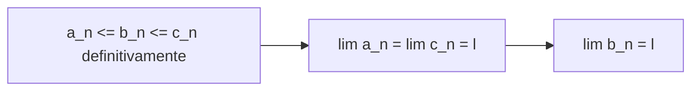
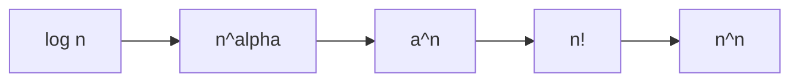

[[00_A1_Indice|⬅️ Torna all'Indice A1]]

# Teoremi sui Limiti di Successioni

Raccolta dei teoremi fondamentali sul [[2026-09-30-Funzioni-Inverse-Successioni-e-Limiti|limite di una successione]]: monotone, limitatezza delle convergenti, progressioni, permanenza del segno, algebra dei limiti, confronto e gerarchia degli infiniti.

## 1. Successioni monotone (dimostrazione completa)

> **Teorema (sul limite delle successioni monotone).** Sia $a_n$ monotona. Allora ammette limite: $\exists\lim_{n\to\infty}a_n=\ell\in\overline{\mathbb{R}}$.
> - Se $a_n$ cresce: $\lim a_n=\ell^-$ con $\ell=\sup_n a_n\in\mathbb{R}\cup\{+\infty\}$.
> - Se $a_n$ decresce: $\lim a_n=\ell^+$ con $\ell=\inf_n a_n\in\mathbb{R}\cup\{-\infty\}$.

**Osservazione.** $a_n$ monotona $\Rightarrow$ $a_n$ regolare.

**Dimostrazione.**

*1) Caso $a_n$ limitata.* Per il teorema sul limite di successioni monotone e limitate (già visto) $\exists\ell\in\mathbb{R}$ con $\lim a_n=\ell$; se crescente $\lim a_n=\ell^-$, $\ell=\sup a_n$; se decrescente $\lim a_n=\ell^+$, $\ell=\inf a_n$.

*2) Caso $a_n$ illimitata.* Per semplicità sia $a_n$ crescente (il decrescente è analogo). Poiché $a_n$ è crescente, $\forall n\ge0$ si ha $a_n\ge a_0$, cioè è limitata dal basso. Quindi deve essere illimitata dall'alto, e per definizione $\sup_{n\in\mathbb{N}}a_n=+\infty$. Dunque $\forall M>0\ \exists n_0\in\mathbb{N}$ tale che $a_{n_0}>M$. Poiché $a_n$ è crescente, $\forall n\ge n_0$: $a_n\ge a_{n_0}>M$. Segue che $\forall M>0\ \exists n_0$ tale che $\forall n\ge n_0$ $a_n>M$, cioè $\lim a_n=+\infty$ con $\sup a_n=+\infty$. $\square$

**Osservazioni.**
- $a_n$ monotona $\Rightarrow$ $a_n$ regolare;
- $a_n$ regolare $\not\Rightarrow$ $a_n$ monotona. Controesempio: $a_n=\dfrac{(-1)^n}{n}$ non è monotona e $\lim\dfrac{(-1)^n}n=0$.

## 2. Convergente implica limitata

> **Teorema.** Se $a_n$ è convergente, cioè $\exists\ell=\lim a_n\in\mathbb{R}$, allora $a_n$ è **limitata**.

Il viceversa è **falso**: $a_n=(-1)^n$ è irregolare ma limitata.

**Dimostrazione.** Poiché $\ell=\lim a_n\in\mathbb{R}$, $\forall\varepsilon>0\ \exists N$ tale che $\forall n\ge N$: $\ell-\varepsilon<a_n<\ell+\varepsilon$. Scegliendo $\varepsilon=1$: $\exists N$ tale che $\forall n\ge N$ $\ \ell-1<a_n<\ell+1$. Siano
$$M=\max\{a_0,a_1,\dots,a_N\},\qquad m=\min\{a_0,a_1,\dots,a_N\},$$
che esistono in $\mathbb{R}$ perché $\{a_0,\dots,a_N\}$ è un insieme **finito e non vuoto**. Posti
$$L=\max\{M,\ell+1\},\qquad P=\min\{m,\ell-1\},$$
vale $P\le a_n\le L$ per ogni $n\in\mathbb{N}$: quindi $a_n$ è limitata. $\square$

![[convergente-implica-limitata.png]]

## 3. Esempi notevoli

### Potenze di $n$
Sia $\alpha\in\mathbb{R}$, $a_n=\dfrac1{n^\alpha}$:
$$\lim_{n\to\infty}\frac1{n^\alpha}=\begin{cases}0 & \alpha>0\ \text{(decresce)}\\ 1 & \alpha=0\\ +\infty & \alpha<0\ \text{(cresce)}\end{cases}$$
Simile per $\lim n^\beta$ con $\beta=-\alpha$.

### Progressione geometrica
Per $q\in\mathbb{R}$, $a_n=q^n$:

| Valore di $q$ | $\displaystyle\lim_{n\to\infty}q^n$ | Nota |
|---|---|---|
| $q>1$ | $+\infty$ | crescente |
| $q=1$ | $1$ | |
| $0<q<1$ | $0$ | decrescente |
| $q=0$ | $0$ | |
| $-1<q<0$ | $0$ | non monotona |
| $q=-1$ | $\nexists$ | limitata |
| $q<-1$ | $\nexists$ | illimitata |

## 4. Permanenza del segno

> **Teorema (permanenza del segno).**
> 1. Data $a_n$, se esiste $\lim a_n=\ell\in\overline{\mathbb{R}}$ e $\ell>0$ (cioè $\ell\in(0,+\infty]$), allora $a_n>0$ **definitivamente** in $n\in\mathbb{N}$. Similmente se $\ell<0$ ($\ell\in[-\infty,0)$) allora $a_n<0$ definitivamente.
> 2. Se esiste $\ell=\lim a_n\in\overline{\mathbb{R}}$ e $a_n\ge0$ definitivamente, allora $\ell\ge0$ ($\ell\in[0,+\infty]$). Similmente, se $a_n\le0$ definitivamente, allora $\ell\le0$.

**Osservazioni.**
- Può essere $\ell=\lim a_n\ge0$ e $a_n<0$: ad esempio $a_n=-\frac1n$ soddisfa $a_n<0\ \forall n\ge1$ e $\lim a_n\ge0$.
- Se $a_n>0$ ed esiste $\lim a_n=\ell$, allora $\ell\ge0$ ma può essere $\ell=0$: ad esempio $a_n=\frac1n>0$ e $\lim a_n=0$.

**Dimostrazione.**

*1)* Sia $\ell=\lim a_n\in(0,\infty]$. Se $\ell=+\infty$, per definizione $\forall M>0\ \exists N$ tale che $\forall n\ge N$ $a_n>M>0$, quindi $a_n>0$ definitivamente. Se $\ell\in(0,+\infty)$, per definizione $\forall\varepsilon>0\ \exists N$: $\forall n\ge N$ $\ell-\varepsilon<a_n<\ell+\varepsilon$. Si sceglie $\varepsilon=\frac\ell2>0$:
$$a_n>\ell-\varepsilon=\frac\ell2>0\quad\Rightarrow\quad a_n>0\ \text{definitivamente}.$$
Similmente se $\ell<0$.

![[permanenza-del-segno-striscia.png]]

*2)* Sia $a_n\ge0$ definitivamente ed esista $\ell=\lim a_n\in\overline{\mathbb{R}}$. Vogliamo provare $\ell\ge0$. Per assurdo sia $\ell<0$: per la parte 1 sarebbe $a_n<0$ definitivamente. **Assurdo**, perché dovrebbe essere $a_n\ge0$ e $a_n<0$ definitivamente. Quindi $\ell\ge0$. Similmente se $a_n\le0$. $\square$

## 5. Algebra dei limiti

> **Teorema (algebra dei limiti).** Siano $a_n,b_n$ due successioni con $a=\lim a_n$, $b=\lim b_n\in\mathbb{R}$. Allora:
> 1. $\lim(a_n\pm b_n)=a\pm b$;
> 2. $\lim a_n\cdot b_n=a\cdot b$;
> 3. $\lim\dfrac{a_n}{b_n}=\dfrac ab$ (se $b\neq0$);
> 4. $\lim a_n^{\,b_n}=a^b$ (se $a>0$).

**Dimostrazione.**

*1) Somma.* Per la [[2026-09-16-Campi-Ordinati-Estremo-Superiore-e-Potenze|disuguaglianza triangolare]] ($|x+y|\le|x|+|y|$):
$$|(a_n+b_n)-(a+b)|=|(a_n-a)+(b_n-b)|\le|a_n-a|+|b_n-b|.$$
Per definizione di limite $\forall\varepsilon>0$ esistono $N_1,N_2$ tali che $|a_n-a|<\frac\varepsilon2$ per $n\ge N_1$ e $|b_n-b|<\frac\varepsilon2$ per $n\ge N_2$. Per $n\ge\max\{N_1,N_2\}$:
$$|(a_n+b_n)-(a+b)|<\frac\varepsilon2+\frac\varepsilon2=\varepsilon\ \Rightarrow\ \lim(a_n+b_n)=a+b.$$
Similmente per «$-$».

*2) Prodotto.* Si osserva che
$$|a_nb_n-ab|=|a_nb_n-a_nb+a_nb-ab|=|a_n(b_n-b)+b(a_n-a)|\le|a_n||b_n-b|+|b||a_n-a|.$$
Poiché $a_n$ converge, è limitata ([[#2. Convergente implica limitata|teorema sopra]]): $\exists M>0$ tale che $|a_n|<M\ \forall n$. Quindi
$$|a_nb_n-ab|\le M|b_n-b|+|b||a_n-a|.$$
Per definizione di limite $\forall\varepsilon>0\ \exists N_1,N_2$: $|a_n-a|<\varepsilon$ per $n\ge N_1$, $|b_n-b|<\varepsilon$ per $n\ge N_2$. Allora per $n\ge\max\{N_1,N_2\}$:
$$|a_nb_n-ab|<M\varepsilon+|b|\varepsilon=(M+|b|)\varepsilon,$$
e quindi $\lim a_nb_n=ab$.

*3), 4)* senza dimostrazione. $\square$

### Corollari (permanenza del segno + algebra)
Date $a_n,b_n$ con $\exists a=\lim a_n$, $b=\lim b_n\in\mathbb{R}$:

1. se $a>b$ ($a<b$) allora definitivamente $a_n>b_n$ ($a_n<b_n$);
2. se $a_n\ge b_n$ ($a_n\le b_n$) definitivamente in $n\in\mathbb{N}$, allora $a\ge b$ ($a\le b$).

**Dimostrazione.** Posto $c_n=a_n-b_n$, per l'algebra dei limiti $\exists c=\lim c_n=a-b\in\mathbb{R}$.
1. Se $a>b$ allora $c>0$ e per permanenza del segno $c_n>0$ definitivamente, cioè $a_n>b_n$ definitivamente.
2. Se $a_n\ge b_n$ definitivamente, $c_n\ge0$ definitivamente; poiché $\exists c=\lim c_n$, per permanenza del segno $c\ge0$, cioè $a\ge b$. $\square$

## 6. Teoremi del confronto

> **Teorema (confronto per successioni convergenti, o dei due carabinieri).** Date tre successioni $a_n,b_n,c_n$ tali che $a_n\le b_n\le c_n$ **definitivamente** in $n\in\mathbb{N}$ e tali che $\exists\lim a_n=\lim c_n=\ell\in\mathbb{R}$. Allora $\exists\lim b_n=\ell\in\mathbb{R}$.

**Dimostrazione.** Per definizione di limite $\forall\varepsilon>0$:
- $\exists N_1$: $\forall n\ge N_1$ $\ \ell-\varepsilon<a_n(<\ell+\varepsilon)$ **(4)**;
- $\exists N_2$: $\forall n\ge N_2$ $\ \ c_n<\ell+\varepsilon\,(>\ell-\varepsilon)$ **(3)**;
- $\exists N_3$: $\forall n\ge N_3$ $\ \ a_n\le b_n\le c_n$ **(1), (2)**.

Allora $\forall n\ge N=\max\{N_1,N_2,N_3\}$:
$$\ell-\varepsilon<a_n\le b_n\le c_n<\ell+\varepsilon,$$
cioè $\forall\varepsilon>0\ \exists N$: $\forall n\ge N$ $\ell-\varepsilon<b_n<\ell+\varepsilon$, quindi $\lim b_n=\ell$. $\square$

> **Teorema (confronto per successioni divergenti).** Date due successioni $a_n,b_n$ tali che $a_n\le b_n$ definitivamente in $n\in\mathbb{N}$:
> 1. se $\lim a_n=+\infty$ allora $\exists\lim b_n=+\infty$;
> 2. se $\lim b_n=-\infty$ allora $\exists\lim a_n=-\infty$.

**Dimostrazione** (solo 1; la 2 è analoga). Per definizione di limite $\forall M>0\ \exists N_1$: $\forall n\ge N_1$ $a_n>M$ **(1)**; inoltre $\exists N_2$: $\forall n\ge N_2$ $a_n\le b_n$ **(2)**. Quindi $\forall M>0\ \exists N=\max\{N_1,N_2\}$ tale che $\forall n\ge N$: $M<a_n\le b_n$. Cioè $\lim b_n=+\infty$. $\square$

### Corollari
1. Se $|b_n|\le c_n$ definitivamente in $n\in\mathbb{N}$ e $\lim c_n=0$, allora $\exists\lim b_n=0$ (equivalentemente $\lim|b_n|=0$).
2. Se $c_n$ è **limitata** e $\lim b_n=0$, allora $\lim c_nb_n=0$ (anche se $\nexists\lim c_n$).

**Esempio.** $\displaystyle\lim_{n\to\infty}\frac{\sin n}n$: sia $b_n=\frac1n$, $c_n=\sin n$. Allora $\lim b_n=0$ e $|c_n|=|\sin n|\le1\ \forall n$. Per il corollario precedente
$$\lim_{n\to\infty}\frac{\sin n}n=\lim b_nc_n=0\quad\text{anche se }\nexists\lim\sin n.$$

## 7. Gerarchia degli infiniti

> **Teorema (gerarchia degli infiniti).**
> 1. $\displaystyle\lim_{n\to\infty}\frac{\log_an}{n^\alpha}=0\qquad\forall\alpha>0,\ a>1$
> 2. $\displaystyle\lim_{n\to\infty}\frac{n^\alpha}{a^n}=0\qquad\forall\alpha>0,\ a>1$
> 3. $\displaystyle\lim_{n\to\infty}\frac{a^n}{n!}=0\qquad\forall a>1$
> 4. $\displaystyle\lim_{n\to\infty}\frac{n!}{n^n}=0$

Quindi, per $n\to\infty$, a ranghi crescenti di «velocità»:
$$\log n\ \ll\ n^\alpha\ \ll\ a^n\ \ll\ n!\ \ll\ n^n.$$

