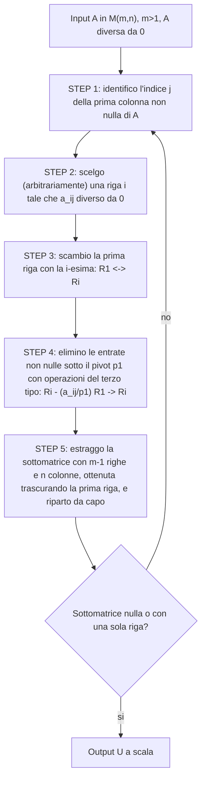

[[00_GAL_Indice|⬅️ Torna all'Indice GAL]]

# Matrice Inversa, Rango, Determinante e Metodo di Eliminazione di Gauss

> Lezione 6 — 07.10.2026. Prosegue da [[2026-10-01-Prodotto-Matriciale-e-Matrice-Identita|Lezione 4]]. Argomenti: [[#Matrice inversa|Matrice Invertibile]], [[#Definizione 6.3 — Rango|Rango di una Matrice]], [[#Determinante|Determinante]], [[#Determinante di una matrice triangolare|Matrice Triangolare]], [[#Metodo di Eliminazione di Gauss (MEG)|Metodo di Eliminazione di Gauss]].

## Matrice inversa

Abbiamo visto che c'è un elemento neutro per il [[2026-10-01-Prodotto-Matriciale-e-Matrice-Identita#Prodotto matriciale righe per colonne|Prodotto Matriciale]] (la [[2026-10-01-Prodotto-Matriciale-e-Matrice-Identita#Matrice identità|Matrice Identità]]). **Domanda**: ha senso parlare di elemento inverso per il prodotto matriciale?

### Definizione 6.1

Consideriamo una matrice $A \in M_{\mathbb{K}}(n,n)$.

- $A$ è **invertibile a destra** se esiste (almeno) una matrice $B \in M_{\mathbb{K}}(n,n)$ tale che $AB = \mathrm{Id}_n$.
- $A$ è **invertibile a sinistra** se esiste (almeno) una matrice $C \in M_{\mathbb{K}}(n,n)$ tale che $CA = \mathrm{Id}_n$.
- $A$ è **invertibile** se è invertibile sia a destra sia a sinistra.

**Domande aperte**:

- quante sono le matrici inverse?
- che relazione c'è tra le matrici inverse destre e le matrici inverse sinistre?
- esistono le matrici inverse?
- come calcolo le matrici inverse?

### Proposizione 6.2

- **HP**: sia $A \in M_{\mathbb{K}}(n,n)$ una matrice invertibile.
- **TH1**: l'inverso destro è uguale all'inverso sinistro.
- **TH2**: l'inverso è unico.

**Dimostrazione.** Siano $B,C \in M_{\mathbb{K}}(n,n)$.

*(TH1)* Per ipotesi $A$ è invertibile, quindi per definizione esistono $B$ e $C$ tali che

$$
AB = \mathrm{Id}_n \quad (1), \qquad CA = \mathrm{Id}_n \quad (2)
$$

Allora

$$
B \overset{\text{el. neutro}}{=} \mathrm{Id}_n B \overset{(2)}{=} (CA)B \overset{\text{prop. ass.}}{=} C(AB) \overset{(1)}{=} C\,\mathrm{Id}_n \overset{\text{el. neutro}}{=} C
$$

*(TH2)* Supponiamo di avere due matrici inverse $B,C \in M_{\mathbb{K}}(n,n)$; devo dimostrare $B = C$. $B$ e $C$ sono sia inverse destre che sinistre. Interpreto $B$ come inverso destro, $C$ come inverso sinistro e ripeto l'argomento di prima. $\blacksquare$

## Non commutatività del prodotto matriciale

In generale il prodotto $AB \neq BA$, anche quando ha senso calcolare entrambi i prodotti.

Siano $A \in M_{\mathbb{K}}(1,n)$ e $B \in M_{\mathbb{K}}(n,1)$:

$$
AB = \begin{bmatrix} a_{11} & \cdots & a_{1n} \end{bmatrix}\begin{bmatrix} b_{11} \\ \vdots \\ b_{n1} \end{bmatrix} = \begin{bmatrix} a_{11}b_{11} + \dots + a_{1n}b_{n1} \end{bmatrix} \in M_{\mathbb{K}}(1,1)
$$

$$
BA = \begin{bmatrix} b_{11} \\ \vdots \\ b_{n1} \end{bmatrix}\begin{bmatrix} a_{11} & \cdots & a_{1n} \end{bmatrix} = \begin{bmatrix} b_{11}a_{11} & \cdots & b_{11}a_{1n} \\ \vdots & & \vdots \\ b_{n1}a_{11} & \cdots & b_{n1}a_{1n} \end{bmatrix} \in M_{\mathbb{K}}(n,n)
$$

$BA$ è descritta da $2n$ elementi (i due vettori) ma ha $n^2$ elementi.

> **Obiettivo**: trovare un modo efficiente di descrivere le matrici.

### Definizione 6.3 — Rango

Sia $A \in M_{\mathbb{K}}(m,n)$. Il **rango** di $A$ è

$$
r(A) = \min\left\{ r \in \mathbb{N} \ \middle|\ A = \sum_{i=1}^{r} C_i R_i \right\}
$$

dove $C_i \in M_{\mathbb{K}}(m,1)$ sono colonne e $R_i \in M_{\mathbb{K}}(1,n)$ sono righe.

### Esempi

$$
A = \begin{bmatrix} 1 & 2 & 3 \\ 4 & 5 & 6 \end{bmatrix}
= \begin{bmatrix} 1 & 2 & 3 \\ 0 & 0 & 0 \end{bmatrix} + \begin{bmatrix} 0 & 0 & 0 \\ 4 & 5 & 6 \end{bmatrix}
= \begin{bmatrix} 1 \\ 0 \end{bmatrix}\begin{bmatrix} 1 & 2 & 3 \end{bmatrix} + \begin{bmatrix} 0 \\ 1 \end{bmatrix}\begin{bmatrix} 4 & 5 & 6 \end{bmatrix}
$$

N.B. $r(A) \le 2$. Allo stesso modo, scrivendola come somma di tre matrici con una sola colonna non nulla:

$$
\begin{bmatrix} 1 & 2 & 3 \\ 4 & 5 & 6 \end{bmatrix}
= \begin{bmatrix} 1 \\ 4 \end{bmatrix}\begin{bmatrix} 1 & 0 & 0 \end{bmatrix} + \begin{bmatrix} 2 \\ 5 \end{bmatrix}\begin{bmatrix} 0 & 1 & 0 \end{bmatrix} + \begin{bmatrix} 3 \\ 6 \end{bmatrix}\begin{bmatrix} 0 & 0 & 1 \end{bmatrix}
$$

N.B. $r(A) \le 3$.

> **Osservazione**: per $A \in M_{\mathbb{K}}(m,n)$ vale $0 \le r(A) \le \min(m,n)$, e $r(A) = 0 \iff A$ è la matrice nulla.

**Matrice di probabilità congiunta moneta-dado** (con $M \times D$ come nella [[2026-09-30-Matrici-Somma-e-Prodotto-per-Scalare|Lezione 3]]): la matrice $2 \times 6$ con tutte le entrate $\frac{1}{12}$ ha $r \le \min(2,6) = 2$, e $r > 0$. **Domanda**: possiamo trovare una decomposizione con 1 addendo? Sì:

$$
\begin{bmatrix} \tfrac1{12} & \cdots & \tfrac1{12} \\ \tfrac1{12} & \cdots & \tfrac1{12} \end{bmatrix}
= \begin{bmatrix} \tfrac12 \\ \tfrac12 \end{bmatrix}\begin{bmatrix} \tfrac16 & \tfrac16 & \tfrac16 & \tfrac16 & \tfrac16 & \tfrac16 \end{bmatrix}
\quad\Longrightarrow\quad r = 1
$$

Qui $\begin{bmatrix} \frac12 \\ \frac12 \end{bmatrix} = \begin{bmatrix} \mathbb{P}(T) \\ \mathbb{P}(C) \end{bmatrix}$ e $\begin{bmatrix} \frac16 & \cdots & \frac16 \end{bmatrix} = \begin{bmatrix} \mathbb{P}(1) & \mathbb{P}(2) & \cdots & \mathbb{P}(6) \end{bmatrix}$.

### Definizione

$$
r(\text{matrice di probabilità congiunta}) = 1 \iff \text{i due eventi sono indipendenti}
$$

**Esempio per casa**: 2 dadi (sei facce equi). $A = \{\text{esito } D_1 \text{ pari},\ \text{esito } D_1 \text{ dispari}\}$, $B = \{\text{esito } D_1 + D_2 \text{ pari},\ \text{esito } D_1 + D_2 \text{ dispari}\}$, $\mathbb{P} : A \times B \to [0,1]$; da completare la tabella:

| $\mathbb{P}$ | $D_1+D_2$ pari | $D_1+D_2$ dispari |
|---|---|---|
| **$D_1$ pari** | | |
| **$D_1$ dispari** | | |

## Determinante

### Definizione 6.4 (sviluppo di Laplace del determinante)

Il **determinante** è una funzione $\det : M_{\mathbb{K}}(n,n) \to \mathbb{K}$ definita come:

- ($n=1$) $\det([a_{11}]) = a_{11}$.
- ($n>1$)

$$
\det(A) = \sum_{j=1}^{n} (-1)^{i+j}\, a_{ij}\, \det(\hat{A}_{ij})
$$

dove: $i$ è un indice di riga (qualsiasi) fissato; $a_{ij}$ è l'elemento di $A$ sulla $i$-esima riga e $j$-esima colonna; $\hat{A}_{ij} \in M_{\mathbb{K}}(n-1,n-1)$ è ottenuta da $A$ eliminando la $i$-esima riga e la $j$-esima colonna.

In maniera equivalente (sviluppo lungo una colonna):

$$
\det(A) = \sum_{i=1}^{n} (-1)^{i+j}\, a_{ij}\, \det(\hat{A}_{ij})
$$

con $j$ indice di colonna (qualsiasi) fissato.

### Teorema di Laplace

«Il risultato non dipende dalla scelta di riga o colonna.»

### Caso $2\times 2$

Sviluppando lungo la colonna $j=1$:

$$
\det\begin{bmatrix} a_{11} & a_{12} \\ a_{21} & a_{22} \end{bmatrix}
= (-1)^{1+1}a_{11}\det([a_{22}]) + (-1)^{2+1}a_{21}\det([a_{12}])
= a_{11}a_{22} - a_{21}a_{12}
$$

### Esempio con sviluppo lungo la prima riga

$$
B = \begin{bmatrix} 9 & 2 & -2 \\ 2 & 2 & 0 \\ -2 & 0 & 2 \end{bmatrix}
$$

$$
\begin{aligned}
\det(B) &= \sum_{j=1}^{3}(-1)^{1+j}\,b_{1j}\det\hat{B}_{1j} \\
&= 9\det\begin{bmatrix} 2 & 0 \\ 0 & 2 \end{bmatrix} - 2\det\begin{bmatrix} 2 & 0 \\ -2 & 2 \end{bmatrix} + (-2)\det\begin{bmatrix} 2 & 2 \\ -2 & 0 \end{bmatrix} \\
&= 9(2\cdot 2 - 0\cdot 0) - 2(2\cdot 2 - (-2)\cdot 0) - 2(2\cdot 0 - (-2)\cdot 2) \\
&= 9\cdot 4 - 2\cdot 4 - 2\cdot 4 = (9-4)\cdot 4 = 20
\end{aligned}
$$

> **Idea**: sfruttare a nostro vantaggio la libertà di scegliere riga/colonna nel calcolo del determinante.

Sviluppando invece lungo la colonna $j=3$ (che contiene uno zero):

$$
\begin{aligned}
\det B &= \sum_{i=1}^{3}(-1)^{i+3}\,b_{i3}\det\hat{B}_{i3} \\
&= (-2)\det\hat{B}_{13} - 0\cdot\det\hat{B}_{23} + 2\det\hat{B}_{33} \\
&= -2\det\begin{bmatrix} 2 & 2 \\ -2 & 0 \end{bmatrix} + 2\det\begin{bmatrix} 9 & 2 \\ 2 & 2 \end{bmatrix} \\
&= -2(2\cdot 0 - (-2)\cdot 2) + 2(9\cdot 2 - 2\cdot 2) = -2\cdot 4 + 2\cdot 14 = 2(-4+14) = 20
\end{aligned}
$$

> **Obiettivo**: selezionare una riga/una colonna con più zeri possibile.

### Esempi

**(I)** Se $A \in M_{\mathbb{K}}(n,n)$ ha una riga o una colonna tutta di zeri $\Rightarrow$ $\det(A) = 0$.

**(II) Definizione 6.5** — Una matrice $T \in M_{\mathbb{K}}(n,n)$ si dice

- **triangolare superiore** se $t_{ij} = 0\ \ \forall i > j$;
- **triangolare inferiore** se $t_{ij} = 0\ \ \forall i < j$.

> **Figura (disegno senza immagine disponibile):**
>
> Due matrici $n\times n$. A sinistra «TRIANG. SUP.»: diagonale $t_{11}, t_{22}, \dots, t_{nn}$, asterischi sopra la diagonale e zeri sotto. A destra «TRIANG. INF.»: zeri sopra la diagonale e asterischi sotto. In basso, una matrice triangolare superiore generica con la prima colonna evidenziata in blu (tutti zeri sotto $t_{11}$).

> **Osservazione**: $\{\text{matrici diagonali}\} \subseteq \{\text{matrici triang. sup.}\}$ e $\{\text{matrici diagonali}\} \subseteq \{\text{matrici triang. inf.}\}$.

### Determinante di una matrice triangolare

Sviluppando lungo la prima colonna ($j=1$) di una triangolare superiore $T$:

$$
\det(T) = \sum_{i=1}^{n}(-1)^{i+1}t_{i1}\det(\hat{T}_{i1}) = (-1)^{1+1}t_{11}\det(\hat{T}_{11}) + 0 + 0 + \dots + 0 = t_{11}\det(\hat{T}_{11})
$$

dove $\hat{T}_{11}$ è ancora triangolare superiore. Iterando:

$$
\det(T) = t_{11}\,t_{22}\cdots t_{nn}
$$

Il determinante di una matrice triangolare è il **prodotto degli elementi diagonali**.

**Recap degli obiettivi**:

1. calcolare le matrici inverse;
2. calcolare il rango;
3. calcolare il determinante usando le matrici triangolari.

## Metodo di Eliminazione di Gauss (MEG)

- **Input**: $A \in M_{\mathbb{K}}(m,n)$ qualsiasi.
- **Output**: $U \in M_{\mathbb{K}}(m,n)$ «con informazione concentrata nella parte in alto a destra» (se $m=n$, l'output sono triangolari superiori).

Per passare da input a output posso usare una sequenza di **3 operazioni elementari**:

1. scambio di due righe;
2. moltiplicazione di una riga per uno scalare $\neq 0$;
3. sostituzione di una riga con la somma della riga sostituita con un multiplo di un'altra riga.

**Scambio**: $\begin{bmatrix} 0 & 0 & 1 \\ 2 & 3 & 7 \end{bmatrix} \xrightarrow{\ \mathrm{I} \leftrightarrow \mathrm{II}\ } \begin{bmatrix} 2 & 3 & 7 \\ 0 & 0 & 1 \end{bmatrix}$

**Moltiplicazione di una riga per uno scalare $\neq 0$**: $\begin{bmatrix} 1 & 2 & 3 \\ \tfrac{1}{10^8} & 4 & 7 \end{bmatrix} \xrightarrow{\ 10^4\,\mathrm{II} \to \mathrm{II}\ } \begin{bmatrix} 1 & 2 & 3 \\ \tfrac{1}{10^4} & 4\cdot 10^4 & 7\cdot 10^4 \end{bmatrix}$

**Sostituzione di una riga con la sua somma con un multiplo di un'altra**: $\begin{bmatrix} 1 & 2 & 3 \\ 4 & 5 & 6 \end{bmatrix} \xrightarrow{\ \mathrm{II} - 4\,\mathrm{I} \to \mathrm{II}\ } \begin{bmatrix} 1 & 2 & 3 \\ 0 & -3 & -6 \end{bmatrix}$ (dove $4 = \frac{4}{1}$ è il rapporto tra i due elementi della prima colonna).

### Algoritmo MEG

**Casi base**: se $A = 0$ allora $U = 0$; se $A \in M_{\mathbb{K}}(1,n)$ allora $U = A$. Possiamo supporre $m > 1$ e $A \neq 0$.

Osservazioni:

- l'algoritmo termina sempre in un numero finito di passi;
- nell'algoritmo ci sono due scelte arbitrarie (la riga $i$ allo STEP 2), per cui l'**output non è univocamente determinato**.

![[2026-10-07-MEG-step2-scelta-riga.png]]
![[2026-10-07-MEG-step3-scambio-righe.png]]
![[2026-10-07-MEG-step4-eliminazione.png]]
![[2026-10-07-MEG-step4-forma-finale.png]]

### Esempio

$$
A = \begin{bmatrix} 0 & 0 & 2 & 0 \\ 1 & 0 & 1 & -1 \\ 2 & 0 & 1 & 4 \end{bmatrix}, \qquad m = 3 > 1,\ A \neq 0
$$

- **STEP 1**: la prima colonna non nulla è la prima.
- **STEP 2**: scelgo la seconda riga (oppure la terza).
- **STEP 3**: sposto la seconda riga in prima posizione, $\mathrm{I} \leftrightarrow \mathrm{II}$:

$$
\begin{bmatrix} 1 & 0 & 1 & -1 \\ 0 & 0 & 2 & 0 \\ 2 & 0 & 1 & 4 \end{bmatrix} \quad (p_1 = 1)
$$

- **STEP 4**: $\mathrm{III} - \frac{2}{1}\mathrm{I} \to \mathrm{III}$:

$$
\begin{bmatrix} 1 & 0 & 1 & -1 \\ 0 & 0 & 2 & 0 \\ 0 & 0 & -1 & 6 \end{bmatrix}
$$

- **STEP 5**: estraggo le ultime due righe e ripeto sulla sottomatrice $\begin{bmatrix} 0 & 0 & 2 & 0 \\ 0 & 0 & -1 & 6 \end{bmatrix}$.
  - STEP 1–2: la prima colonna non nulla è la terza; scelgo la terza riga.
  - STEP 3: scambio $\mathrm{II} \leftrightarrow \mathrm{III}$, ottenendo $p_2 = -1$:

$$
\begin{bmatrix} 1 & 0 & 1 & -1 \\ 0 & 0 & -1 & 6 \\ 0 & 0 & 2 & 0 \end{bmatrix}
$$

  - STEP 4: $\mathrm{III} - \frac{2}{-1}\mathrm{II} \to \mathrm{III}$:

$$
U = \begin{bmatrix} 1 & 0 & 1 & -1 \\ 0 & 0 & -1 & 6 \\ 0 & 0 & 0 & 12 \end{bmatrix}
$$

![[2026-10-07-MEG-esempio-completo.png]]

### Definizione 6.6 — Matrice a scala

Consideriamo una matrice $U \in M_{\mathbb{K}}(m,n)$ e siano $U_1, U_2, \dots, U_m$ le sue righe ($U_i \in M_{\mathbb{K}}(1,n)$).

- Il **pivot** della riga $U_i$ è il primo elemento non nullo sulla $i$-esima riga.
- La matrice $U$ si dice **a scala** se:
  - date due righe consecutive non nulle $U_i, U_{i+1}$, il pivot di $U_i$ si trova su una colonna che precede la colonna contenente il pivot di $U_{i+1}$;
  - se $U_i$ è una riga nulla, allora sono nulle tutte le righe seguenti.

![[2026-10-07-matrice-a-scala-pivot.png]]

> **N.B.** L'output del MEG è una matrice a scala.

Vedi anche: [[2026-10-01-Prodotto-Matriciale-e-Matrice-Identita#Matrice identità|Matrice Identità]], [[2026-10-01-Prodotto-Matriciale-e-Matrice-Identita#Prodotto matriciale righe per colonne|Prodotto Matriciale]], [[#Metodo di Eliminazione di Gauss (MEG)|Operazioni Elementari sulle Righe]], [[#Definizione 6.6 — Matrice a scala|Pivot]], [[#Teorema di Laplace|Teorema di Laplace]].
