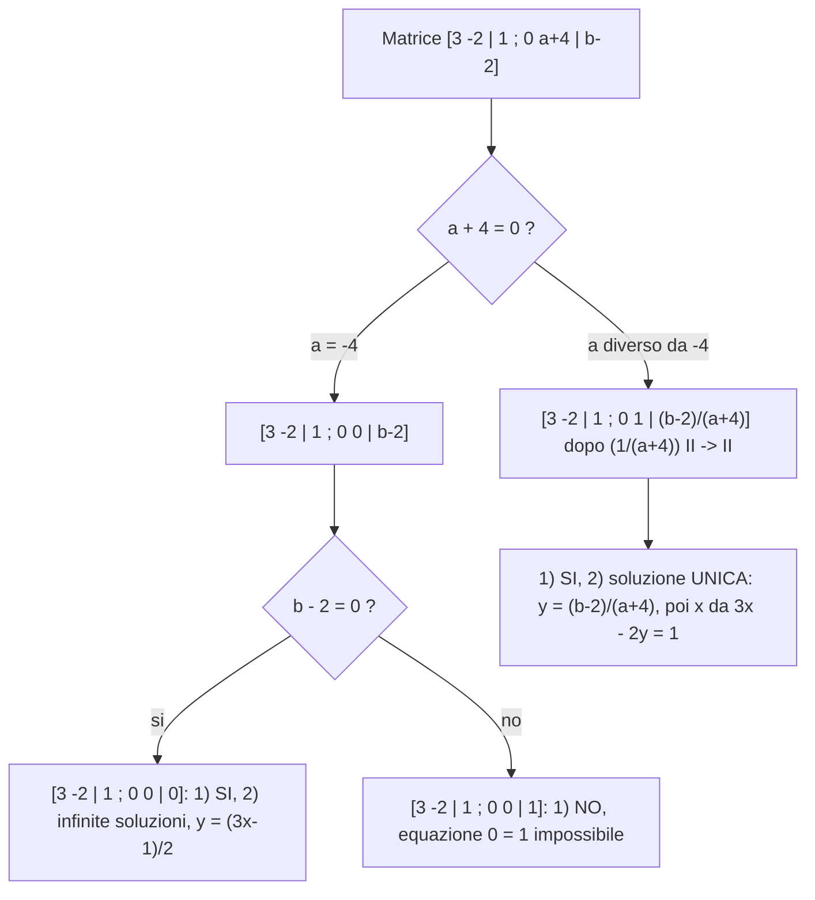

[[00_GAL_Indice|⬅️ Torna all'Indice GAL]]

# Sistemi Lineari, Risoluzione via MEG e Teorema di Rouché-Capelli

> Lezione 9 — 12.10.2026. Argomenti: rappresentazioni matriciali di un [[#Rappresentazioni matriciali di un sistema lineare|Sistema Lineare]], metodo di risoluzione via [[2026-10-07-Inversa-Rango-Determinante-e-Eliminazione-di-Gauss#Metodo di Eliminazione di Gauss (MEG)|Metodo di Eliminazione di Gauss]], [[#Teorema di Rouché-Capelli|Teorema di Rouché-Capelli]]. Prosegue da [[2026-10-08-MEG-Matrici-Invertibili-Rango-e-Determinante|Lezione 7]].

## Rappresentazioni matriciali di un sistema lineare

Temi: **formalizzazione** e **risoluzione** (teorica/pratica).

**Esempio.**

$$
\begin{cases} x - 3y = 2 \\ 4x + 5y = 1 \end{cases}
\qquad \text{(2 incognite } x,y \text{; 2 equazioni)}
$$

Il sistema equivale a un'uguaglianza tra matrici:

$$
\begin{bmatrix} x - 3y \\ 4x + 5y \end{bmatrix} = \begin{bmatrix} 2 \\ 1 \end{bmatrix}
$$

**(I) Uso la somma tra matrici e il prodotto per scalari** — *rappresentazione matriciale del I tipo*:

$$
\begin{bmatrix} x - 3y \\ 4x + 5y \end{bmatrix} = \begin{bmatrix} x \\ 4x \end{bmatrix} + \begin{bmatrix} -3y \\ 5y \end{bmatrix} = x\begin{bmatrix} 1 \\ 4 \end{bmatrix} + y\begin{bmatrix} -3 \\ 5 \end{bmatrix} = \begin{bmatrix} 2 \\ 1 \end{bmatrix}
$$

Un sistema con 2 equazioni e 2 incognite è equivalente a **1 equazione** che coinvolge vettori colonna di altezza 2.

**(II) Uso il prodotto matriciale** — *rappresentazione matriciale del II tipo*:

$$
\begin{bmatrix} x - 3y \\ 4x + 5y \end{bmatrix} = \begin{bmatrix} 1 & -3 \\ 4 & 5 \end{bmatrix}\begin{bmatrix} x \\ y \end{bmatrix} = \begin{bmatrix} 2 \\ 1 \end{bmatrix}
$$

> **Oss. 1**: la matrice dei coefficienti (nel II tipo) è la giustapposizione dei vettori colonna dei coefficienti (I tipo).
>
> **Oss. 2**: il nome di $x$ e $y$ è marginale: il sistema $\begin{cases} x - 3y = 2 \\ 4x + 5y = 1 \end{cases}$ e il sistema $\begin{cases} A - 3B = 2 \\ 4A + 5B = 1 \end{cases}$ hanno la stessa risolubilità e le stesse soluzioni.

**(III) Ottimizzazione dell'informazione** — *rappresentazione matriciale del III tipo*:

$$
\begin{bmatrix} 1 & -3 \\ 4 & 5 \end{bmatrix}\begin{bmatrix} x \\ y \end{bmatrix} = \begin{bmatrix} 2 \\ 1 \end{bmatrix}
\ \leadsto\
\left[\begin{array}{cc|c} 1 & -3 & 2 \\ 4 & 5 & 1 \end{array}\right]
$$

(colonne: «$x$», «$y$», «termini noti»).

### Caso generale

Un sistema lineare di $m$ equazioni in $n$ incognite è del tipo

$$
\begin{cases}
a_{11}x_1 + a_{12}x_2 + \cdots + a_{1n}x_n = b_1 \\
a_{21}x_1 + a_{22}x_2 + \cdots + a_{2n}x_n = b_2 \\
\qquad\vdots \\
a_{m1}x_1 + a_{m2}x_2 + \cdots + a_{mn}x_n = b_m
\end{cases}
$$

- **I tipo**:

  $$x_1\begin{bmatrix} a_{11} \\ a_{21} \\ \vdots \\ a_{m1} \end{bmatrix} + x_2\begin{bmatrix} a_{12} \\ a_{22} \\ \vdots \\ a_{m2} \end{bmatrix} + \cdots + x_n\begin{bmatrix} a_{1n} \\ \vdots \\ a_{mn} \end{bmatrix} = \begin{bmatrix} b_1 \\ b_2 \\ \vdots \\ b_m \end{bmatrix}$$

- **II tipo**:

  $$\underbrace{\begin{bmatrix} a_{11} & a_{12} & \cdots & a_{1n} \\ a_{21} & a_{22} & & \vdots \\ \vdots & \vdots & & \\ a_{m1} & a_{m2} & \cdots & a_{mn} \end{bmatrix}}_{A}\underbrace{\begin{bmatrix} x_1 \\ \vdots \\ x_n \end{bmatrix}}_{\underline{x}} = \underbrace{\begin{bmatrix} b_1 \\ \vdots \\ b_m \end{bmatrix}}_{\underline{b}} \iff A\underline{x} = \underline{b}$$

- **III tipo**: la **matrice completa** (o aumentata)

  $$[A \mid \underline{b}] = \left[\begin{array}{ccc|c} a_{11} & \cdots & a_{1n} & b_1 \\ \vdots & & \vdots & \vdots \\ a_{m1} & \cdots & a_{mn} & b_m \end{array}\right] \in M_{\mathbb{K}}(m,n+1)$$

  con $A \in M_{\mathbb{K}}(m,n)$ e $\underline{b} \in M_{\mathbb{K}}(m,1) \cong \mathbb{K}^m$.

## Risoluzione

Due domande:

1. il sistema è risolubile?
2. se la risposta a 1 è sì, quante e quali sono le soluzioni?

### Esempio con parametri

$$
\begin{cases} 3x - 2y = 1 \\ 6x + ay = b \end{cases}
\qquad x,y \text{ incognite};\ a,b \in \mathbb{R} \text{ parametri}
$$

Rappresentazione del III tipo:

$$
\left[\begin{array}{cc|c} 3 & -2 & 1 \\ 6 & a & b \end{array}\right] \in M_{\mathbb{R}}(2,2+1) = M_{\mathbb{R}}(2,3)
$$

**Quale metodo risolutivo?** confronto, sostituzione, **riduzione** (scelto: la riduzione, che corrisponde al MEG). Il passo $\mathrm{II} - 2\mathrm{I} \to \mathrm{II}$ sul sistema e sulla matrice dà

$$
\begin{cases} 3x - 2y = 1 \\ (a+4)y = b - 2 \end{cases}
\qquad\longleftrightarrow\qquad
\left[\begin{array}{cc|c} 3 & -2 & 1 \\ 0 & a+4 & b-2 \end{array}\right]
$$

**Caso $a = -4$.**

- Se $b - 2 = 0$: la matrice è $\left[\begin{array}{cc|c} 3 & -2 & 1 \\ 0 & 0 & 0 \end{array}\right]$. (1) **Sì**, è risolubile; (2) **infinite soluzioni**: resta l'equazione $3x - 2y = 1$ (la riga $0=0$ si elimina), cioè $2y = 3x - 1$, $y = \frac12(3x-1)$.
- Se $b - 2 \neq 0$: con $\frac{1}{b-2}\mathrm{II}\to\mathrm{II}$ si ottiene $\left[\begin{array}{cc|c} 3 & -2 & 1 \\ 0 & 0 & 1 \end{array}\right]$. (1) **No**: l'equazione $0 = 1$ è **impossibile**.

**Caso $a \neq -4$.** Con $\frac{1}{a+4}\mathrm{II}\to\mathrm{II}$ si ottiene $\left[\begin{array}{cc|c} 3 & -2 & 1 \\ 0 & 1 & \tfrac{b-2}{a+4} \end{array}\right]$. (1) **Sì**; (2) soluzione **unica**: $y = \frac{b-2}{a+4}$ e $3x - 2\frac{b-2}{a+4} = 1$.

### Riepilogo

**Domanda 1 — il sistema è risolubile?**

- **Sì**, soluzione **unica**: un pivot nelle prime due colonne.
$$
\left[\begin{array}{cc|c} 3 & -2 & 1 \\ 0 & 1 & \tfrac{b-2}{a+4} \end{array}\right]
$$
- **Sì**, soluzioni **infinite**: un solo pivot.
$$
\left[\begin{array}{cc|c} 3 & -2 & 1 \\ 0 & 0 & 0 \end{array}\right]
$$
- **No**, nessuna soluzione ($\emptyset$): il secondo pivot cade nella colonna dei termini noti.
$$
\left[\begin{array}{cc|c} 3 & -2 & 1 \\ 0 & 0 & 1 \end{array}\right]
$$

> **Figura (disegno senza immagine disponibile):**
>
> Tre matrici a scala con una linea rossa a gradini e pallini blu sui pivot. (1) *Sol. unica*: pivot nelle prime due colonne (una per riga), colonna dei termini noti libera. (2) *Sol. infinite*: un solo pivot nella prima riga, seconda riga tutta nulla. (3) *$\emptyset$*: primo pivot nella prima colonna, secondo pivot nella colonna dei termini noti (a destra della barra verticale).

## Teorema di Rouché-Capelli

### Teorema 9.1 (Teorema di Rouché-Capelli)

- **HP**: sia $A\underline{x} = \underline{b}$ un sistema lineare, $A \in M_{\mathbb{K}}(m,n)$.
- **TH1**: il sistema $A\underline{x} = \underline{b}$ è risolubile se, e solo se,

  $$r(A) = r([A \mid \underline{b}])$$

- **TH2**: se $r = r(A) = r([A \mid \underline{b}])$, allora esistono $n - r + 1$ vettori colonna $\underline{v}_0, \underline{v}_1, \dots, \underline{v}_{n-r} \in \mathbb{K}^n$ tali che tutte e sole le soluzioni del sistema sono descritte da

  $$\underline{x} = \underline{v}_0 + t_1\underline{v}_1 + \dots + t_{n-r}\underline{v}_{n-r}$$

  dove $t_1,\dots,t_{n-r} \in \mathbb{K}$ (**parametri liberi**).

### Dimostrazione

$A\underline{x} = \underline{b}$ risolubile $\iff r(A) = r([A \mid \underline{b}])$ è equivalente a dimostrare 2 casi:

- $A\underline{x} = \underline{b}$ risolubile $\Rightarrow r(A) = r([A\mid\underline{b}])$; equivalentemente (contronominale) $r(A) \neq r([A\mid\underline{b}]) \Rightarrow A\underline{x} = \underline{b}$ **non** risolubile;
- $r(A) = r([A\mid\underline{b}]) \Rightarrow A\underline{x} = \underline{b}$ risolubile.

Comincio a usare il MEG sulla rappresentazione matriciale del III tipo:

$$
[A \mid \underline{b}] \overset{\text{MEG}}{\leadsto} [U \mid \underline{b}']
$$

Per definizione di rango: $r = r(A) = r(U) = \#\text{pivot di } U$. Considerando l'ultima colonna ci sono 2 possibilità:

1. **$r(A) = r([A\mid\underline{b}])$**: $[U\mid\underline{b}']$ ha i pivot $p_1,\dots,p_r$ tutti nelle colonne di $U$, e le righe dalla $(r+1)$-esima in poi sono completamente nulle (anche nei termini noti).
2. **$r([A\mid\underline{b}]) = r(A) + 1$** (cioè $r(A) \neq r([A\mid\underline{b}])$): esiste un pivot $b'_{r+1} \neq 0$ nella colonna dei termini noti.

> **Figura (disegno senza immagine disponibile):**
>
> Due matrici a scala $[U \mid \underline{b}']$ con linea rossa a gradini. Caso (1): pivot $p_1,\dots,p_r$ nella parte $U$, la linea a gradini termina prima della colonna dei termini noti; righe nulle in fondo anche nella colonna $b'$. Caso (2): oltre ai pivot $p_1,\dots,p_r$ compare un ulteriore pivot $b'_{r+1} \neq 0$ nella colonna dei termini noti, sotto $p_r$.

**Nel caso (2)**, l'equazione sulla riga $r+1$ dice $0 = b'_{r+1} \neq 0$ $\Rightarrow$ $A\underline{x} = \underline{b}$ **non risolubile**.

**Adesso mi occupo del caso (1)** e cerco le soluzioni. Le righe nulle in fondo (barrate in viola) si eliminano. Divido le variabili in due gruppi:

- **variabili dipendenti**: corrispondono alle colonne contenenti i pivot ($r$ variabili);
- **variabili indipendenti**: corrispondono alle colonne non contenenti i pivot ($n - r$ variabili).

Suppongo, per semplicità, che le variabili dipendenti siano le prime $r$ variabili.

> **Figura (disegno senza immagine disponibile):**
>
> Matrice $[U\mid b']$ con $r$ equazioni; sotto, la ripartizione delle colonne: le prime $r$ colonne ($r$ variabili dipendenti, contenenti i pivot $p_1,\dots,p_r$ a scala), le successive $n-r$ colonne (variabili indipendenti, con asterischi) e infine la colonna dei termini noti. Sotto la linea orizzontale sono aggiunte $n-r$ equazioni fittizie la cui parte di coefficienti è una matrice identità sulle variabili indipendenti, con termini noti $t_1,\dots,t_{n-r}$.

Aggiungo $n - r$ equazioni (fittizie):

$$
x_{r+1} = t_1,\ \dots,\ x_n = t_{n-r}, \qquad t_i \in \mathbb{K}
$$

Il sistema diventa un sistema con $n$ equazioni e $n$ incognite, che risolvo per **sostituzione all'indietro**:

- **Step 1**: il termine noto delle prime $r$ equazioni diventa $b'_j + \sum c_i t_i$ (le variabili indipendenti portate a destra);
- **Step 2**: sostituisco a ritroso anche tra le prime $r$ equazioni.

**Dove arrivo?** Si ottiene una forma in cui la parte dei coefficienti è l'identità $n\times n$, con termini noti

$$
x_j = v_{0j} + \sum_{i=1}^{n-r} v_{ij}\,t_i \quad (j = 1,\dots,r), \qquad x_{r+i} = t_i \quad (i = 1,\dots,n-r)
$$

Dunque

$$
\begin{bmatrix} x_1 \\ \vdots \\ x_n \end{bmatrix}
= \underbrace{\begin{bmatrix} v_{01} \\ \vdots \\ v_{0r} \\ 0 \\ \vdots \\ 0 \end{bmatrix}}_{\underline{v}_0\ (\text{parte costante})}
+ t_1\underbrace{\begin{bmatrix} v_{11} \\ \vdots \\ v_{1r} \\ 1 \\ 0 \\ \vdots \\ 0 \end{bmatrix}}_{\underline{v}_1}
+ t_2\underbrace{\begin{bmatrix} v_{21} \\ \vdots \\ v_{2r} \\ 0 \\ 1 \\ \vdots \\ 0 \end{bmatrix}}_{\underline{v}_2}
+ \cdots
+ t_{n-r}\underbrace{\begin{bmatrix} v_{n-r,1} \\ \vdots \\ v_{n-r,r} \\ 0 \\ \vdots \\ 1 \end{bmatrix}}_{\underline{v}_{n-r}}
$$

che è l'espressione cercata. $\blacksquare$

Vedi anche: [[#Caso generale|Matrice Completa]], [[2026-10-07-Inversa-Rango-Determinante-e-Eliminazione-di-Gauss#Definizione 6.3 — Rango|Rango di una Matrice]], [[#Dimostrazione|Variabili Libere]], [[#Dimostrazione|Sostituzione all'Indietro]].
